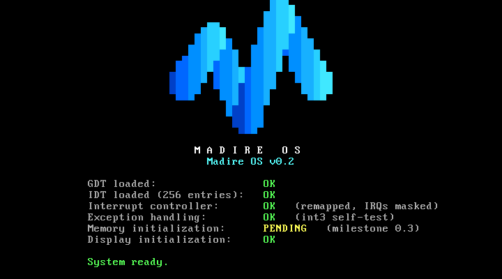

# Madire OS

Madire OS is an operating system written from scratch: its own kernel and architecture, not a Linux distribution.

**Current version:** 0.2 (Milestone 0.2: CPU foundation and Madire logo)



It boots through GRUB into a 32-bit x86 kernel written in C and NASM. So far the kernel:

- installs its own segment table (GDT) and interrupt table (IDT);
- makes the interrupt controller safe;
- catches CPU exceptions and shows them on a readable crash screen;
- draws the Madire M logo, built from geometry, in VGA text mode.

The project is built one milestone at a time, and each milestone has to boot in VirtualBox before the next one starts. See [docs/roadmap.md](docs/roadmap.md).

## Development environment

| Role | Tool |
|---|---|
| Editor / host | Windows 11, Visual Studio Code |
| Build environment | Ubuntu Linux: a GitHub Codespace (current), or WSL2 / CI |
| Compiler | GCC in 32-bit freestanding mode (`gcc -m32`), or `i686-elf-gcc` if installed |
| Assembler | NASM |
| Bootloader / ISO | GRUB 2 (`grub-mkrescue`) + xorriso |
| Automated tests | QEMU (`qemu-system-i386`), headless |
| Target machine | Oracle VirtualBox 7.2, VM `MadireOS-Test` (BIOS firmware) |

Linux is used only to run the build tools. It is not part of Madire OS.

## Build

On Windows, compile remotely in the Codespace. This copies your local files up, builds, runs the tests and fetches the ISO back:

```powershell
.\scripts\build.ps1 -InstallDeps   # first time on a new Codespace
.\scripts\build.ps1                # afterwards
```

On Linux (Codespace terminal, WSL, CI):

```sh
bash scripts/install-deps.sh   # once
make            # kernel ELF: build/madire.kernel
make iso        # bootable ISO: build/madire-os.iso
make test       # 26 automated checks: boot, logo, GDT/IDT/PIC, 3 crash tests
make run        # boot in a QEMU window
make clean
```

## Test in VirtualBox

```powershell
.\scripts\run.ps1                       # attach ISO, boot MadireOS-Test in a window
.\scripts\run.ps1 -Headless -Screenshot # boot without a window, save build\boot-screen.png
```

The GRUB menu has a **Diagnostics** submenu that deliberately triggers CPU exceptions, to show the crash screen. See [docs/testing.md](docs/testing.md) for the expected screens and troubleshooting.

## Limitations (v0.2)

- 32-bit x86 only; the VM must use **BIOS** firmware (VGA text mode doesn't exist under EFI).
- No memory management yet (`Memory initialization: PENDING`), and no timer, keyboard input, filesystem or processes.
- All hardware interrupts are masked; only CPU exceptions are handled.
- The logo is blocky: text mode gives 80×50 pixels, each 9×8 screen pixels in size.
- The screen does not scroll; output wraps back to the top.
- Building needs a Linux environment; there is no native Windows toolchain yet.

## Documentation

- [docs/architecture.md](docs/architecture.md): system design, current and planned
- [docs/development.md](docs/development.md): layout, toolchain, rules for kernel code
- [docs/testing.md](docs/testing.md): automated and VirtualBox test procedures
- [docs/roadmap.md](docs/roadmap.md): milestones
