# Madire OS

Madire OS is an operating system written from scratch: its own kernel and architecture, not a Linux distribution.

**Current version:** 1.3 (Milestone 1.3 "The desktop"; tag `v1.3`)


1.3 gives Madire OS **a desktop**:

- **The desktop at System ready:** the splash hands over to the desktop with the Madire M where it was, on the same procedural wallpaper; a **taskbar** with the **M button** at the left and a **clock** (24-hour `HH:MM`, from the computer's clock) at the right; the **mouse pointer** appears with the first movement.
- **The M menu:** click the M button, or press the **Windows key** (also with a window open), for **About**, **Console** and **Restart**; Up, Down, Enter and Esc work in it. A **right-click** on the desktop opens a small menu (Open Console, About Madire OS).
- **Windows:** the **About** window (the version, boot loader, display, memory and mode) and the **Console** window: the same shell and commands as before, 80×25 at the screen's scale. **Any key** on the desktop opens the Console window (that key isn't typed); closing it only hides it, and the session goes on. Windows are dragged by their title bar, raised and focused by a click, and closed with ×.
- **Restart asks first**, in a dialog (Cancel or Restart).
- **New console keys:** **Ctrl+L** clears the screen and keeps the typed line; **Ctrl+A** and **Ctrl+E** go to the start and end of the line; **Ctrl+K** and **Ctrl+U** delete to the end and to the start; **Ctrl+W** deletes the word before the cursor.
- **Built from scratch, tested pixel by pixel:** a compositor that redraws only what changed, and Madire's own toolkit (drawing, Madire's own stroke icons, buttons, windows, menus, the dialog), in the colours and sizes of the **Madire Design Guide v0.2**; every scene is compared with an independent reference rendering pixel for pixel, in five screen modes.
- **The full-screen console stays** for Esc during the splash, the boot option `verbose`, any failure or crash, and the test boots; the Diagnostics entries still boot in text mode.
- **Tests:** 271 new QEMU checks (`[1.3]`), 16 new unit-test suites, a drag burst in the stress part, and a VirtualBox `desktop` group that drives the mouse through VirtualBox's own mouse events.

The M menu, the About window, the right-click menu, the Console window and the Restart dialog (the VirtualBox acceptance run; the clock shows the VM's clock, which VirtualBox keeps on the host's local time):

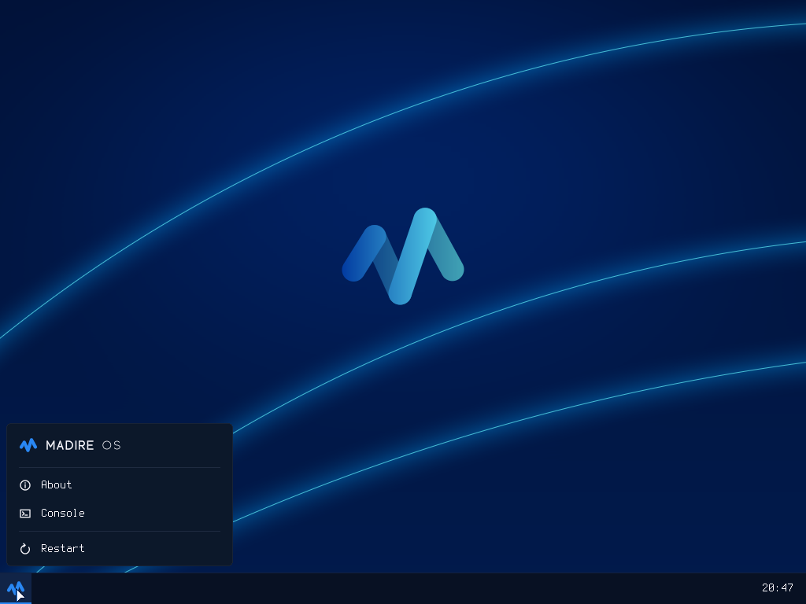

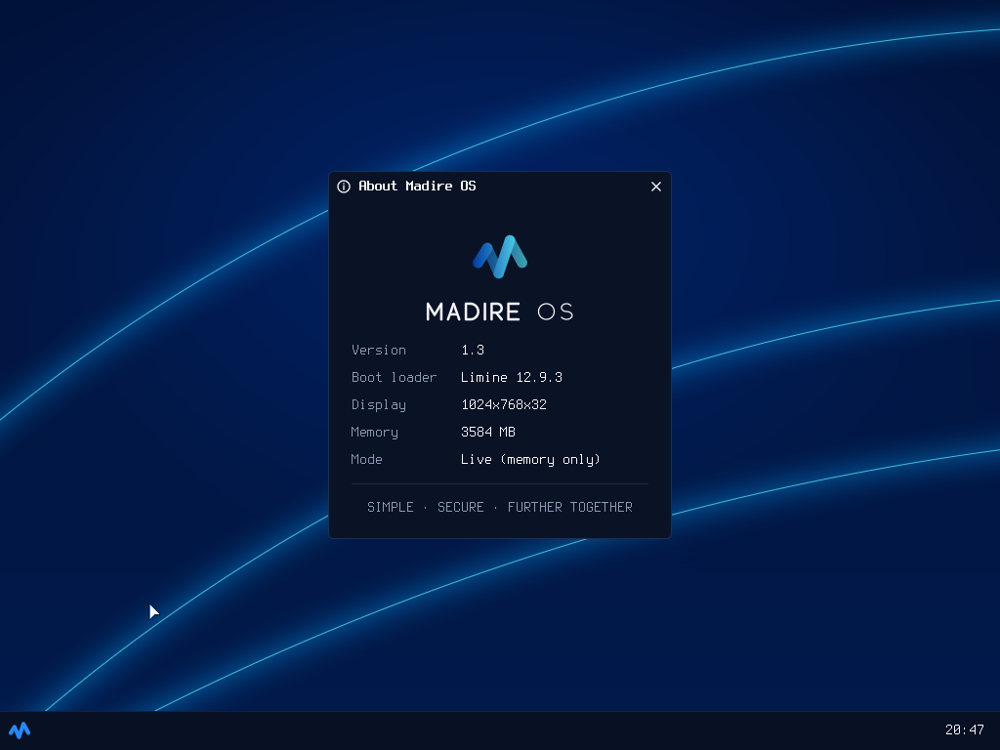

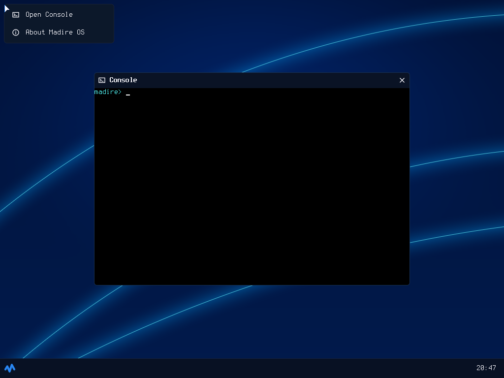

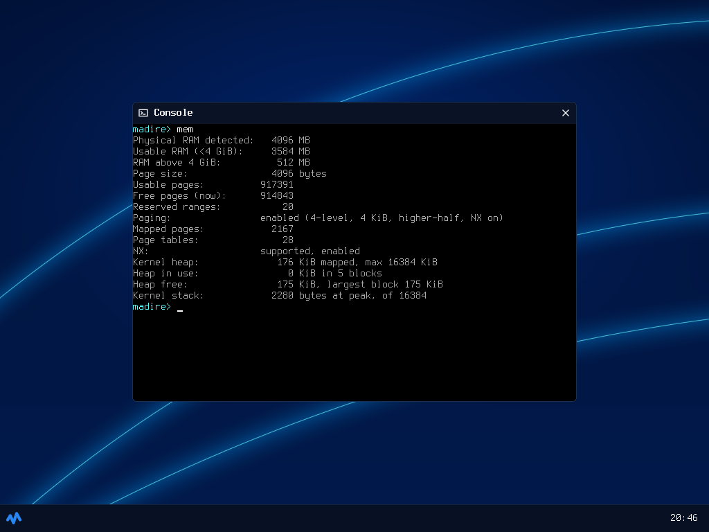

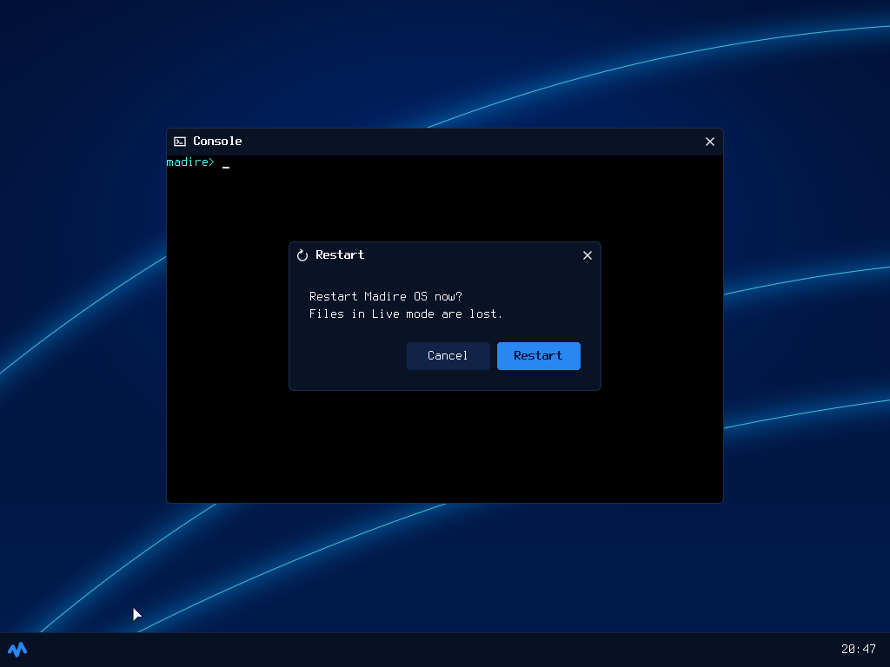

1.2 moved Madire OS from VGA text to graphics:

- **A graphical boot:** the default boot entry asks the boot loader for a 1024×768 screen (any mode from 800×600 works). A **splash** shows the Madire logo and "MADIRE OS" on a procedural wallpaper (dark blue, glowing curves), with "Booting Madire OS" and moving dots; at System ready it says **"Press any key to open the console"**. Esc, or the boot option `verbose`, shows the text boot screen instead, and so does any failure or crash.
- **The console in graphics:** the same 80×25 console and shell, drawn on the screen with the **Terminus** bitmap font (SIL OFL 1.1, the first third-party asset Madire ships), scaled to 100, 125, 150 or 200 % by the screen's height. The crash screen is drawn there too, even before the console has started.
- **`display`:** a new command that shows the screen's mode and scale.
- **The mouse:** a PS/2 mouse driver (IRQ12) with a pointer drawn over the screen. The console has no use for a pointer, so in 1.2 it was shown only with a test option; since 1.3 the desktop uses it.
- **Built from scratch, tested pixel by pixel:** the drawing library, the wallpaper (integer maths, the same rules as the boot menu's wallpaper script, which is now integer too), the console and the pointer are Madire's own code, and the tests compare the screen with independent reference renderings pixel for pixel.
- **Text mode stays:** the Diagnostics entries, and any machine without a usable framebuffer, boot in VGA text as before.
- **The Madire Design Guide v0.1** ([docs/design/design-guide.md](docs/design/design-guide.md)): the colours, sizes and layout rules the graphics follow.
- **Tests:** 149 new QEMU checks (`[1.2]`), 8 new unit-test suites, a 1000-packet mouse burst in the stress part, and a VirtualBox `graphics` group.

The splash at System ready (1.2; since 1.3 it hands over to the desktop):

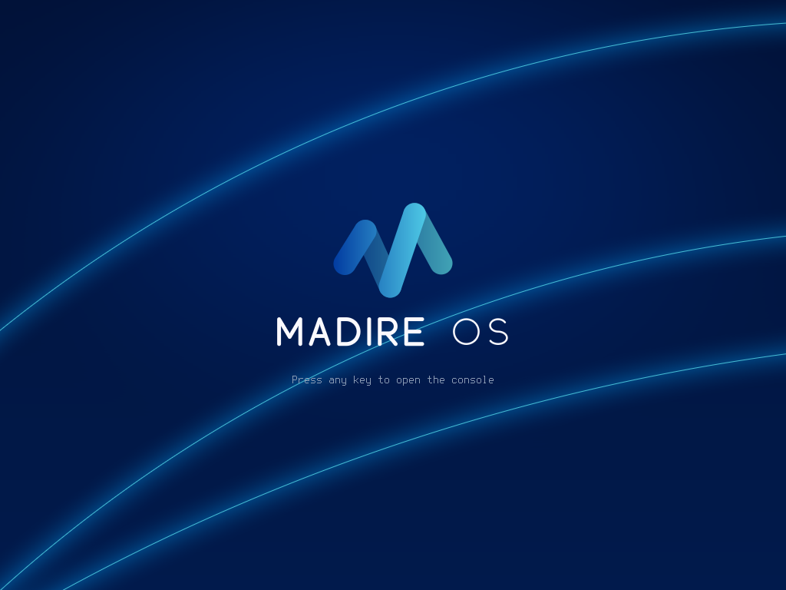

`display` in the console, drawn on the framebuffer (1.2):

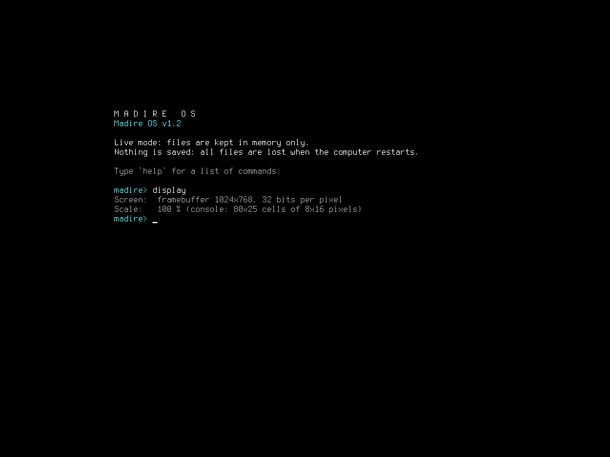

1.1 polished what was already there, before graphics in 1.2:

- **A branded, hidden boot menu:** Limine shows nothing for 2 s and then starts Madire OS; the boot screen was the same as 1.0's (since 1.2 the splash). Press a key during those 2 s and the menu appears on a 1024×768 Madire wallpaper (the M logo, the title, the tagline "SIMPLE · SECURE · FURTHER TOGETHER", the version), with `Boot Madire OS` and the **Diagnostics** directory (its 27 entries unchanged, shown 10 at a time) inside the wallpaper's panel. The wallpaper is drawn by Madire's own script from the logo's geometry, with no font file or image library.
- **Num Lock and Scroll Lock:** Num Lock is on at start; the numeric keypad types digits when it is on and acts as the arrow, Home/End, PgUp/PgDn, Insert and Delete keys when it is off (so Shift + keypad 9/3 page the scrollback). Scroll Lock is tracked and shown.
- **Keyboard lights:** the Caps Lock, Num Lock and Scroll Lock lights follow the keys (set at boot, then at every change); a keyboard that doesn't answer keeps working without lights.
- **Console keys at the prompt:** **Ctrl+C** clears the line (at a yes/no question it answers "no"), **Esc** clears the line, **Tab** completes a command name (a second Tab lists the names that match). A cleared line is never logged or kept in the history.
- **The ISO key** (the extra key next to the left Shift on many non-US keyboards) types `\` and, with Shift, `|`.
- **Tests:** 36 new QEMU checks (`[1.1]`: the boot menu read back pixel by pixel, the keypad, the lights as QEMU's keyboard sees them, the console keys), 2 new unit-test suites, and new VirtualBox rows (the boot menu's key window, the lights read from VirtualBox's keyboard, the console keys).

The boot menu, shown with a key during the 2 s window, on the Madire wallpaper (here 1.2's, with its version):

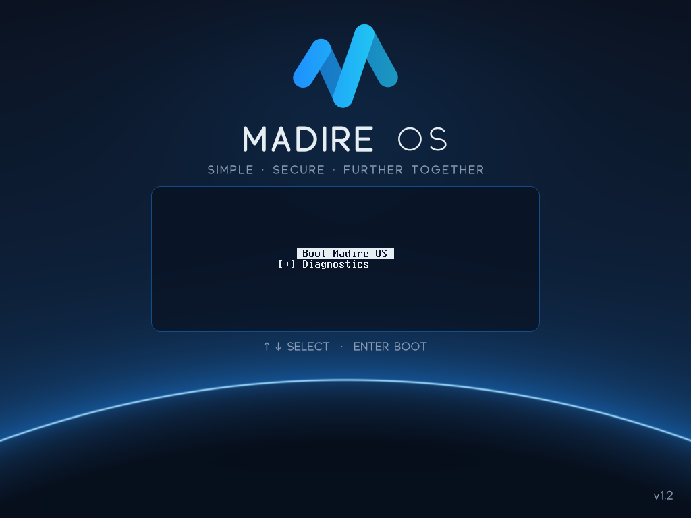

1.0 gave Madire OS **files and folders**:

- **A filesystem:** a virtual filesystem (VFS) layer with a **RAM filesystem** behind it: up to 1024 files and folders, 2 MiB per file, and up to 32 MiB of file data, taken from free memory only as files grow.
- **Live mode:** booted from the ISO, every file lives in memory and nothing is saved. The console says so when it opens, and `version` and `df` show it; there is no disk driver yet.
- **File commands in the console:** `pwd`, `cd`, `ls` (`-l`), `mkdir`, `rmdir`, `touch`, `stat`, `cat`, `rm`, `cp`, `mv`, `df` and `du`, in the new help section `files`; `rm`, and `cp` or `mv` over an existing file, ask first (`-y` doesn't); a built-in command's output goes into a file with `>` or `>>`.
- **Files for programs:** 21 new Linux x86-64 system calls (`open`, `read`, `close`, `stat`, `lseek`, `mkdir`, `rename`, `getdents64`, the `*at` forms and more), with Linux's numbers, structures and error codes; 16 descriptors per program; large reads and writes return the full count, as on Linux.
- **Programs start as on Linux:** with `argc`, `argv`, the environment (the shell's exported variables) and the auxiliary vector on their stack, so `run <program> [args…]` passes arguments; a program starts in the shell's current folder.
- **One lock for the filesystem**, fair (first come, first served) and never blocking the console; a lock holder can't be switched away in the middle.
- **`help` fits one screen** again: the commands' names by section; `help <command>` and `help <section>` give the details.
- **Madire's own licence files** (`LICENSE`, `NOTICE`, `THIRD_PARTY_NOTICES`) at the root of every ISO.
- **Tests:** 260 new QEMU checks, 13 new unit-test suites, a stress part (the lock under load, the kill race), and a VirtualBox `files` group.

The console opens in Live mode; `help files` lists the file commands:

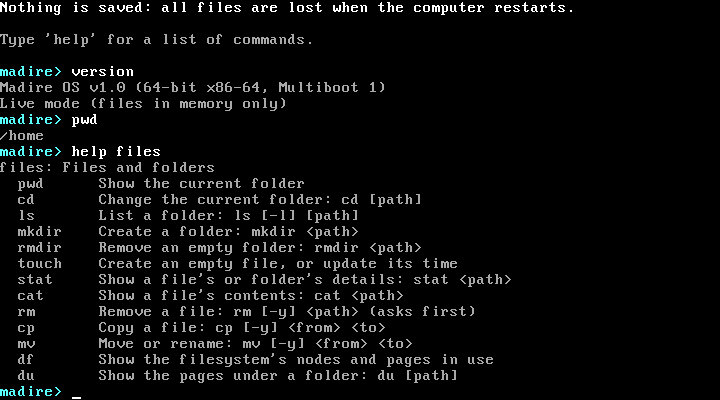

0.13 replaced the bootloader: the ISO now boots through **Limine** (v12.9.3, BSD-2-Clause) instead of GRUB:

- **Limine's boot menu:** the default entry and a **Diagnostics** directory with the 27 test boots; it waits 3 s, as GRUB did.
- **The same kernel:** still Multiboot 1; `madire.kernel` differs from v0.12's only in the three bytes of its version string.
- **A pinned, checked tool:** the build fetches Limine's unmodified binary package and checks its SHA-256 every time; GRUB is no longer used.
- **`THIRD_PARTY_NOTICES`:** Limine's licence and notices, which every ISO also carries.
- **Tests:** a Madire-written Multiboot header check replaces GRUB's `grub-file`; new checks prove where Limine places the boot data and that a module without a name is refused; the VirtualBox automation drives Limine's menu.


0.12 made the console shell easier to use, and the kernel checks itself:

- **"Did you mean":** a mistyped command suggests up to three close names (`hlep` → `Did you mean: help, sleep?`); nothing is run for you.
- **Help in sections:** `help shell`, `help system` and `help programs` list one group each; `help` still lists everything.
- **`prompt`:** change the prompt (up to 8 characters) or go back with `prompt --reset`.
- **`alias` and `unalias`:** short names for commands (up to 16).
- **`set`, `unset`, `export` and `env`:** shell variables, kept in memory until restart.
- **`sleep`, `presskey` and `time`:** wait for a number of seconds, wait for a key, or time a command; Ctrl+C cancels a wait.
- **`kill -y <pid>`:** ends a process without asking (plain `kill` still asks first).
- **Always-on kernel self-checks:** at every thread switch, every address-space (CR3) load and every return to user mode, the kernel checks that the thread, the address space and the process belong together; a broken rule stops the kernel with a panic instead of carrying on.

Since 0.11 you **run programs from the console**: `run hello` loads an ELF program that the bootloader delivered as a boot module and shows its output on the screen; `run -b spin` runs one in the background; `ps` lists threads and processes; `kill <pid>` ends one (it asks first; `kill -y <pid>` doesn't); **Ctrl+C** ends the program in the foreground:

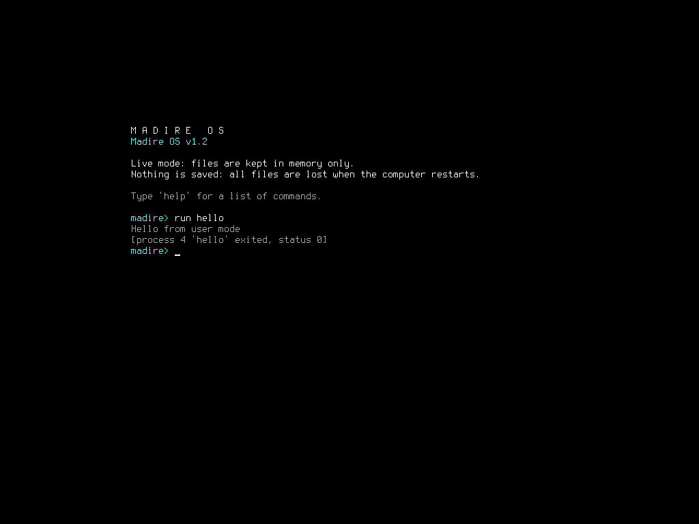

Programs run in **user mode** (since 0.10), each in its own address space, and talk to the kernel only through system calls; a program that makes a mistake is ended alone, and the kernel carries on. The Diagnostics menu runs the built-in test programs:


At System ready, press any key to open the console (since 1.3 the Console window on the desktop). Output that scrolls off the top isn't lost: **Shift+PgUp** and **Shift+PgDn** page back through the last 1000 lines (0.9.2; since 1.1 also Shift + keypad 9/3 with Num Lock off), with an indicator on the bottom row; any other key returns:


`help` fits one screen (since 1.0): the commands' names by section; `help <section>` lists one group with each purpose, and `help <command>` or `<command> --help` explains one:

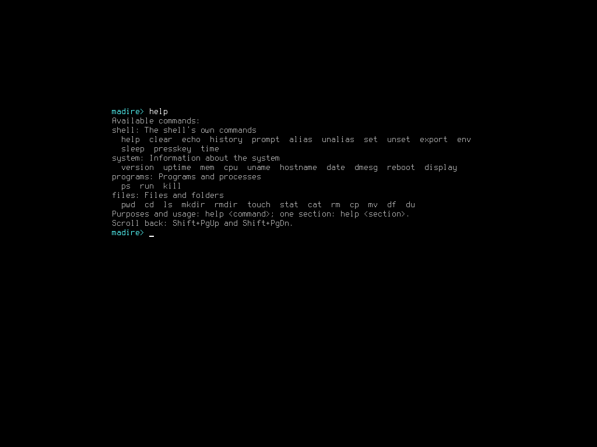

`uname -a`, `hostname`, `date`, `dmesg`, Up-arrow recall and `history` (0.9.1):


`ps` lists the threads and processes (after boot only thread 0, the console itself, is left, and no process), and `mem` shows the higher-half kernel, NX and the kernel stack's high-water mark:

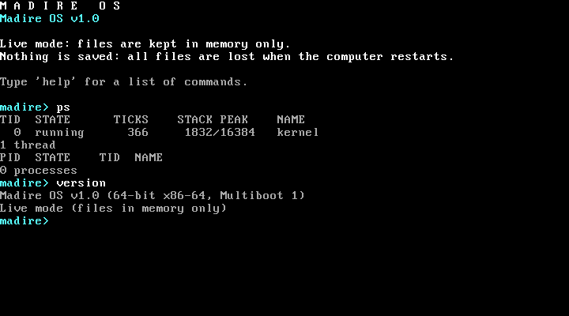

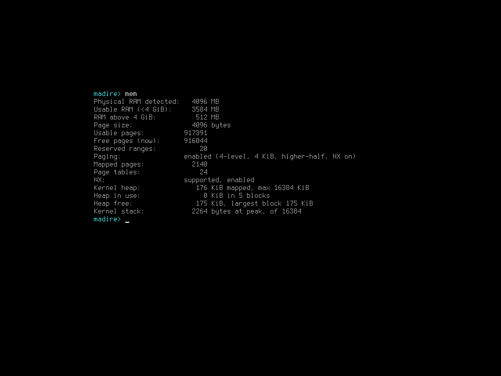

It boots through Limine (GRUB until 0.12) into a 64-bit (x86-64) kernel written in C and NASM. So far the kernel:

- checks that the CPU can run it (CPUID, long mode, PAE) and switches from the bootloader's 32-bit protected mode into 64-bit long mode; a CPU without long mode gets a clear message and halts;
- runs in the **higher half** (since 0.8): it is loaded at 1 MiB but runs at `0xFFFFFFFF80000000` and above, and once its own page tables are loaded **nothing in the lower half is mapped**, so any stray low address faults;
- reaches the low 1 MiB (VGA) and the bootloader's data through a small **physical view**, which never includes free RAM, page 0 or the kernel image;
- installs its own segment table (GDT, with a task-state segment) and interrupt table (IDT);
- catches CPU exceptions and shows them on a readable crash screen with the 64-bit registers;
- reads and validates the firmware's memory map, and protects the kernel and boot data;
- runs a physical page allocator, which it tests on real RAM at every boot;
- runs with 4-level paging: the page tables are checked before they are loaded, page 0 is left unmapped so NULL pointers fault, kernel code is read-only, and everything except kernel code is **no-execute (NX)**;
- has unmapped **guard pages** below its stacks: a kernel stack overflow becomes a double fault, handled on its own stack (IST1), and is reported instead of resetting the machine;
- measures how deep its stack has ever been used (a **high-water mark**, shown by `mem`: 1832 of 16384 bytes at "System ready." in 1.0);
- runs **kernel threads** (since 0.9), each with its own 16 KiB stack above an unmapped guard, so a thread's stack overflow is caught and the crash screen names the thread;
- **schedules them preemptively**: round robin with a 50 ms time slice, switching at the end of a timer interrupt (and, since 0.11, as soon as a thread leaves a section where preemption was off, so every turn stays within about a slice), plus sleep, join and exit codes; a thread that never gives up the CPU can't starve the others;
- keeps itself safe under preemption without locks: the heap, the page allocator, paging and screen/serial output each run with preemption briefly disabled, and only the console thread writes to the screen;
- tests its scheduler at every boot (two threads taking turns, preemption, sleep, everything freed afterwards);
- runs **user processes** (since 0.10): programs in ring 3, each in **its own address space** (the kernel's half shared, and frozen at boot), preempted like any thread, killed safely at their next return to user mode, and torn down exactly;
- offers **system calls** through `SYSCALL`, with Linux x86-64 numbers and behaviour: six since 0.10 (`write`, `sched_yield`, `nanosleep`, `getpid`, `exit`, `exit_group`) and, since 1.0, 21 file and folder calls (27 in all; every other number answers `-ENOSYS`), and checks every pointer a program passes before touching it;
- **contains faults:** a program that reads NULL, runs an invalid or privileged instruction, touches kernel memory, overflows its stack, writes its code or executes its data (W^X) is ended alone, with one log line naming the exception and the exact instruction;
- uses **SMEP and SMAP** when the CPU has them, so the kernel itself can't run or touch program memory by mistake (and the crash screen names such a fault); x87/MMX/SSE are off for programs (CR0.EM);
- tests user mode at every boot (three programs as processes 1–3: output, an exit status, a contained NULL read);
- **loads ELF programs** (since 0.11) delivered by the bootloader as boot modules (7 on the default entry), after strict checks at boot and again at load (static x86-64 only, no writable code, at most 4 segments and 1 MiB), copying them into fresh pages through one loading path;
- **runs and manages them from the console** (since 0.11): `run` and `run -b`, `ps` with process IDs, `kill` (which asks first) and Ctrl+C, which also wakes a sleeping program at once; a foreground program's output appears on the screen, drawn only by the console thread from a queue, and a program that floods it is slowed down rather than the console;
- keeps **files and folders** (since 1.0) in a RAM filesystem behind a VFS layer, in **Live mode** (nothing is saved), with descriptors for programs, one fair lock that never blocks the console, and a self-test at every boot;
- starts programs with the **System V layout** (since 1.0): `argc`, `argv`, `envp` and the auxiliary vector;
- has a kernel heap (`kmalloc`, `kcalloc`, `kfree`) that catches double frees, invalid frees and corrupted blocks;
- explains page faults on the crash screen (what kind of access, and the faulting address);
- checks that boot modules loaded by the bootloader arrive intact, and shows the result on the screen as well as the serial log;
- handles hardware interrupts safely: only the timer (IRQ0), the keyboard (IRQ1) and, since 1.2 on graphics boots, the mouse (IRQ12, through the cascade IRQ2) are enabled, each only after its handler is ready;
- keeps time with the PIT at 100 Hz (uptime is shown on screen);
- reads the PS/2 keyboard: key presses and releases, Shift/Ctrl/Alt/Caps Lock and extended keys, queued for the kernel; since 1.1 also Num Lock (on at start; the keypad follows it), Scroll Lock and the ISO key, and it sets the **keyboard lights** at boot and at every lock-key change;
- provides a text console with a scrolling screen, a blinking cursor and an editable input line (insert, Backspace, Delete, Left/Right/Home/End), since 0.9.2 a **scrollback** of the last 1000 lines (Shift+PgUp / Shift+PgDn), since 1.1 **Ctrl+C** and **Esc** to clear the line and **Tab** to complete a command name, and since 1.3 **Ctrl+L**, **Ctrl+A/E** and **Ctrl+K/U/W**;
- **doesn't log what you type** (since 0.9.2): key events reach the logs only with the boot option `keylog` (for tests) or during the keyboard diagnostics;
- runs a small command shell: `help`, `clear`, `version`, `uptime`, `mem`, `cpu`, `echo`, since 0.9 `ps`, since 0.9.1 `history` (with Up/Down recall), `uname`, `hostname`, `date`, `dmesg` and `reboot` (which asks first), since 0.11 `run` and `kill`, since 0.12 `prompt`, `alias`, `unalias`, `set`, `unset`, `export`, `env`, `sleep`, `presskey`, `time` and `kill -y`, and since 1.0 `pwd`, `cd`, `ls`, `mkdir`, `rmdir`, `touch`, `stat`, `cat`, `rm`, `cp`, `mv`, `df` and `du`, with `>` and `>>`, and since 1.2 `display` (40 commands); `help` fits one screen, `help <command>` and `<command> --help` explain any command, `help <section>` lists one group, and a mistyped name gets "Did you mean" suggestions;
- **checks itself at every switch** (since 0.12): the scheduler, address-space (CR3) and return-to-user-mode self-checks are always on, and each one's panic is proven by its own test boot;
- keeps a 32 KiB kernel log in memory (`dmesg`), reads the date and time from the real-time clock, and restarts the machine through the keyboard controller, with a triple-fault fallback;
- draws the Madire M logo, built from geometry, in VGA text mode (and, since 1.1, the same geometry drawn smooth in the boot menu's wallpaper, since 1.2 also on the splash);
- **draws on a framebuffer** (since 1.2): the mode the boot loader set (1024×768×32 asked for), mapped in its own kernel area with a back buffer; a splash on a procedural wallpaper; the console in the Terminus font, scaled by the screen's height; the crash screen; a mouse pointer with save-under; only the console thread draws, and VGA text stays for every boot without a usable framebuffer;
- shows **a desktop** (since 1.3): a compositor on the console thread that owns the back buffer from System ready and redraws only the damaged rectangles, from a cached background and per-window surfaces (with fallbacks that give the same pixels when memory is short); Madire's own toolkit for windows, menus and a dialog; the taskbar with the M button and the clock; the M menu (also by the Windows key), a right-click menu, the About and Console windows, the Restart dialog; the crash screen still full-screen.

The project is built one milestone at a time, and each milestone has to boot in VirtualBox before the next one starts. See [docs/roadmap.md](docs/roadmap.md) and [docs/PROGRESS.md](docs/PROGRESS.md).

**Tested at v1.3:** 1948 QEMU checks and 94 unit-test suites pass in the official regression on GitHub Actions (the full run 41096493517 and the sharded run 41096468244 on the last code change), together with the reproducible-build check; the stress part's 130 checks passed in run 41026007238 (stage 7b); the automated VirtualBox acceptance test (`MadireOS-Test`, run by the owner) passes 674 of its 675 rows on that full run's ISO, with the new `desktop` group driving the pointer, the menus, the windows and the Restart dialog and comparing each screen with its reference pixel for pixel (the clock masked); the one missed row, and one more in five reruns of the boot menu's key window (59 of 60), are timing edges of the test outside Madire's code (keys reaching the VirtualBox BIOS during its keyboard check at 0 ms; keys arriving as the boot loader's 2 s wait ends at 6 s), accepted and to be redesigned; 30 more normal boots all reached System ready and the desktop. From `main`, the milestone commit passed a full run (41131135304, the release ISO `e1305451…`), a sharded run (41131155009, with the 4 MiB kernel gate) and the stress part's 130 checks (41131173016) on the same kernel, before the tag `v1.3`.

**Tested at v1.2:** 1677 QEMU checks and 78 unit-test suites pass in the official regression on GitHub Actions (the full run 40015866525 and the sharded run 40015842544 on the last code change), together with the reproducible-build check, and the stress part's 127 checks (40005957778) on the same kernel; the automated VirtualBox acceptance test (`MadireOS-Test`) passes all 645 of its rows on that run's ISO, with the new `graphics` group comparing the splash and the console with their reference renderings pixel for pixel, and 30 more normal boots all reached System ready. From `main`, the milestone commit passed a full run (40036808466), a sharded run (40036822525, with the 4 MiB kernel gate) and the stress part's 127 checks (40036836216) on the same kernel, before the tag `v1.2`.

## Roadmap

A summary of [docs/roadmap.md](docs/roadmap.md); each step needs its own plan and the owner's approval.

- **0.1–0.13: done.** Boot, CPU and memory foundations, interrupts, the console and shell, paging and the heap, 64-bit long mode, the higher-half kernel, kernel threads and preemption, user processes, ELF programs and process management, the shell improvements of 0.12, and in 0.13 the bootloader, GRUB → Limine ([plan](docs/plans/0.13.md), [evaluation](docs/evaluations/limine.md)).
- **1.0: the filesystem, done** ([plan](docs/plans/1.0.md)): a VFS layer with a RAM filesystem, the Live mode, the file system calls and commands, System V program start-up.
- **1.1 "Polish", done** ([plan](docs/plans/1.1.md)): the branded, hidden boot menu (boot branding, phase A) and keyboard polish (Num Lock and the keypad, Scroll Lock, the keyboard lights, Ctrl+C, Esc and Tab at the prompt, the ISO key).
- **1.2 "Graphical boot and console", done** ([plan](docs/plans/1.2.md)): the Madire Design Guide, a framebuffer, the Terminus console with display scaling, the mouse and a pointer, the splash (the boot branding's phase B).
- **1.3: the desktop, done** ([plan](docs/plans/1.3.md)): the Madire Design Guide v0.2, a compositor and Madire's own toolkit, the taskbar with the M button and a clock, the M menu and a right-click menu, the About and Console windows, the Restart dialog, the console keys Ctrl+L, Ctrl+A/E/K/U/W.
- **1.4: storage, next** (a disk driver and a filesystem that keeps files: ext2 first, built from its specification; Madire's own filesystem later).
- **1.5: the Files app and the desktop folders** (the home folders and a Trash, desktop icons, New Folder and New File from the right-click menu, window management: minimise, maximise, resizing; the mouse wheel).
- **1.6: UEFI boot** (the boot loader's own protocol, a UEFI ISO, the test VMs in UEFI mode).
- **Then the desktop grows further:** a window interface for programs; the Madire Calculator (Standard, Scientific and Financial); a search box in the M menu when typing on the desktop; the screen resolution in Settings.
- **Then, unscheduled and in this order:** an installer (virtual disks only at first), networking, the Linux-compatible foundation (system calls and a C library), TLS, audio and video, the Madire Browser, Linux apps, and in the long term Windows apps through Wine on top of the Linux layer.
- **Alongside:** the modernisation track: UEFI, APIC, multi-core, USB, all RAM, Wi-Fi and Bluetooth; ARM64 later.

## v1.3 in pictures

Screenshots from the 1.3 VirtualBox acceptance run (`MadireOS-Test`, the ISO of the full regression run 41096493517), the guest screen only. The desktop at System ready is at the top of this page, with the M menu, the About window, the right-click menu, `mem` in the Console window and the Restart dialog below it. The clock shows the time as the VM's clock gave it (20:46–20:47; VirtualBox keeps that clock on the host's local time).

## v1.2 in pictures

Screenshots from the 1.2 VirtualBox acceptance run (`MadireOS-Test`, the ISO of the full regression run 40015866525), the guest screen only. The splash at System ready is at the top of this page, `display` and the boot menu above, and the console's `help`, `run hello` and `mem` (all drawn on the 1024×768 framebuffer) in the sections above.

## v1.1 in pictures

Screenshots from the 1.1 VirtualBox acceptance run (`MadireOS-Test`, the ISO of the final full regression run, 39836152722).

The boot menu with the **Diagnostics** directory open (10 entries at a time; the arrows show there are more):

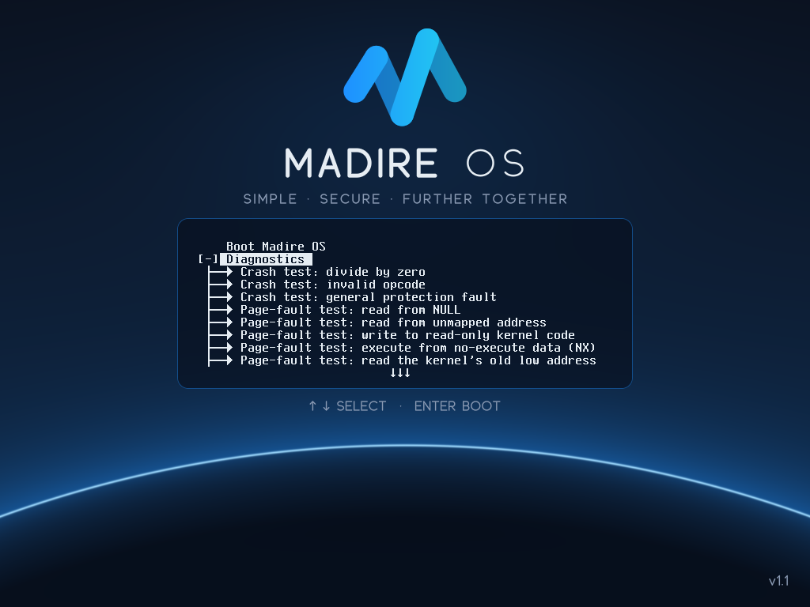

The keyboard diagnostic: the ISO key types `\`, Num Lock goes off, and keypad 8 is then the Up arrow:

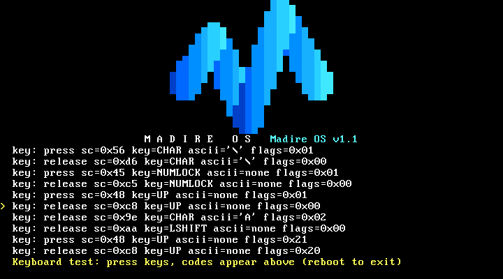

## v1.0 in pictures

Screenshots from the 1.0 VirtualBox acceptance run (`MadireOS-Test`, the ISO of the final full regression run, 38966032674).

Limine's menu with the **Diagnostics** directory open (the automation selects each entry by its position):

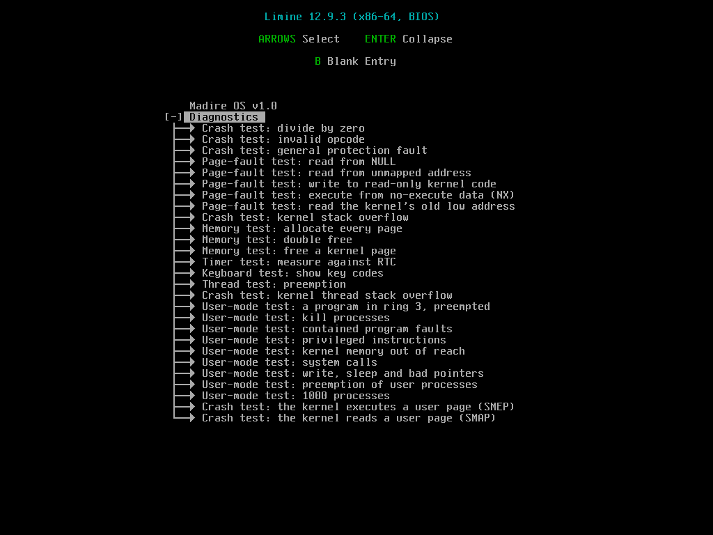

Files made with `>` and `>>`, read with `cat`; `echo hi>b.txt` stays one word (`>` must stand alone); `stat` shows a file's details:

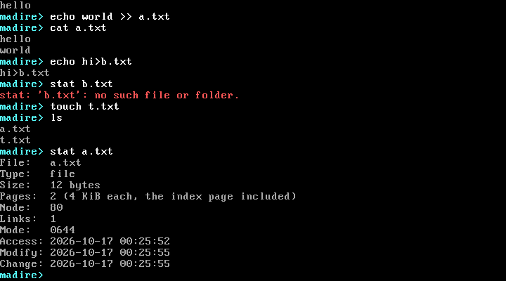

`cp` asks before replacing a file ("no" keeps it, "yes" replaces it; `-y` doesn't ask):

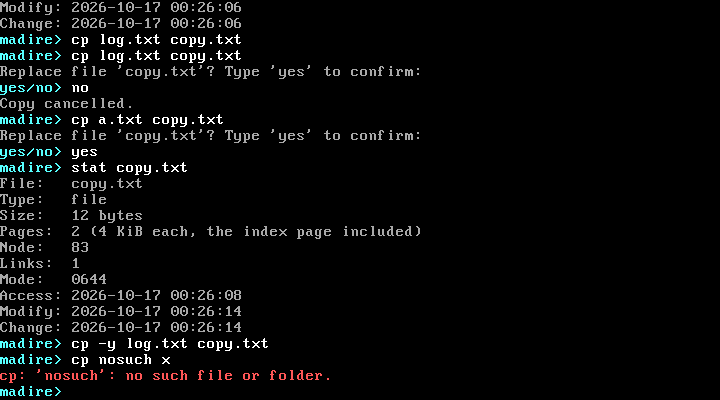

`mv` and `rm` ask the same way:

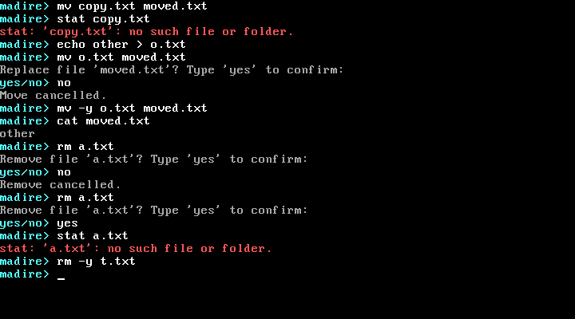

Clear refusals, then `df` (Live mode, nodes and pages in use) and `du`:

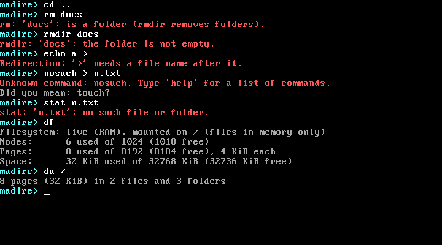

### The 0.12 shell commands (v0.13 screenshots)

`help` ended with the list of sections in 0.13 (since 1.0 it fits one screen, above); `help system` and `help programs` show one group each:


A mistyped command or help topic gets "Did you mean" suggestions:


`prompt` changes the prompt and refuses text that is too long, starts with `-` or has spaces:


`alias` makes short names for commands, with clear refusals for bad names:


`set` keeps shell variables in memory, with its limits checked:


`export` marks variables, and `env` lists the exported ones:


`time sleep 1` takes 100 ticks (1.00 s); `presskey` waits for a key, and Ctrl+C cancels it:


`kill` asks first; `kill -y` ends a process without asking, and `time kill -y` times it:


**Ctrl+C** ends a program that never stops by itself (`run spin`):


## Development environment

| Role | Tool |
|---|---|
| Editor / host | Windows 11, Visual Studio Code |
| Build environment | Ubuntu Linux: a GitHub Codespace (current; created from `.devcontainer/`, proven on a fresh Codespace in 0.8), or WSL2 / CI |
| Compiler | the host GCC in 64-bit freestanding mode (`gcc -m64 -ffreestanding -mno-red-zone -mgeneral-regs-only -mcmodel=kernel`) |
| Assembler | NASM |
| Bootloader / ISO | Limine 12.9.3 (since 0.13; the pinned binary package, SHA-256 checked) + xorriso (`limine bios-install`); GRUB 2 until 0.12 |
| Automated tests | QEMU (`qemu-system-x86_64`, and `qemu-system-i386` for the "no 64-bit CPU" test), headless |
| Official regression | GitHub Actions (since 0.12): started by hand, sharded into parallel jobs, QEMU 8.2.2 and gcc 13 (`scripts/actions-regress.ps1`); a GitHub Codespace is the fallback |
| Target machine | Oracle VirtualBox 7.2, VM `MadireOS-Test` (BIOS firmware, OS type Other 64-bit) |

Linux is used only to run the build tools. It is not part of Madire OS.

## Build

On Windows, compile remotely in the Codespace. This copies your local files up, builds, runs the tests and fetches the ISO back:

```powershell
.\scripts\build.ps1 -InstallDeps   # first time on a new Codespace
.\scripts\build.ps1                # afterwards
```

On Linux (Codespace terminal, WSL, CI):

```sh
bash scripts/install-deps.sh   # once (a Codespace from .devcontainer/ runs it for you)
make            # kernel: build/madire.elf (with symbols) and build/madire.kernel (bootable)
make iso        # bootable ISO: build/madire-os.iso (Limine; scripts/install-deps.sh
                # fetches the pinned Limine package)
make unit       # host unit tests, 94 suites (memory, 4-level page tables, heap,
                # keyboard decoder and queue, PIT maths, console text grid, line
                # editor, parser, shell, CPUID decoding, kprintf, NX and page-fault
                # decoding, boot modules, stack high-water mark, scheduler, thread
                # stack slots, ps, command history, RTC decoding, kernel log, the
                # 0.9.1 commands, scrollback; 0.10: GDT, SMEP/SMAP, the freeze,
                # user pages, user copies, process table, program images, ring-3
                # entry, fault opcodes, system calls, SMEP/SMAP crash causes,
                # turn order; 0.11: ELF checks, program modules, load plans,
                # turn owners, policy (b), the early wake, run/ps/kill, the
                # output queue; 0.12: the 0.12 shell commands, shell sessions,
                # bounded diagnostic waits, the scheduler self-checks; 1.0: paths,
                # the VFS, the RAM filesystem, file pages, the VFS lock, descriptors,
                # copy_to_user, the file and folder system calls, the start-up
                # block, the file commands, help on one screen; 1.1: the keyboard
                # lights exchange, command-name completion; 1.2: the i8042
                # controller, the framebuffer fields, drawing surfaces, the
                # framebuffer console, the mouse decoder, the pointer, the
                # wallpaper and splash, display; 1.3: coverage, rectangles and
                # damage, drawing, icons, widgets, the clock, the compositor,
                # the desktop, windows, About, the display plan, the Console
                # window, menus, the dialog, menu input, the console keys)
make repro      # two clean builds in fresh directories: madire.elf and
                # madire.kernel must be byte-identical (make test runs it too)
make test       # unit tests + repro + 1948 QEMU checks (150 from 0.3 + 30 from 0.4 +
                # 31 from 0.5 + 49 from 0.6 + 96 from 0.7 + 32 from 0.8 + 139 from
                # 0.9 + 32 from 0.9.1 + 25 from 0.9.2 + 253 from 0.10 + 233 from
                # 0.11 + 151 from 0.12 + 11 from 0.13 + 260 from 1.0 + 36 from 1.1
                # + 149 from 1.2 + 271 new; the agreed counts are in
                # tests/expected-checks.txt):
                # boot, long mode, CPUs without long mode, logo, memory at 5 RAM
                # sizes, crash tests, timer rate, scripted keyboard input, a scripted
                # console session, paging and heap self-tests, the higher-half kernel
                # and empty lower half, page faults, NX, stack overflow and stack
                # peak, heap misuse and exhaustion, boot-module integrity, screen
                # line widths, threads, preemption, sleep and join, the heap and page
                # allocator under preemption, thread stack overflow, ps, the 0.9.1
                # commands, reboot through the keyboard controller and by triple fault,
                # key logging off by default, scrollback read back from the VGA screen,
                # user mode: segments, SMEP/SMAP, address spaces, programs in ring 3,
                # kill, contained faults with their instructions, system calls, bad
                # pointers, 1000 processes, the boot menu's Diagnostics entries; ELF programs
                # from boot modules and malformed files, run/kill/ps and Ctrl+C in
                # console sessions, screen output and a flooding program; the 0.12
                # shell commands in console sessions, the self-checks' panics; the
                # Multiboot header (scripts/check-multiboot.py), Limine's files and
                # notices in the ISO, where Limine places the boot data; the
                # filesystem and its limits, the VFS lock, descriptors, the file and
                # folder system calls, System V start-up, the file commands in
                # console sessions, Madire's licence files in the ISO; the hidden
                # boot menu and its wallpaper (read back from the screen), the
                # keypad and lock keys, the keyboard lights as QEMU's keyboard
                # stores them, Ctrl+C, Esc and Tab at the prompt; the framebuffer
                # in several modes, the console, the splash and the pointer
                # compared with reference renderings pixel for pixel, the mouse
                # through QEMU's injected events, the crash screen in graphics;
                # the desktop, its windows, menus and dialog compared with an
                # independent reference renderer in five modes, driven by the
                # mouse and the keyboard over QMP, the splash-to-desktop
                # handover, the console keys.
                # The official run is on GitHub Actions, sharded, about 20 minutes:
                # scripts/actions-regress.ps1 -Dispatch (see docs/development.md)
make run        # boot in a QEMU window
make clean
```

## Test in VirtualBox

```powershell
.\scripts\run.ps1                       # attach ISO, boot MadireOS-Test in a window
.\scripts\run.ps1 -Headless -Screenshot # boot without a window, save build\boot-screen.png
.\scripts\vbox-acceptance.ps1           # the automated acceptance test (since 0.9): checks
                                        # the VM settings (never changes them), boots each
                                        # test, keeps screenshots and serial logs; since
                                        # 0.12 a scripted shell session too (-Only boot,shell);
                                        # since 0.13 it drives Limine's menu;
                                        # since 1.0 a files session (-Only files);
                                        # since 1.1 the hidden menu's key window
                                        # (-Only keywindow), the lights and the
                                        # console keys; since 1.2 the splash and
                                        # the console in graphics (-Only graphics);
                                        # since 1.3 the desktop (-Only desktop),
                                        # run by the owner with VS Code closed
```

In the console, try `run hello`, `run -b spin`, `ps`, then `kill <pid>` (it asks first) or `kill -y <pid>`, and `run lines 65636` followed by **Ctrl+C**. From 0.12: `help shell`, a typo such as `hlep`, `alias ll echo hi`, `set A=1`, `time sleep 1`. From 1.0: `help files`, `mkdir docs`, `cd docs`, `echo hello > a.txt`, `cat a.txt`, `ls -l`, `cp a.txt b.txt`, `df`. From 1.1: type `his` and press **Tab**, type `un` and press **Tab** twice, clear a line with **Esc** or **Ctrl+C**, and press Num Lock to turn the keypad into arrow keys. From 1.2: `display`. From 1.3: click the M button or press the Windows key, open About, drag its window by the title bar, right-click the desktop, type a line and try Ctrl+A, Ctrl+E, Ctrl+W and Ctrl+L.

When the desktop appears, press a key: the Console window opens (that key only opens it; it isn't typed). In text mode the boot screen says `System ready. Press any key to open the console.` Type `help` for the list of commands. Esc while the splash shows brings back the text boot screen and the full-screen console. In `MadireOS-Test` the mouse doesn't move in the VM's window (its USB tablet; the acceptance script moves it through VirtualBox's mouse events); `MadireOS-View` has a PS/2 mouse.

The boot menu is hidden (since 1.1): press a key (for example **Home**) during the 2 s after the BIOS screen to show it. It has a **Diagnostics** directory (press **↓**, then **Enter** to open it):

- **Crash tests** that deliberately trigger CPU exceptions, including a **kernel stack overflow**.
- **Page-fault tests:** read from NULL, read from an unmapped address, write to read-only kernel code, execute from a no-execute data page (NX), read the kernel's old low address `0x100000` (0.8: it must fault, because the lower half is empty).
- **Memory tests:** allocate every page, double free, free a kernel page.
- **Timer test:** measures the tick rate against the real-time clock.
- **Keyboard test:** shows the code of every key pressed.
- **Thread tests (0.9):** three threads that never yield share the CPU by preemption; a kernel thread's stack overflow is caught by its guard and the crash screen names the thread.
- **User-mode tests (0.10):** a program in ring 3 preempted by the timer; processes killed; programs that fault, try privileged instructions or touch kernel memory, each ended alone; system calls; `write`, `nanosleep` and bad pointers; preemption of user processes; 1000 processes.
- **SMEP and SMAP crash tests (0.10):** the kernel deliberately executes or reads a program's page; on a CPU with SMEP/SMAP this must end on the crash screen naming the cause, otherwise it reports NOT APPLICABLE (the VirtualBox VM doesn't offer them).

See [docs/testing.md](docs/testing.md) for the expected screens and troubleshooting.

## Limitations (v1.3)

- 64-bit x86 (x86-64) only; the 32-bit build was dropped in 0.7. The VM must use **BIOS** firmware (the ISO is BIOS-only; the framebuffer comes from the BIOS's VBE modes, and VGA text, the fallback, doesn't exist under EFI; Limine could also boot UEFI later).
- **Graphics (1.2):** the screen mode is the one the firmware gives for 1024×768×32 (VirtualBox offers only 800×600 and 1024×768); no other resolution can be chosen and nothing changes the mode at run time (`display` only shows it). The framebuffer is mapped without write-combining, so drawing may be slow on real hardware (untested there). The full-screen console is the 80×25 grid, centred, with a black border.
- **The desktop (1.3)** runs inside the kernel: programs can't open windows yet. It has the M menu, a right-click menu, the About window, one Console window (fixed size; closing hides it) and the Restart dialog; no minimise, maximise or resizing, no taskbar window buttons, several consoles, desktop icons, Files, Settings, Shut Down or Calculator yet; windows are dragged only by their title bar. The clock is the computer's clock as it is, with no date or time zone. The text is the Terminus bitmap font. The 1.2 splash's own text has too little contrast against the wallpaper for the desktop's rules (a follow-up).
- **Early failures in graphics:** a panic before the kernel has read the framebuffer's details, and the boot stub's "no 64-bit CPU" message, appear on the serial port only. Keys act from System ready on, so a boot that hangs earlier leaves the splash on the screen: boot with `verbose` (no splash) or read the serial log.
- **The mouse** works only on graphics boots; the pointer shows on the desktop from the first movement (on the full-screen console only with the test option `pointer`). It moves 1:1 (no acceleration); the scroll wheel and the middle button do nothing yet. The test VM `MadireOS-Test` has a USB tablet, which gives a PS/2-only guest no mouse in its window; `MadireOS-View` has a PS/2 mouse.
- **A rare hang before the kernel starts** at 1024×768 has been seen 3 times on this laptop's virtualisation in 1.2 (never on GitHub Actions, never in 30 VirtualBox boots in 1.2 or in 30 more in 1.3); its cause is unknown (an open watch item, see [docs/PROGRESS.md](docs/PROGRESS.md)).
- **Only RAM below 4 GiB is used.** On `MadireOS-Test` (4096 MB), 512 MB sits above 4 GiB and is shown separately as `RAM above 4 GiB`.
- The whole low 1 MiB is reserved on purpose, and ACPI-reclaimable memory isn't reclaimed yet.
- **Paging:** 4 KiB pages; one kernel half, shared by every process and frozen at boot. There is no direct map of physical memory: the physical view covers only the low 1 MiB and the boot data, and other frames are reached one page at a time through the physical-access window. A page fault in the kernel is fatal (nothing is loaded on demand); one in a program ends that program.
- **Stacks:** the high-water mark covers the kernel stack and each thread's stack (not the double-fault stack). It can read a few bytes too low, never too high, and it always counts the top 736 bytes (the boot frames and a safety margin, which are never painted) as used.
- **Kernel heap:** one heap, at most 16 MiB, never shrinks. Safe between threads, but not interrupt-safe: `kmalloc`/`kcalloc`/`kfree` refuse to run with interrupts disabled (so never from an IRQ or exception handler). `kfree` checks the whole heap every time, which gets slower as the heap fills.
- **Boot modules:** the screen has one message line, so with several modules only the last result stays visible; the serial log has them all.
- **Keyboard:** PS/2 only (USB keyboards need firmware legacy emulation), US layout only (no AltGr or other layouts). The keyboard diagnostics leave the lights as they were set at boot; after one failed exchange they stay off until restart. F1–F12, Insert's overwrite mode, plain PgUp/PgDn, the Menu key, media and power keys, Print Screen and Pause do nothing (the Windows key opens the M menu on the desktop since 1.3); Scroll Lock only toggles its light.
- **Boot menu:** shown only when a key is pressed in its 2 s window; its layout is made for 1024×768 (another resolution centres the wallpaper, and the menu may not line up with its panel).
- **Console and shell:**
  - 40 built-in commands (the full plan is in [docs/commands.md](docs/commands.md)).
  - Commands are lowercase and case-sensitive; at most 8 words per line and 71 characters of input.
  - `history` keeps only the last 16 lines and the scrollback the last 1000 lines; both are lost at restart. Tab completes command names only (not aliases or file paths); no pipes, quoting or scripting.
  - The prompt, aliases (at most 16, one level) and variables (at most 32, values up to 63 characters) live in memory only and are lost at restart. Variables are not expanded (`$NAME` doesn't exist yet), and no environment reaches a program. `time` times built-in commands only, not aliases.
  - Scrollback pages only with Shift+PgUp/PgDn (the grey keys, or the keypad's 9/3 with Num Lock off); plain PgUp/PgDn do nothing.
  - `hostname` is fixed (`madire`). `date` shows the real-time clock as it is, with no time zone: VirtualBox keeps it on the host's local time, QEMU on UTC. It assumes years 2000–2099 and can't set the date.
  - `dmesg` shows only what the kernel logged through `kprintf`/`klogf`: the boot screen's status lines and the console's own output aren't in it, and a boot-screen line can appear joined to the next one there.
  - Key events are logged only with the boot option `keylog` or during the keyboard diagnostics (for tests); never use `keylog` where secrets are typed. There is no password prompt yet; the first one must come with a secret-input mode (see [AGENTS.md](AGENTS.md)).
  - `reboot` uses the keyboard controller (or a triple fault); there is no `shutdown` or `poweroff` yet.
  - Ctrl+key and Alt+key do nothing, except Ctrl+C: it ends the foreground program (0.11), cancels `sleep` and `presskey` (0.12), and at the prompt clears the line or answers "no" to a yes/no question (1.1); and since 1.3 Ctrl+L, Ctrl+A/E and Ctrl+K/U/W at the prompt (ignored at a yes/no question and while a program runs). Ctrl+D waits for `exit` ([docs/commands.md](docs/commands.md)).
  - Long output lines wrap at column 80, even mid-word (for example `cpu`'s "Features:" line on some CPUs).
- **Interrupts:** only IRQ0 and IRQ1 are enabled (and IRQ12 with the cascade IRQ2 on graphics boots), through the legacy 8259 PIC (no APIC). The timer runs at a fixed 100 Hz (10 ms resolution).
- **User processes:** programs come only as boot modules (files can't be run yet): at most 8 are kept, and 14 or more boot modules of any kind stop the boot. Only static x86-64 ELF executables within the loader's rules (no dynamic linking, at most 4 segments, 1 MiB). One thread per process, at most 63 processes, a 32 KiB stack each; no signals, `fork` or `exec`. Programs can't use x87/MMX/SSE (no FPU state is saved). Only the foreground program's output reaches the screen; background programs (`run -b`) write to the serial log and `dmesg` only. 27 system calls (Linux numbers); the others a C library needs (`mmap`, `brk`, `readv`/`writev`, `ioctl`, `fcntl`, `pipe`, …) come with the Linux-compatibility milestone. The start-up block (arguments and environment) holds at most 4096 bytes, without `AT_RANDOM`. Programs can't read the keyboard (fd 0 reads return 0). Without NX, program data is executable. SMEP and SMAP are used only when the CPU offers them (the VirtualBox VM doesn't).
- **Threads and scheduling:** at most 64 threads with 16 KiB stacks; round robin with a fixed 50 ms slice, no priorities. Only one CPU is used.
- **Files (1.0):** Live mode only: files live in memory and are **lost at restart**; there is no disk driver. At most 1024 files and folders, 2 MiB per file and 32 MiB of file data (less with under 64 MiB of RAM). No permissions, owners or links; times have no time zone. `ls` lists in creation order; `rm` removes files only (no `rm -r`); `cp` copies files only, and `cp`/`mv` don't copy or move into a folder; `mkdir` has no `-p`. `>` and `>>` work only as separate words (`echo hi > a.txt`, not `echo hi>a.txt`) and only for built-in commands, not for `run`. Large `cat` and `cp` take one 4 KiB piece per console pass (a 2 MiB copy takes a few seconds).
- **Test programs in the kernel:** the kernel image still carries the built-in test programs (in 1.0 eight more, about 80 KiB); they move to boot modules after 1.0.
- In text mode (the Diagnostics entries) the logo is blocky: text mode gives 80×50 pixels, each 9×8 screen pixels in size; the splash draws it smooth.
- Building needs a Linux environment; there is no native Windows toolchain yet. The kernel build is reproducible (byte-identical), but the ISO isn't: it still differs between builds, although since 0.13 its build gives `xorriso` a fixed `SOURCE_DATE_EPOCH` (the cause is on the `xorriso` side; a watch item).

## How Madire OS is built

Madire OS is designed and directed by Mamishi Tonny Madire. The code is written with AI coding assistants, mainly Claude Code (Anthropic; OpenAI's Codex for part of 0.11), working under a written, approved plan for each milestone, in small stages that each stop for review, and checked by automated tests: host unit tests, QEMU tests on GitHub Actions, and a scripted VirtualBox acceptance run. Every decision, review and approval is the author's. Since the licence decision of 12 October 2026, every commit is signed off under the Developer Certificate of Origin (see [CONTRIBUTING.md](CONTRIBUTING.md)). The working rules for anyone, person or coding agent, are in [AGENTS.md](AGENTS.md).

## Documentation

- [docs/architecture.md](docs/architecture.md): system design, current and planned
- [docs/development.md](docs/development.md): layout, toolchain, rules for kernel code
- [docs/testing.md](docs/testing.md): automated and VirtualBox test procedures
- [docs/roadmap.md](docs/roadmap.md): milestones
- [docs/commands.md](docs/commands.md): the Madire OS Command Standard: every command, implemented and planned
- [docs/PROGRESS.md](docs/PROGRESS.md): history, tests per milestone, decisions, future direction
- [docs/references.md](docs/references.md): external projects used as references only
- [AGENTS.md](AGENTS.md): the working rules for anyone, person or coding agent, changing the repository
- [THIRD_PARTY_NOTICES](THIRD_PARTY_NOTICES): the third-party software Madire OS ships (since 0.13: Limine); since 1.0 every ISO carries it at its root, with Madire's `LICENSE` and `NOTICE`
- [THIRD_PARTY_ASSETS.md](THIRD_PARTY_ASSETS.md): the third-party assets Madire OS ships (since 1.2: the Terminus font, SIL OFL 1.1, whose licence every ISO carries too)
- [docs/design/design-guide.md](docs/design/design-guide.md): the Madire Design Guide (since 1.2; v0.2 since 1.3)
- [docs/plans/](docs/plans/): every approved milestone plan

## Licence

Madire OS is licensed under the [Apache License 2.0](LICENSE) (see also [NOTICE](NOTICE)). The name "Madire OS" and the M logo are not covered by that licence: see [TRADEMARKS.md](TRADEMARKS.md). Contributions are accepted under the Developer Certificate of Origin, see [CONTRIBUTING.md](CONTRIBUTING.md); report vulnerabilities as described in [SECURITY.md](SECURITY.md).
