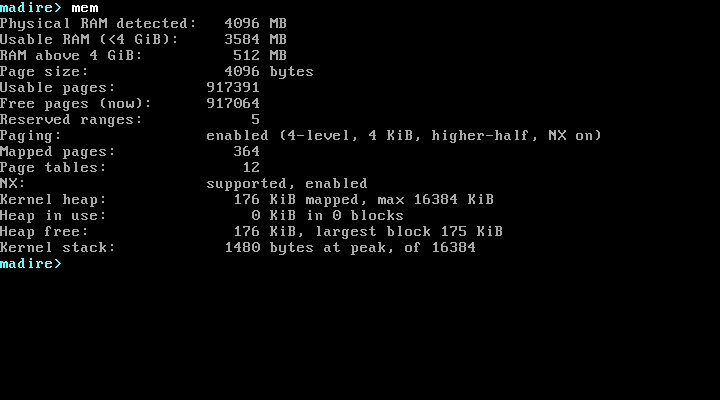

# Madire OS

Madire OS is an operating system written from scratch: its own kernel and architecture, not a Linux distribution.

**Current version:** 0.8 (Milestone 0.8: higher-half kernel)


After the boot checks, press any key to open the console. `mem` shows the higher-half kernel, NX and the kernel stack's high-water mark:



It boots through GRUB into a 64-bit (x86-64) kernel written in C and NASM. So far the kernel:

- checks that the CPU can run it (CPUID, long mode, PAE) and switches from GRUB's 32-bit protected mode into 64-bit long mode; a CPU without long mode gets a clear message and halts;
- runs in the **higher half** (since 0.8): it is loaded at 1 MiB but runs at `0xFFFFFFFF80000000` and above, and once its own page tables are loaded **nothing in the lower half is mapped**, so any stray low address faults;
- reaches the low 1 MiB (VGA) and the bootloader's data through a small **physical view**, which never includes free RAM, page 0 or the kernel image;
- installs its own segment table (GDT, with a task-state segment) and interrupt table (IDT);
- catches CPU exceptions and shows them on a readable crash screen with the 64-bit registers;
- reads and validates the firmware's memory map, and protects the kernel and boot data;
- runs a physical page allocator, which it tests on real RAM at every boot;
- runs with 4-level paging: the page tables are checked before they are loaded, page 0 is left unmapped so NULL pointers fault, kernel code is read-only, and everything except kernel code is **no-execute (NX)**;
- has unmapped **guard pages** below its stacks: a kernel stack overflow becomes a double fault, handled on its own stack (IST1), and is reported instead of resetting the machine;
- measures how deep its stack has ever been used (a **high-water mark**, shown by `mem`: 1480 of 16384 bytes so far);
- has a kernel heap (`kmalloc`, `kcalloc`, `kfree`) that catches double frees, invalid frees and corrupted blocks;
- explains page faults on the crash screen (what kind of access, and the faulting address);
- checks that boot modules loaded by GRUB arrive intact, and shows the result on the screen as well as the serial log;
- handles hardware interrupts safely: only the timer (IRQ0) and keyboard (IRQ1) are enabled, each only after its handler is ready;
- keeps time with the PIT at 100 Hz (uptime is shown on screen);
- reads the PS/2 keyboard: key presses and releases, Shift/Ctrl/Alt/Caps Lock and extended keys, queued for the kernel;
- provides a text console with a scrolling screen, a blinking cursor and an editable input line (insert, Backspace, Delete, Left/Right/Home/End);
- runs a small command shell: `help`, `clear`, `version`, `uptime`, `mem`, `cpu` and `echo`;
- draws the Madire M logo, built from geometry, in VGA text mode.

The project is built one milestone at a time, and each milestone has to boot in VirtualBox before the next one starts. See [docs/roadmap.md](docs/roadmap.md) and [docs/PROGRESS.md](docs/PROGRESS.md).

## Development environment

| Role | Tool |
|---|---|
| Editor / host | Windows 11, Visual Studio Code |
| Build environment | Ubuntu Linux: a GitHub Codespace (current; created from `.devcontainer/`, proven on a fresh Codespace in 0.8), or WSL2 / CI |
| Compiler | the host GCC in 64-bit freestanding mode (`gcc -m64 -ffreestanding -mno-red-zone -mgeneral-regs-only -mcmodel=kernel`) |
| Assembler | NASM |
| Bootloader / ISO | GRUB 2 (`grub-mkrescue`) + xorriso |
| Automated tests | QEMU (`qemu-system-x86_64`, and `qemu-system-i386` for the "no 64-bit CPU" test), headless |
| Target machine | Oracle VirtualBox 7.2, VM `MadireOS-Test` (BIOS firmware, OS type Other 64-bit) |

Linux is used only to run the build tools. It is not part of Madire OS.

## Build

On Windows, compile remotely in the Codespace. This copies your local files up, builds, runs the tests and fetches the ISO back:

```powershell
.\scripts\build.ps1 -InstallDeps   # first time on a new Codespace
.\scripts\build.ps1                # afterwards
```

On Linux (Codespace terminal, WSL, CI):

```sh
bash scripts/install-deps.sh   # once (a Codespace from .devcontainer/ runs it for you)
make            # kernel: build/madire.elf (with symbols) and build/madire.kernel (bootable)
make iso        # bootable ISO: build/madire-os.iso
make unit       # host unit tests, 21 suites (memory, 4-level page tables, heap,
                # keyboard decoder and queue, PIT maths, console text grid, line
                # editor, parser, shell, CPUID decoding, kprintf, NX and page-fault
                # decoding, boot modules, stack high-water mark)
make repro      # two clean builds in fresh directories: madire.elf and
                # madire.kernel must be byte-identical (make test runs it too)
make test       # unit tests + repro + 389 QEMU checks (150 from 0.3 + 30 from 0.4 +
                # 32 from 0.5 + 49 from 0.6 + 96 from 0.7 + 32 new): boot, long mode,
                # CPUs without long mode, logo, memory at 5 RAM sizes, crash tests,
                # timer rate, scripted keyboard input, a scripted console session,
                # paging and heap self-tests, the higher-half kernel and empty lower
                # half, page faults, NX, stack overflow and stack peak, heap misuse
                # and exhaustion, boot-module integrity, screen line widths
make run        # boot in a QEMU window
make clean
```

## Test in VirtualBox

```powershell
.\scripts\run.ps1                       # attach ISO, boot MadireOS-Test in a window
.\scripts\run.ps1 -Headless -Screenshot # boot without a window, save build\boot-screen.png
```

When the boot screen says `System ready. Press any key to open the console.`, press a key. That key only opens the console; it isn't typed. Type `help` for the list of commands.

The GRUB menu has a **Diagnostics** submenu:

- **Crash tests** that deliberately trigger CPU exceptions, including a **kernel stack overflow**.
- **Page-fault tests:** read from NULL, read from an unmapped address, write to read-only kernel code, execute from a no-execute data page (NX), read the kernel's old low address `0x100000` (0.8: it must fault, because the lower half is empty).
- **Memory tests:** allocate every page, double free, free a kernel page.
- **Timer test:** measures the tick rate against the real-time clock.
- **Keyboard test:** shows the code of every key pressed.

See [docs/testing.md](docs/testing.md) for the expected screens and troubleshooting.

## Limitations (v0.8)

- 64-bit x86 (x86-64) only; the 32-bit build was dropped in 0.7. The VM must use **BIOS** firmware (VGA text mode doesn't exist under EFI).
- **Only RAM below 4 GiB is used.** On `MadireOS-Test` (4096 MB), 512 MB sits above 4 GiB and is shown separately as `RAM above 4 GiB`.
- The whole low 1 MiB is reserved on purpose, and ACPI-reclaimable memory isn't reclaimed yet.
- **Paging:** 4 KiB pages; one address space, kernel mode only. There is no direct map of physical memory: the physical view covers only the low 1 MiB and the boot data, and other frames are reached one page at a time through the physical-access window. Every page fault is fatal (nothing is loaded on demand).
- **Stacks:** the high-water mark covers the kernel stack only (not the double-fault stack). It can read a few bytes too low, never too high, and it always counts the top 736 bytes (the boot frames and a safety margin, which are never painted) as used.
- **Kernel heap:** one heap, at most 16 MiB, never shrinks. Not interrupt-safe: `kmalloc`/`kcalloc`/`kfree` refuse to run with interrupts disabled (so never from an IRQ or exception handler). `kfree` checks the whole heap every time, which gets slower as the heap fills.
- **Boot modules:** the screen has one message line, so with several modules only the last result stays visible; the serial log has them all.
- **Keyboard:** PS/2 only (USB keyboards need firmware legacy emulation), US layout only, no LEDs (Caps Lock state is tracked in software only), keypad assumes Num Lock on.
- **Console and shell:**
  - Seven built-in commands only.
  - Commands are lowercase and case-sensitive; at most 8 words per line and 71 characters of input.
  - No command history, tab completion, scrollback, pipes or scripting.
  - Ctrl+key and Alt+key do nothing.
  - Long output lines wrap at column 80, even mid-word (for example `cpu`'s "Features:" line on some CPUs).
- **Interrupts:** only IRQ0 and IRQ1 are enabled, through the legacy 8259 PIC (no APIC). The timer runs at a fixed 100 Hz (10 ms resolution).
- No filesystem, processes or scheduler. Only one CPU is used.
- The logo is blocky: text mode gives 80×50 pixels, each 9×8 screen pixels in size.
- Building needs a Linux environment; there is no native Windows toolchain yet. The kernel build is reproducible (byte-identical), but the ISO isn't (`grub-mkrescue` records timestamps).

## Documentation

- [docs/architecture.md](docs/architecture.md): system design, current and planned
- [docs/development.md](docs/development.md): layout, toolchain, rules for kernel code
- [docs/testing.md](docs/testing.md): automated and VirtualBox test procedures
- [docs/roadmap.md](docs/roadmap.md): milestones
- [docs/PROGRESS.md](docs/PROGRESS.md): history, tests per milestone, decisions, future direction
- [docs/references.md](docs/references.md): external projects used as references only
