# Testing

## 1. Automated tests (`make test`)

These run in the Linux build environment, and `scripts/build.ps1` runs them on every build. `make test` runs the host unit tests first (`make unit`), then [`tests/qemu-tests.sh`](../tests/qemu-tests.sh).

### 1a. Host unit tests (`make unit`, `tests/unit/`)

The pure modules have no hardware access, printing or panics:

- memory: `mmap.c`, `pmm.c`, `reserve.c`
- paging and heap (0.6; 4-level since 0.7): `pte.h`, `vmm_core.c` (on fake physical frames), `heap.c`
- keyboard decoder and queue: `scancode.c`, `keyqueue.c`
- PIT divisor maths: `pit_divisor.h`
- console and shell: `textbuf.c`, `lineedit.c`, `parser.c`, `shell.c`, `cpuinfo.c`
- 0.7: the boot-module check `bootmod.c`; the NX decision in `cpuid.h` and the page-fault decoding in `pagefault.h`; the formatter in `kprintf.c`
- 0.8: the stack high-water mark `stackpeak.c`
- 0.9: the scheduler core `sched_core.c` (threads, run queue, slices, sleep, join, stack slots, the turn-order check), and the shell's `ps`
- 0.9.1: the command history `history.c`, the RTC decoding `rtc_time.c`, the kernel log `logbuf.c`, and the 0.9.1 shell commands
- 0.9.2: the console scrollback `scrollback.c`, and through it the (unchanged) decoder's Shift+PgUp/PgDn
- 0.10: the GDT layout `gdt_desc.h`, the SMEP/SMAP decision, user virtual memory `uvm_core.c`, the freeze in `vmm_core.c`, the user-range checks `usercopy_core.c`, the process table `proc_core.c`, the image table `userimg.c`, the ring-3 entry frame `userentry.h`, opcode evidence `faultop.h`, the system-call rules `syscall_core.c`, the SMEP/SMAP crash-screen cause in `pagefault.h`, and the 0.9 turn-order check's 0.10 window (`test_sched010`)
- 1.0 (13 new suites, 55 → 68 with the 0.11 and 0.12 ones): paths `path_core.c` (`test_path`), the VFS `vfs_core.c` (`test_vfs`), the RAM filesystem `ramfs_core.c` (`test_ramfs`), file pages and the budget (`test_fspage`), the VFS lock `klock_core.c` (`test_klock`), descriptors and open files `fdtable_core.c` (`test_fdtable`), `copy_to_user` (`test_usercopy_out`), the file and folder system calls `fsys_core.c` (`test_syscall_fs`, `test_syscall_dir`), the System V start-up block (`test_startstack`), the shell's file commands (`test_shell_fs10`, `test_shell_fs10b`) and `help` on one screen (`test_shell_help10`); `test_parser` gained the redirection cases (85 checks), and the protected `test_shell.c` changed its help check (see [PROGRESS.md](PROGRESS.md)). Each suite's check count is in the run's `regression.log`

They're compiled with the host GCC as ordinary 64-bit Linux programs (`-m64 -no-pie`, same warnings-as-errors options), linked at 256 MiB so their static test data lies below 4 GiB (the memory modules take 32-bit physical addresses), and tested with synthetic data: cases real hardware can't produce on demand. Known limitation: `test_reserve` also relies on that data lying above its fake 32 MiB machine, so it depends on the test binary's load address.

| Suite | Since | Cases |
|---|---|---|
| `test_mmap` (14) | 0.3, view API in 0.8 | QEMU- and VirtualBox-shaped maps; type classification (1/2/3/4/5/unknown); entry `size > 20` skipped correctly; `size < 20`, truncated entry, 64-bit overflow (including an end of exactly 2^64), empty map, null or wrapping buffer all rejected; zero-length entries skipped; unsorted and overlapping entries; 150 entries (no silent limit). 0.8: the physical address that is validated and the view the bytes are read through are separate: a map validated at a fake physical address (`0x9000`) and read through the test's buffer, with error offsets relative to the buffer; a null or wrapping physical address is rejected even with a valid view, and a missing view is rejected too |
| `test_pmm` (20) | 0.3 | first allocation = lowest free page; distinct allocations; exhaustion (then 0, repeatedly); free and reallocate; free after exhaustion; double free, reserved or kernel page, VGA page, page 0 and unaligned address all rejected; sub-page region and page-boundary crossing; reservations round outward; reserved wins over overlapping usable; phase enforcement; RAM above 4 GiB ignored or clipped (including near 2^64); no memory; a single usable page; multiple regions in order; the full 4 GiB space drained (1,048,320 pages) |
| `test_reserve` (9) | 0.3 | low 1 MiB, kernel, info block, map, command line; modules (table, range, name; empty module); invalid module range; table full; null or wrapping pointers; unterminated string; kernel and stack layout checks; end to end: every page from an exhausted allocator is checked against every reserved byte |
| `test_pit` (5) | 0.4 | 100 Hz → 11932, 1000 → 1193, 50 → 23864; extremes (1193182 Hz → 1, 19 Hz → 62799); out-of-range rejected (18 Hz, 0, above the base clock) with output untouched; rounding in both directions; every rate from 19 to 10,000 Hz within 0.5 % |
| `test_scancode` (17) | 0.4 | letter press and release; left, right and both Shifts; Caps Lock toggles once while held (auto-repeat ignored); Caps+Shift; shifted symbols; Ctrl/Alt flags; `E0` extended keys (Up, right Ctrl, keypad Enter, right Alt, Delete, Left), including the same byte without a prefix; fake shifts around Print Screen ignored; full Pause sequence → one event; unknown codes; stray release; Enter/Backspace/Tab/Space/Esc; F1–F12; prefix then release; keyboard replies are not keys; **all 256 bytes after every prefix state** decode safely; every key has a name |
| `test_keyqueue` (8) | 0.4 | empty pop; FIFO order; fill to 64; overflow drops the newest and counts it (the first 64 kept, in order); space frees after a pop; 1,000 uneven push/pop rounds with wrap-around; counters wrapping past 2^32; re-init |
| `test_textbuf` (9) | 0.5 | writing and position; newline; wrap at column 80 (an 80-character line plus newline gives no blank line); scrolling at the bottom; 1,000 scrolls; clear; Backspace (never past column 0); tab and non-printable characters; cursor clamping and direct cell writes |
| `test_lineedit` (12) | 0.5 | insert; Shift/Caps characters passed through; Backspace at start and in the middle; Delete; Left/Right/Home/End at the edges; insert at cursor; **exactly 71 characters accepted, the 72nd refused** (also mid-line); Enter and keypad Enter; releases ignored; Ctrl/Alt ignored; Up/Down/F-keys/Esc/modifiers ignored (no history); Tab inserted |
| `test_parser` (9) | 0.5 | one word; multiple spaces; leading/trailing spaces; tabs; empty and blank lines; exactly 8 words accepted, a 9th refused; a 71-character word; case preserved; nothing outside the line touched |
| `test_cpuinfo` (8) | 0.5 | CPUID unavailable; vendor strings; family/model/stepping with extended family and model (families 6, 0xF, 5); no leaf 1; brand string trimmed, absent, or exactly 48 characters; hypervisor vendor with NUL padding; feature list, "none" and safe truncation; non-printable bytes sanitised |
| `test_shell` (12) | 0.5 | **exact output** of `help`, `version`, `uptime` (0 s up to 2^32 − 1 s; ticks hidden once they no longer fit in 32 bits; timer unavailable), `mem` (MadireOS-Test figures), `cpu` (full, minimal, unavailable, paging on), `echo` (spaces, tabs, empty, 8 words); unknown commands and case-sensitivity; usage errors for all six fixed-argument commands; too many words; empty lines; `clear`; repeated commands give identical output |
| `test_pte` (7) | 0.6, 4-level in 0.7 | index split at every level (PML4, PDPT, PD, PT); canonical and non-canonical addresses, sign extension; entry encode/decode including the NX bit (offset bits never leak into the frame); alignment helpers; the 64-bit layout constants consistent (slots 508–511); page 0 (and the BIOS data area in it) is the NULL guard. 0.8: the higher-half helpers: the kernel offset is PML4 slot 511 (PDPT slot 510) and canonical up to 1 GiB of physical addresses; `kernel_phys()` gives the physical address (`0xFFFFFFFF80100000` → `0x100000`); the physical view is slot 256, `phys_view(0xB8000)` = `0xFFFF8000000B8000`, all of 0–4 GiB stays inside slot 256, and slot 256 is apart from every other area |
| `test_vmm` (17) | 0.6, 4-level in 0.7 | on fake frames: map, translate, unmap (frame returned); PDPT, PD and PT created on demand per level, counted and cleared; `ensure_table`; out of frames **at each level** → `NO_FRAME` with nothing half-done; unaligned addresses and frames, and only the write and NX flags accepted (never user pages); page 0, the recursive slot and non-canonical addresses refused; no mapping replaced (`EXISTS`); unmap of an unmapped page (`NOT_MAPPED`); **exactly one flush per unmap, for that address**; remap after unmap; leaf flags and intermediate entries; many mappings across table boundaries; upper-half addresses; a 2 MiB page translated, and never replaced or split; the recursive entry never touched; recursive-table addresses; error strings |
| `test_heap` (25) | 0.6 | init and bad parameters; basic alloc/free; **16-byte alignment for every size 1–4,096**; `alloc(0)`; 1,000 small blocks packed and intact; whole arena without growth; growth (page-sized, at least 16 KiB), refused growth, cap reached (never beyond); **repeated exhaustion → NULL, no corruption**; fragmentation then merging; merge with next, previous and both; split threshold (16 left → no split, 32 → split); **double free** (also after a merge); **invalid pointers** (outside, header, inside a block, misaligned); **corruption** (magic, check value, `prev_size`, size, payload overrun) caught by `heap_check`, `free` and `alloc`; `calloc` zeroes and refuses overflow; statistics consistent; **10,000 pseudo-random steps** with tagged payloads and overlap checks |
| `test_shell_mem06` (5) | 0.6 | `mem` without the 0.6 pointers is exactly the 0.5 output and a prefix of the extended one; exact paging and heap lines (0.8: `enabled (4-level, 4 KiB, higher-half, NX on/off)`, `identity-mapped` in 0.7; and the `NX:` row: supported/enabled, supported/not enabled, not supported); paging-disabled and heap-disabled wording; singular `block`, a heap at the 16 MiB cap |
| `test_bootmod` (5) | 0.7 | FNV-1a against published test vectors; an intact test module; every single changed byte detected; truncated modules and modules without the header; status strings |
| `test_kprintf` (7) | 0.7 | the existing formats unchanged; `%llx`/`%llu`/`%lld` and `%lx`/`%lu` up to the full 64-bit range; `%p` at 16 digits; every power of ten; truncation to the buffer size. 0.9: every output call leaves the preemption-disable count as it found it, also when nested inside a guarded section (`ksnprintf` doesn't touch it) |
| `test_nx` (3) | 0.7 | NX capability decision from CPUID (no extended leaf, bit clear, bit set); the NX page-table flag (bit 63, or 0 without NX); page-fault error-code decoding, including the NX-violation case |
| `test_shell_cpu07` (8) | 0.7 | `cpu` mode line `64-bit long mode` only when EFER.LMA is set (LME alone is not enough; no EFER keeps the 32-bit wording); `version` says `64-bit x86-64` exactly when `cpu` says long mode; `version x` still gives its usage |
| `test_stackpeak` (5) | 0.8 | a freshly painted 16 KiB stack reports 0 and every byte holds the pattern; used 100 bytes deep, then 5000 (the peak grows), then 40 (the peak stays at 5000); a fully used stack, also when only the bottom byte changed; written bytes equal to the pattern at the deepest point make it read 2 bytes low, never high; length 0 and 1, an unaligned start and length, bytes outside the range ignored |
| `test_shell_mem08` (4) | 0.8 | without the stack fields `mem` has no stack row (the 0.5/0.6 output unchanged); the exact row `Kernel stack:            5120 bytes at peak, of 16384`, and it is the last line; peaks of 0, 16384 and 123456 (wider than the column) formatted exactly; every `mem` line at most 79 characters |
| `test_sched` (17) | 0.9 | initial state (thread 0 running, nothing else); allocation up to the 64-thread limit and the lowest free tid; round-robin order; yield alone and with others; the slice: `need_resched` only after 5 ticks **and** only when another thread is ready; preemption disabled blocks every switch and nests; yield, sleep and join refused with preemption off, changing nothing; sleepers wake at exactly their tick, in tick order, at the tail of the queue, also across a tick-counter wrap; thread 0 never blocks or exits (it gets "poll" instead); join on a zombie and on a live thread, with the refusals (self, detached, second joiner); exit codes including −1, `INT32_MIN` and `INT32_MAX`; detached threads reaped by thread 0; the full table filled and emptied repeatedly; **the turn-order check** (strict order, also when preemptions didn't change it; relaxed only when every break comes right after a preemption, including a shifted rotation of three threads and a first turn after a preemption; a break without a preemption, a repeated or skipped turn, too few turns and an unknown thread all rejected); every state and result string |
| `test_kstack` (4) | 0.9 | stack slots: lowest free first, all 64, then exhaustion, freeing out of range or twice refused; the sizes (16 KiB stack, 16 KiB guard, 32 KiB slot, 2 MiB area); the layout: every slot inside PML4 slot 507, canonical and page-aligned, the guard directly below its stack, no gap and no overlap, one page table for the whole area, apart from slots 508–511; looking up the slot from an address in a guard or a stack (and nothing for addresses outside) |
| `test_shell_ps09` (5) | 0.9 | without the thread fields every command and `help` is exactly as before and `ps` is unknown; with them `help` lists `ps` last; the exact `ps` output (header, rows, `1 thread` / `N threads`); edge cases (tid 63, a 10-digit tick count, a 16384/16384 peak, a 15-character name, a tick count beyond 32 bits shown as `large`, an empty table, `ps x` → `Usage: ps`); every line at most 79 characters |

| `test_history` (8) | 0.9.1 | empty history (nothing to recall); lines numbered from 1 and kept as typed, repeats included; empty and blank lines refused; a line longer than 71 characters cut, exactly 71 kept; after 40 lines only the last 16 are kept and the numbers keep counting (the 17th drops exactly the first); Up from the newest to the oldest and staying there, Down back, an empty line past the newest, then no more Down; adding a line or a blank submit ends browsing; browsing after wrap-around stops at the oldest kept line; the limit equals the line editor's |
| `test_rtc` (7) | 0.9.1 | BCD and binary values in 24-hour mode (2000-01-01 00:00:00 to 2099-12-31 23:59:59); 12-hour mode in BCD and binary (12 AM = 00, 12 PM = 12, PM adds 12; hours 0 and 13 refused; in 24-hour mode bit 7 isn't a PM flag); every field's range, including 31 April and year 100; BCD nibbles above 9 (all 256 byte values as seconds); leap years (2000 yes, 2100 no) and every day of every month of a leap and a common year; the exact format, with the output unchanged on failure |
| `test_logbuf` (10) | 0.9.1 | empty and storage-less buffers; the last *n* lines before wrap-around (and fewer when there are fewer); an unfinished last line counts; empty lines count; after wrap-around the cut first line is left out (also when the cut falls mid-line); a buffer holding one endless line shows nothing; a short copy keeps the newest bytes; copy order after wrapping, and "exactly full" isn't wrapped; fitting to 79 columns (exactly 79 kept, 80 or more cut to 76 plus `...`, tabs and control characters replaced, tiny widths never overrun); the real 32 KiB size with 1000 lines |
| `test_shell_091` (11) | 0.9.1 | **without `extras` nothing changes** (help, `help x` → `Usage: help`, `mem --help` → `Usage: mem`, `echo --help` prints `--help`, the six new names unknown); the exact `help` list (with and without `ps`); `help <command>` for several commands and an unknown name, shortened beyond 40 characters; `help a b` → `Usage: help [command]`; `<command> --help` equal to `help <command>` for all 13 commands, never running the command (`reboot --help`, `clear --help`); `uname`, `uname -a` (`x86_64`, `x86` without long mode), `uname -x`; `hostname`; `date` and the RTC failure message; `dmesg` (default 20, `dmesg 2`, `9999`, every bad argument, empty and wrapped logs); a 200-character log line cut to 79; `history` (empty, numbered, after wrap-around, usage); the reboot question and the confirmation rule (`yes` only, spaces allowed); every line at most 79 columns |
| `test_scrollback` (11) | 0.9.2 | an empty scrollback (Shift+PgUp says so); order and colours kept; wrap at 1000 (2500 pushed, the last 1000 kept in order, Y = 1025); paging limits (24 lines a page, the first page = the 24 lines above the screen, X = Y − 48, stops at line 1, Shift+PgDn back to the live screen); fewer lines than a page; the view mapping, mixing kept lines and live-screen rows; a full ring dropping its oldest line while scrolled back keeps the same lines in view; the exact indicator text and every position within 79 columns; row text and the used-rows rule for `clear`; which keys page (Shift+PgUp/PgDn, not with Ctrl or Alt), which do nothing (releases, modifiers alone) and which return (every other press, plain PgUp included); **through the unchanged decoder:** `2A E0 49` and a real keyboard's `2A E0 AA E0 49` give Shift+PgUp, `2A E0 51` Shift+PgDn, `E0 49` alone a plain PgUp, and the release does nothing |

| `test_gdt010` (5) | 0.10 | the selectors (`0x33`, `0x3B`, limit `0x3F`); the kernel and user code/data descriptors bit by bit (present, DPL, code/data, readable/writable, L = 1 and D = 0 for code); the all-zero entry at `0x28` is refused as a data segment (so `gpf` still raises #GP(0x28)); the STAR value and the selectors `SYSCALL` and a 64-bit `SYSRET` would load |
| `test_cpuprot010` (2) | 0.10 | the CR4 and CPUID bits for SMEP and SMAP; leaf 7 used only when the CPU lists it, each bit decided on its own |
| `test_vmm010` (5) | 0.10 | the freeze: off by default; once frozen, a new kernel-half PML4 entry is refused (`VMM_ERR_FROZEN`, nothing created); mappings below existing kernel-half entries still grow; the lower half is not affected; the result string |
| `test_uvm` (13) | 0.10 | on fake frames: map, translate, unmap; PTE_USER at every level; user range only (below 4 MiB, the top page and the upper half refused); flags and **W^X** (writable + executable refused with NX; only write/NX accepted; NX refused without NX); bad frames; an existing mapping never replaced; out of frames at each level, nothing half-done; teardown gives back every page and table (also empty, reused, and across table boundaries); a large entry left alone; counting user entries in the upper half; result strings |
| `test_usercopy` (6) | 0.10 | range arithmetic and overflow; length 0 touches nothing; mapped user pages accepted; checked page by page (a hole or a kernel page anywhere refuses the whole range); NULL and the top of the user range |
| `test_proc` (7) | 0.10 | allocation and PIDs from 1; names cut to 15 characters; exit, reap, and PIDs never reused; fault and kill results; a full table (63); hundreds of processes through the table; PIDs used up |
| `test_userimg` (6) | 0.10 | a good image; names (`[a-z0-9_]`, 1–15 characters); sizes (code and data at most 64 KiB, data at most data + bss); the entry point inside the code; table checks (duplicates) and lookup by name; pages needed |
| `test_userentry` (3) | 0.10 | the `IRETQ` frame (SS `0x33`, RSP, RFLAGS with IF and no IOPL, CS `0x3B`, RIP); refused frames (kernel selectors, kernel or non-canonical addresses, IOPL); the user ranges |
| `test_faultop` (4) | 0.10 | the bytes at RIP match the expected opcode; a wrong opcode is refused; short and unreadable reads (never a match); the printed form |
| `test_syscall` (10) | 0.10 | the six implemented numbers; everything else unknown, compared as the full 64-bit RAX (x32 bit, 2^32 and above, −1); the reserved Madire range; `write`'s argument rules (fd, the 4096-byte cap, short counts); `nanosleep`'s rounding to ticks and its errors; `status & 0xFF`; the `[pid N] ` lines (split at `\n` and after 100 characters, every byte outside `0x20`–`0x7E` shown as `?`); the RFLAGS cleaning |
| `test_pfcause010` (3) | 0.10 | the crash screen's `Cause:` decision: SMEP for a kernel-mode fetch from a present lower-half page with CR4.SMEP (also with AC set); SMAP for a kernel read or write with CR4.SMAP and AC clear; nothing for a kernel-half address, a user-mode fault, a not-present page, a reserved bit, AC set, or the feature off; the boundary at `0x0000800000000000`; every message fits 79 columns; the NX decoding unchanged |
| `test_sched010` (7) | 0.10 | the 0.9 turn-order check with its 0.10 window (one cycle of k turns): a thread preempted after logging its turn and before yielding is accepted; nothing looser than that (two turns of the same thread still fail); `pingpongbad`'s skip and repeat still fail; `pingpongpreempt` still passes; the strict case unchanged; a three-thread cycle. This suite fails on the 0.9 rule |

| `test_elf` (158 checks) | 0.11 | every ELF64 rule: header fields, type, machine, program-header counts and the allowlist, 1–4 `PT_LOAD` (a fifth refused), ascending, range, alignment and congruence, shared pages, W+X, entry inside executable file bytes, size caps; the segment plan |
| `test_progmod` (67) | 0.11 | module names (second word, file name without `.elf`, `[a-z0-9_]{1,15}`, duplicates refused), the table of at most 8 kept programs, the summary line |
| `test_loadplan` (47) | 0.11 | load plans from a built-in image and from a checked ELF file: pages, protections, bytes to copy, zero fill, the entry point |
| `test_longest011` (54) | 0.11 | the longest-turn record with its owner (thread, process ID, kernel or ring-3 thread), ties, name cutting |
| `test_preemptb` (53) | 0.11 | policy (b): the switch-on-enable decision (count, pending, interrupts on, ready, no panic) and the inline `preempt_enable` calling `preempt_resched` only at count 0 with a switch pending |
| `test_order011` (10) | 0.11 | the ping-pong sequence logged under load (`A A B … B B`, one preemption before the first turn) and its `BAD_ORDER` verdict; a cycle queued first stays strict; `pingpongbad` stays strict |
| `test_wake011` (47) | 0.11 | `sched_wake`: a sleeper woken at once to the tail of the run queue with `need_resched`; only sleepers (not ready, joining or free threads); other sleepers keep sleeping |
| `test_shell_run011` (114) | 0.11 | `run` (foreground, `-b`, arguments 0–4294967295, refusals), `ps` with processes, the end lines, `help`; every line at most 79 columns; nothing changes without the `procs` field |
| `test_shell_kill011` (44) | 0.11 | `kill` asks first; PID 0, unknown, ended processes and bad arguments refused; `help kill` |
| `test_outq` (18) | 0.11 | the 8 KiB output queue: writes, reads, wrap-around, full and empty |

`test_pte` is unchanged in 0.9: the slot-507 layout cases that the plan put there are in `test_kstack`, next to the stack-slot code they check. In 0.10 every existing suite is unchanged and still passes; the 0.10 rules got their own 12 suites (41 in all). In 0.11 the 10 new suites bring the total to 51; `test_kprintf` got two stubs for policy (b) (no check changed), and `test_shell_run011`'s help tail was extended for `kill` (a 0.11 check).

### 1b. QEMU tests (`tests/qemu-tests.sh`)

These boot the kernel headless in QEMU and check the serial output. The kernel copies its screen text to COM1 and logs details there. Each run writes `build/serial-*.log`.

Checks added in 0.4 to 0.11 are tagged `[0.4]` to `[0.11]`, so the summary line separates them from the 0.3 regression checks:
`ALL TESTS PASSED (1071 checks: 150 0.3 regression + 30 from 0.4 + 32 from 0.5 + 49 from 0.6 + 96 from 0.7 + 32 from 0.8 + 139 from 0.9 + 32 from 0.9.1 + 25 from 0.9.2 + 253 from 0.10 + 233 new in 0.11)`.

`make test` also runs `make repro` before the QEMU tests; its result becomes 3 of the `[0.8]` checks. The whole suite takes about 50 minutes in 0.11 (30 in 0.10, 15 in 0.9); run it with `scripts/remote-regress.ps1` (see [development.md](development.md)).

**Regression durations in 0.11** (full detached runs): about 46–53 minutes each from stage 3b on (3b.1 49, 3b.2 47, 4a 50, 4a.1 47, 4b 47, 5 about 53, 6 49 minutes); the stage 6 Codespace session took 55 minutes in all.

**The `[0.11]` groups** (233 checks; 14 of them are owner checks inside the `[0.9]` and `[0.10]` diagnostics):

| Group (checks) | Boots | Proves |
|---|---|---|
| **The longest turn's owner** (2 + 14) | the self-test and every scheduler and user-mode diagnostic | each "longest turn taken by thread N 'name' (kernel thread / user process N / ring-3 thread)" line gives exactly the ticks the existing longest-turn line reported |
| **ELF checks on the host** (33) | none (`make elfcheck`) | the built programs pass the kernel's own ELF checks on the host; each of the 29 malformed fixtures is refused with its expected reason |
| **Program modules found at boot** (56) | `-initrd` with programs and fixtures | each module's line (accepted with its segments, pages and entry, or refused with the reason); names from the command line or the file; bad and duplicate names refused; at most 8 kept; 13 modules fill the reservation table, a 14th stops the boot; nothing on the screen |
| **The default boot entry loads 7 programs** (12) | the real ISO and the keylog ISO | the boot menu (`limine.conf` since 0.13, `grub.cfg` before) names exactly the 7 programs the ISO holds; each accepted with its size; 20 reserved ranges; no module line on the screen (read from the VGA buffer) |
| **ELF programs loaded into processes** (56) | `test=elfrun` with modules, also on `qemu64,+smep,+smap` | every module program runs through the one loading path with its exact result; the built-in images still run; two `isolate` copies isolated; no frame inside a module ever mapped; every malformed fixture refused again at load, with no address space built |
| **Policy (b) turn bounds** (7) | the logs of `framethreads`, `heapthreads`, `userpreempt`, `preemptoff` | each longest turn at most 6 ticks with its owner named; `preemptoff`: the other thread runs 0 or 1 tick after the release with the switch recorded there, the switch inside the releasing `preempt_enable`, and the holder's deliberate 20-tick hold exempt by name |
| **`test=preemptlong`** (10) | `test=preemptlong` | 4 kernel threads spend over 95% of their time in guarded sections for 300 ticks; each takes at least 5 turns, every turn at most 6 ticks |
| **Console: `run`, `run -b`, `ps`** (11) | a QMP console session with 4 program modules | `run hello` (its line, then `exited, status 0`), `run exitcode` (42), `run nullptr` (#PF at the address the kernel logged), `run -b spin` then `ps` with its PID, state and name; an unknown name and a bad argument refused; every line at most 79 columns; no `key:` lines |
| **Console: `kill` and Ctrl+C** (18) | a QMP console session with `spin`, `sleep`, `lines` | `kill` asks; "no" cancels (still running), "yes" ends it with its end line; `kill 0` and an unknown PID refused; Ctrl+C on `spin`, on a 10 s `sleep` (woken early) and on `lines` (stopped early), each prompt back at most 2 ticks after Ctrl+C; no process left; free pages equal before and after |
| **Screen output, scrollback and Q8** (14) | QMP sessions read with `qmp_screen.py` | `hello`'s text on the VGA screen; `lines` wrapped at exactly 79 columns with control characters as `?`; one unchanged `[pid N]` serial record per line; background output never on the screen; Shift+PgUp shows earlier program output; the flood program fills the queue, Ctrl+C ends the waiting writer, the prompt accepts another command and no process is left |

**Changed checks in 0.11** (each reported and accepted, none removed or weakened): the two `ps` help checks of `[0.9]` and `[0.9.1]` expect "Show threads and processes"; "all 19 built programs" became 20; and five `[0.11]` checks were corrected during the milestone (the owner-name pattern, the `userpreempt` owner window, the `elfrun` fixture-only line, the `preemptoff` release check, "hello ran exactly once"). The full list is in [PROGRESS.md](PROGRESS.md).

**The stall watch (0.11, a harness diagnostic that decides no check).** `qemu-tests.sh` puts `tests/qemu-watch.sh` first in `PATH` as `qemu-system-x86_64`, so every QEMU boot runs through it. It starts QEMU in its own session (`setsid`) with one more HMP monitor and watches the serial log: after 6 seconds without output (an idle kernel logs `uptime` every 5 s), `tests/qemu_capture.py` takes 3 samples 1 s apart of the registers (RIP resolved with `nm`, RSP, RFLAGS and IF, CR3, CS, HLT), `info pic`, `info irq` (how far IRQ 0 advanced), `info lapic`, and kernel variables read from memory at their symbols (the tick count, `preempt_count_value`, `preempt_resched_pending`, the current thread, `need_resched`). Deliberate halts are skipped unless a check logged MISMATCH first. The captures are listed at the end of the run under "Stall watch"; a capture in a boot that passed is a slow test, not a stall. This is how the 0.11 stall was diagnosed (see [PROGRESS.md](PROGRESS.md)).

**Patterns reach awk unchanged (0.12).** Up to 0.11 the helpers `expect_next`, `expect_in_order` and `max_width` in `tests/qemu-tests.sh` passed their patterns with `awk -v`, which processes escape sequences. The Codespace's mawk keeps an unknown escape like `\(`; gawk (Kali, GitHub Actions) drops the backslash, so `\(64-bit` became `(64-bit`, an invalid or different pattern, and 28 checks failed there on a correct kernel. Since 0.12 every helper reads its patterns from the environment (`ENVIRON`), which no awk changes; no pattern text changed. The same change was made to the other `awk -v` uses (`sum_of` in the harness, `sym` in `scripts/user-images.sh`; exact comparisons, so unaffected, changed for consistency). Every helper call is traced and replayed under both awks to prove the verdicts are unchanged (see [development.md](development.md)). Also since 0.12, the default boot entry's title is generated from `kernel/kernel.h` (`@MADIRE_OS_VERSION@`; since 0.13 in `iso/boot/limine/limine.conf`, replaced into `build/limine.conf`; before, in `grub.cfg`), which the ISO and the checks use, so a version bump can't miss it again.

**Parts, sharded runs and the agreed counts (0.12, stage 0c).** The checks of `tests/qemu-tests.sh` are in parts: `tests/qemu-part-static.sh` (the checks that boot nothing: Multiboot header, `[0.8]` reproducible build, `[0.10]` version read once), `-1.sh` (`[0.3]`–`[0.9]`, and the `[0.9.2]` key-logging checks, which read part 1's keyboard logs), `-2.sh` (`[0.9.1]`, `[0.9.2]` scrollback, `[0.10]` up to `userkmem`), `-3.sh` (`[0.10]` `usersys` to `userchurn`, and `[0.11]`), `-4.sh` (`[0.10]` boot menu Diagnostics, named "GRUB Diagnostics" before 0.13) and `-final.sh`; `tests/qemu-lib.sh` holds the helpers more than one part uses and the normal-boot fixture (the normal boot and the keylog ISO's boot, whose logs parts 1–3 read: a full run boots them once, a shard run of part 2 or 3 boots them itself; a boot is not a check), and `fixture_log`, with which part 3 boots, in a shard run only, the four logs of part 1 it reads (`serial-mem-32M.log`, `serial-preemptoff.log`, `serial-heapthreads.log`, `serial-framethreads.log`; the same commands as in part 1). A sharded run's combining job checks that every serial log a part names was made in its own job. Every line was moved unchanged (proven by a one-off script when the split was made); a full run (`make test`) sources the parts in order and runs every check once, as before. GitHub Actions runs the parts as parallel jobs (see [development.md](development.md)). `tests/expected-checks.txt` holds the agreed number of checks per tag and of unit suites: a full run ends with `EXPECTED_CHECKS=MATCH (<n> checks)` and fails on any difference, and so does a sharded run's combining job; a stage that adds or changes checks updates the file in the same diff.

**The every-boot self-test check moved to the end (0.12, stage 0c).** `[0.10] boot self-test: PASS in every one of the <n> boots that reached System ready` looks at every serial log in `build/`. Until 0.12 it ran in the middle of the `[0.10]` checks, so it covered the boots made before it (the `<n>` was the count at that point). It is now the part `final`: after every other part in a full run, and in a sharded run in the combining job over every job's logs. It checks the same fact (no boot that reached System ready lacks the self-test's PASS) over every boot of the run instead of the earlier ones only, so `<n>` is larger; the check's text is unchanged.

**Bounded diagnostic waits (0.12, stage 3).** Every wait for ticks in the thread and process diagnostics (`kernel/proc/schedtest.c`, `kernel/proc/usertest.c`) polls through `kernel/proc/diagwait.c`, so it ends even if the timer stops: at its condition, at its limit in ticks, or at a *stall*, when the tick count has not moved for 100 × max(the most polls the wait has seen within one tick, the boot calibration) polls. A stall, or a limit reached where the condition had to come first, logs `Diagnostic wait: <file>:<line>: … tick count … polls …: MISMATCH` and fails the test. Thread 0's sleeps in these files are bounded the same way (it yields at every poll, as `thread_sleep` does when others can run, and busy-polls instead of halting when alone). The `[0.12]` checks: `test=waitstall` stops the timer on purpose (interrupts off) and both kinds of wait must end as stalls at exactly 100 × that boot's calibration; every boot that ran the scheduler self-test logged a calibration; no other boot logged a wait line. The rule is unit-tested in `tests/unit/test_diagwait.c`.

**The heartbeat stays out of `dmesg` (0.12, stage 4, option B).** The idle loop's `uptime: N s` line every 5 s goes to the serial port only (`kserialf` in `kernel/kprintf.c`), no longer into the kernel log, so after a few idle minutes `dmesg` still shows the last real messages instead of heartbeats (found in the stage 4 VirtualBox check). Two `[0.12]` checks in a boot of their own (`serial-dmesgidle.log`, part 1): after 15 s of idle console, `dmesg 5` holds no `uptime:` line and ends with the command before the pause and `dmesg 5` itself; and the serial log still has at least 2 heartbeats in that pause. **Changed check:** `[0.9.1] dmesg 5` compares the command's 5 lines with the serial lines just before it; it now skips `uptime: N s` serial lines, which are no longer kernel-log lines. It proves the same fact (the 5 lines are the kernel log's last 5, the newest being the command); without the skip, a heartbeat in those lines would fail it on a correct kernel.

**VirtualBox `shell` group (0.12, stage 4).** `scripts/vbox-acceptance.ps1 -Only shell` types every 0.12 command and its error paths (as in the QEMU `[0.12]` sessions) through `keyboardputscancode`, in bursts of 8 characters 80 ms apart (set-1 scancodes, US layout, Shift for capitals and symbols): `help` and its sections, "Did you mean", `prompt`, `alias`/`unalias` up to the full table, `set`/`unset`/`export`/`env` up to 32 variables, `sleep` and `presskey` with Ctrl+C, `time`, `run`, `ps`, `kill` (no and yes), `kill -y` and its refusals, Ctrl+C on `run spin`, a 7-line typing test (451 characters; Shift must not stick) and the heartbeat check (15 s idle, then `dmesg 5`). Each command's logged line and its expected output lines are checked **in order** in the serial log, one row each; process IDs are read from the log as the run goes. The boot calibration is recorded, not range-checked. 15 screenshots (`vbox-shell-*.png`). The owner's manual check is an optional 5-minute spot check (boot, the screen, fast typing, Ctrl+C).

- **Calibration.** At every boot, just before the scheduler self-test (thread 0 alone, preemption held off, timer interrupts still counted), the tightest loop of the same poll runs for a partial tick and 5 whole ticks; the most polls within one tick is this machine's value, logged as `Diagnostic waits: calibrated: at most N polls per tick (5 whole ticks measured, T ticks spent)`. It costs at most about 6 ticks of boot time. There is no fixed floor: a fast machine polls millions of times per tick, and its calibration says so. Without a working timer the waits are not calibrated and use 50,000,000 polls (the timer self-test's limit).
- **Guest ticks, not host time.** Polls are counted against the guest's own tick count, never against the host's clock, so a stall needs the guest to keep running while its ticks stand still. Host starvation does not make the guest poll faster: a tick in which the emulator was descheduled holds fewer polls, and a tick delivered late (the guest ran on while the timer interrupt waited) holds more. The calibration keeps the most of its 5 whole ticks, so it is lowered only if all 5 were starved, and the factor of 100 covers ordinary variation.
- **Not bounded (documented exceptions).** Blocking waits end only when another thread or the timer ends them: `thread_join`, `process_wait`, `thread_sleep` in threads other than 0, and a ring-3 program that is never preempted. `test=timer` (in the protected `devtest.c`, decision Q8) stays bounded in ticks only. The stall watch records such a boot.

**Key evidence (0.11, decides no check).** `boot_keys` keeps the key injector's output next to the serial log (`<log>.keys.txt`), and when a key-typing boot reaches its time limit the stall watch records QEMU's IRQ 1 count and the kernel's `counts[1]` (`<log>.irq1.txt`). A boot with missing keys can then be classified: injector failed, IRQ 1 never raised, or raised but not logged (a kernel issue).

**The regression tool's guard proof.** Before every run, `scripts/remote-regress.ps1` proves its own hash guard on the target (the Codespace, or the local Kali VM with `-Target Kali`): a deliberately altered copy of the snapshot must be rejected before anything runs (`ALTERED_GUARD_EXIT=43`), and the correct copy must pass (`CORRECT_SNAPSHOT_GUARD_PASS`); at the end it checks that the remote snapshot's hashes still match (`FINAL_SNAPSHOT_HASH_MATCH=PASS`). See [development.md](development.md).

**The `[1.0]` checks** (260; the agreed counts are in `tests/expected-checks.txt`): part static 2 (Madire's `LICENSE`, `NOTICE` and `THIRD_PARTY_NOTICES` at the ISO root, byte-identical to the repository's; every `.md` file under `docs/` valid UTF-8), part 1 14 (the filesystem at boot and its self-test), part 2 105 (`help` on one screen, `test=fslimits`, `fsfill` at `-m 32M` and `-m 64M`, `klock`, the descriptor calls (`fdsys`) and `test=fdkill`, the file calls (`fileio`, `fileerr`, `bigio` with the 1 MiB and 2 MiB single calls, `filecontend`)), part 4 138 (the self-check proof boots, the padded test kernel, the folder calls (`dirops`), `test=fsunlink`, the System V start-up, the console sessions of the file commands and redirection with the Live label), and part final 1. The **stress part** (`parts=stress`, 125 `[stress]` checks, about 32 minutes) runs the kill race (`test=killrace`, 3 boots with seeds), 6 console boots of `kill -y` and Ctrl+C, the key-pace sessions (30:30, 50:50 and 50:20 ms gap:hold), `test=klock` × 30 and `test=filecontend` × 10 (the VFS lock under ring-3 load); it decides nothing on its own, and any failure is a STOP.

**Kernel margin (1.0, D1).** The kernel image may now grow to 4 MiB: `KERNEL_MARGIN_BYTES` = `0x400000` − the physical end of the image, required ≥ 32,768 (computed in `tests/combine-shards.sh` for sharded runs, and printed by the workflow from 1.0's commit on `main`). The old `TWO_MIB_MARGIN_BYTES` is still printed, report only; the real kernel crossed 2 MiB in stage 5 (it ends at `0x231000` at 1.0: 1,896,448 bytes below 4 MiB, −200,704 against 2 MiB). A padded test kernel (`make KERNEL_PAD=…`, never shipped, not in `make repro`; its image ends at `0x431000`, past 4 MiB) proves that a kernel past the next page-table boundary boots, with one more page table (15 instead of 14).

**Size report (1.2, stage 2; report only).** Part static prints `size` (Berkeley format: text, data, bss) of `build/madire.elf` and of every program ELF (`build/user/*.elf` and the test-only `build/test-user/*.elf`), each line starting with `SIZE` and (since stage 3) ending with its label: `shipped` for `madire.elf` and every `build/user/*.elf` (the kernel links each as a built-in program; seven are also modules on the ISO), `test-only` for `build/test-user/*.elf` (never in the kernel or the ISO); and one line `KERNEL_MARGIN_TRIGGER KERNEL_MARGIN_BYTES <n>, trigger 524288 (decision 13): …` with the margin below 4 MiB computed as the workflow computes it, from `__kernel_end`. `tests/combine-shards.sh` repeats these lines from the static job's log and gives the trigger line again from the margin it computes itself. They decide no check and add none to the counts: a margin below 524,288 bytes does not fail the run; it stops the milestone for its own size-gate stage (`docs/plans/1.2.md`, decision 13). The 4 MiB gate (at least 32,768 bytes) is unchanged.

**Section timings (1.3, stage 1; report only).** Every part opens its sections with `section "<title>"` (a helper in `tests/qemu-tests.sh`), which prints the same `== <title>` line the parts' `echo` lines printed before. When the next section opens, or the part ends, it prints `SECTION_SECONDS <part> <n> <seconds>`: the part's n-th `== ` line (`0` is the time from the part's start to its first section), in seconds with one decimal; at the part's end `SECTION_SECONDS <part> total <seconds>` (from `SHARD_PART_BEGIN` to `SHARD_PART_END`). The line carries no title, so a grep of the log for a word that a title contains (the workflow's unanchored `FAILED`, for example) never finds it. `tests/section-times.sh <log>...` pairs the numbers with the titles and prints, per part, a `SECTION_TIMES part=<p> sections=<n> timed=<n> total=<s> s` line and a table (part, section, seconds; the longest first); `tests/combine-shards.sh` prints every job's make-step seconds and these tables under `== Section timings (report only)` in a sharded run's summary (for a full run, run the script on its `regression.log` by hand). They decide no check, add none to the counts and are not in any job's `checks.txt`; `tests/expected-checks.txt` is unchanged by them. They are what any later move of whole sections between parts is planned from (`docs/plans/1.3.md`, section G).

**The switch: the desktop on the default path (1.3, stage 8).** A boot with no `test=` option whose splash is still showing at the idle loop's first pass after `System ready.` shows the desktop (`kernel/display/desktop.h`); Esc pressed during the splash, `verbose`, a FAILED status line and every other `test=` boot keep 1.2's full-screen console, with no `Desktop:` line. So the real ISO, the keylog ISO and the framebuffer serial twin now show the desktop, and their checks read it: part 1's `[1.3] The real ISO's default path` section (the default path's `Desktop: shown … (the default path, 1.3 stage 8)` line, slot 506 with the background cache and the window surfaces against `tests/pagetables.py`, the key that opens the Console window; the keylog ISO's, in order), a `[1.3]` check each in the twins, `verbose` and `test=splashfail` sections, and part final's check that no boot off the framebuffer logs a `Desktop:` line. Part 3's real-ISO session compares the **Console window** after `clear` with `tests/screen_ref.py check-desktop-console` (the desktop, the focused window, the cleared grid; the clock read from the kernel's own string, `desktop.c`'s `clock` at its `nm` address, while the guest is stopped, since the real ISO logs no clock; one retry only if that string changed), then types `mem` (the stack's peak after the desktop: `[1.3]`). The two 1.2 `mouselog` sessions boot with `verbose` added (their full-screen console as before); the Esc case presses Esc **during** the splash (`tests/qmp_splash.py`'s `stopkey`: Esc sent at the `Mouse: no pointer …` line while the guest runs, since QEMU drops input sent while it is stopped; `ready_before=no` required). **The handover** (parts 2 and 3, `desktop_handover_case` in `tests/qemu-lib.sh`, at 1024×768×32 and 800×600×24): a test ISO with `still desktoplog mouselog` and no `test=`; with `desktoplog` the kernel holds the splash's ready state 3 s after its own frame marker before the cut; `tests/qmp_desktop.py` takes that screen (`splash`, against make-wallpaper.py's ready state; 1.2's ready-state check now lives here) and the desktop's first frame (`screen`), and `handover` compares them with `tests/desktop_ref.py`'s `handover_check` (the M's box identical, every other difference inside the wordmark, the ready line or the taskbar); then the lines in order (no `Splash: closed`), the pointer, and a key that opens the Console window. Part static checks the same rule on the references in five modes, and that the VirtualBox `desktop` group's plan and references are made (`tests/screen_ref.py desktop-plan` and `desktop-render`). On the default path the frame markers and clock lines come only with `desktoplog`, so a normal boot's serial log and dmesg gain only its `Desktop:` lines (after `Kernel stack:`, outside every key session's window). **The Kali hand-off (stage 8, an owner-run step):** `.\scripts\remote-regress.ps1 -Target Kali -Trial` (plain PowerShell, VS Code closed) ran `make all`, `make unit`, part static and one real-ISO default boot to the desktop's first frame (compared by `check-desktop`) on the committed, unpushed tree; it refuses below 4,500 MB free in three samples, while `MadireOS-Test` or `MadireOS-View` runs, or unless Kali has 3,072 MB; everything goes into `build\regression\<run id>\` (`trial-transcript.txt`, `trial-summary.txt` with its exit status, the evidence). Never evidence: a fresh session judges it before anything is pushed. **Since stage 9** the trial runs only `make all`, `make unit` and `make repro` (no QEMU boot: Kali's QEMU stalled the poll in part static's boots; the boot's script, `tests/trial-default-boot.sh`, was removed in 1.3 stage 10a), the poll's `ssh` reads no stdin (`-n`) and ends a connection that stops answering (`ServerAliveInterval=15`, `ServerAliveCountMax=4`), and a trial that fails after `make` started still copies `regression.log` back before Kali is shut down.

**Probes (1.2, stage 3; report only; removed in stage 5).** The probe build and its tools are no longer in the tree: stage 4 removed the probe section from part 1, and stage 5 removed `boot/boot.asm`'s `-DPROBE` code, `make probe` and `make probe-iso`, `tests/probe-iso.sh`, `tests/probe_fb.py` and `scripts/vbox-probe.ps1`. **To rerun the probes, check out `287b355`** (the probe commit tested by sharded run 39889490495; its part 1 still runs the probe section, `make probe-iso` makes the VirtualBox probe ISO) in a separate working tree, never on `wip/` or `main`. As they were: `make probe` built a test-only kernel in `build/probe/` (`boot/boot.asm` assembled with `-DPROBE`; refused for the default `build/`, so the real kernel, the ISO and `make repro` never saw it). Its Multiboot header asked for a 1280×800×32 linear framebuffer (flag bit 2); its 32-bit stub logged `probe: ` lines on serial: the request, the Multiboot information's flags, VBE and framebuffer fields; with `probedelay` on the command line it waited 4–5 s before its first serial byte; with `probeaux` it enabled the i8042's aux port, logged every byte it read for about 10 s and disabled the port again. In stage 3 the last section of part 1 (`== Probes`) made one probe ISO per case with `tests/probe-iso.sh` (the real global options, seven entries: 1280×800×32 with delay and aux, the same with `textmode: yes`, no preferred mode, 1024×768×32, 800×600×32, 1920×1080×32, 1280×800×24; the case under test first), booted each with no key, then showed the menu and booted the `textmode` entry from it, then booted the probe kernel under `-kernel`. `tests/probe_fb.py` classed a screendump every 250 ms (before or after the first serial byte, size, blank, the menu header box against `wallpaper.png`) and sent mouse events with QMP `input-send-event` once the probe polled the aux port. Every line started with `PROBE` (`PROBE_MODE` gave the mode asked for and given per boot); none was a check, the logs stayed in `build/probe-run/`, and no probe boot printed `BOOT_SECONDS`. `scripts/vbox-probe.ps1` ran the same cases in `MadireOS-Test` from a probe ISO made elsewhere (`make probe-iso`); it checked the VM like the acceptance script, attached only the probe ISO and attached the previous medium again at the end. A probe ISO is never acceptance evidence.

**Derived logs are never named `serial-*.log` (1.0, stage 7).** Part final counts every `build/serial-*.log` as a boot, so a file made from another log (for example the joined start-up lines, `build/startup-joined.txt`) must use another name.

**`dmesg` fill (1.0, report only).** Part 3 prints `DMESG_BYTES=<n>`: the bytes printed between `madire> dmesg 9999` and the next command in its seven-module boot (`serial-progmod.log`), lines as the console prints them. 18,740 bytes of the 32 KiB log at 1.0.

**The version is read once (0.10).** The script reads `MADIRE_OS_VERSION` from `kernel/kernel.h` once (`VERSION`) and builds every version regex from it (`VRE`, the dots escaped with `sed`, which behaves the same in every bash version); a missing or malformed version stops the run. `scripts/vbox-acceptance.ps1` does the same (`$VRe`). So a new version changes no check. Before the bump to 0.10 this was proven at 0.9.2: every regex built from the file expanded byte for byte to the old fixed one (in bash 5.2.37, bash 5.2.21 and PowerShell).

Existing checks updated in 0.10 (none was removed or weakened; the count of existing checks is unchanged):

- **7 version checks now built from `kernel/kernel.h`**, each still matching the same line: the title check (`version shown`), `[0.5] version`, the count of 7 identical `version` outputs, `[0.5] clear, then the console keeps working`, `[0.9.1] uname -a`, and the two version pins in `scripts/vbox-acceptance.ps1`. Before: fixed strings with `0.9.2`; after: the same regexes, built from the file (proven identical at 0.9.2, above).
- **`[0.7]` guard-page reject** (one check pattern, used in 6 runs: the boot, keyboard-flood, console and heap-exhaustion logs and both memory-exhaustion logs): `CPU exception|Double fault|PANIC` → `CPU exception [0-9]+:|Double fault|PANIC`. Before, it also matched the user-mode self-test's line `process 3 killed by a CPU exception: #PF …`, a contained fault in a program, which isn't a kernel exception. The crash screen always prints `CPU exception N: name`, so the narrowed pattern still catches every kernel exception; checked against 20 crash logs (11 exceptions and 9 panics, all still matched) and 13 user-fault logs (none matched).
- The `[0.9]` turn-order rule (an approved deviation, see [PROGRESS.md](PROGRESS.md)) changed no check: `pingpongbad` still fails both ways and `pingpongpreempt` still passes; `test_sched010` proves the new window.

Checks created during 0.10 and changed before its commit (explained here because they were reported at stop points): `usersys`'s call counts became `write 4, -ENOSYS 1028` (from `-ENOSYS 1032`) in stage 5b, because its 4 `write` calls had returned `-ENOSYS` until `write` existed; `userkill`'s PID check became `PIDs 4-63` when stage 6a's boot self-test took PIDs 1–3; the GRUB Diagnostics entry count became 27 (from 25) when `smep` and `smap` were appended in stage 7; and `userpriv`'s `fpu 1` case runs `pxor %mm0,%mm0` instead of `emms` (see *Opcode evidence* below).

Existing checks updated in 0.9.2 (the count is unchanged, none was weakened or removed):

- **5 version checks**, `0.9.1` → `0.9.2`: the 4 above plus `[0.9.1] uname -a` (`Madire OS madire 0.9.2 x86_64`), a fifth version pin the plan missed (lesson: list every check that contains a version string; the 0.10 plan proposes building them from `kernel/kernel.h`).
- **36 checks whose boot changed, with every assertion unchanged**, because key events are no longer logged by default:
  - `[0.4] key typed after boot reaches the kernel`, `[0.4] key release reaches the kernel` and `[0.5] the typed key opened the console` read the log of a **test-only ISO** the script builds: the same kernel, and the boot menu (`limine.conf` since 0.13, `grub.cfg` before) identical except `keylog` on the default entry (a new check proves that this is the only difference). The check lines are byte-for-byte unchanged; `LOG=` lines around them pick the log.
  - the `[0.9] preempt` group (11 checks) boots with `-append "test=preempt keylog"`;
  - the `[0.9.1]` console session (22 checks) boots with `-append "keylog"`.
- `test=keyboard` and `test=kbdflood` turn key logging on themselves, so their checks didn't change at all.

Existing checks updated in 0.9.1: only the version checks (4), `v0.9` → `v0.9.1`; the count is unchanged and none was weakened. The new 32 come with a new tag counter.

Existing checks updated in 0.9: only the version checks (4), `v0.8` → `v0.9`. The count of existing checks is unchanged and none was weakened. The extra boot-time page tables 0.9 adds needed no change either: the exhaustion checks recompute their page counts from the log, and the walk-check and `mem` checks accept any count.

Existing checks updated in 0.8 (the count of existing checks is unchanged; each still proves the same fact, at the new address or in the new wording):

- the version checks (4): `v0.7` → `v0.8`;
- `[0.6] pfreadonly`: CR2 and the address are `0xffffffff80100000` (still a write to read-only kernel code, now at its high address);
- `[0.6] mem` and 3 rows of `test_shell_mem06`: the paging line reads `enabled (4-level, 4 KiB, higher-half, NX on|off)`;
- `[0.7] kernel runs at its identity address` became `… at its higher-half address`: RIP inside kernel code, which starts at `0xffffffff80100000`;
- the walk-check wording in 12 `[0.7]` regexes (code, stubs, handlers, rodata, data/bss with its 2 guard holes, IST1, RSP, the stack sizes, the no-NX run): `expected identity …` → `expected kernel …`, with the same range and access checked.

Existing checks updated in 0.7 (the count of existing checks is unchanged; each still proves the same thing):

- every boot uses `qemu-system-x86_64` instead of `qemu-system-i386`;
- the version checks (4): `v0.6` → `v0.7`, and `version` prints `Madire OS v0.7 (64-bit x86-64, Multiboot 1)` (the `[0.5] version` check and the count of 7 identical outputs);
- the crash tests' register dump: `EIP=0x…` (8 digits) → `RIP=0x…` (16 digits), still with `CS=0x0008`;
- `[0.5] cpu reports CPUID information`: the mode line must say `64-bit long mode, paging on, 1 CPU in use`;
- `[0.6] CR0.PG, CR0.WP, CR4.PAE and EFER.LMA set, CR3 holds a page-aligned PML4`: CR4 and EFER added, CR3 printed 16 digits wide;
- `[0.6]` page faults: CR2 and the address are 16 digits; the decoded line and the address are now two lines (`Page fault: …`, then `Address: 0x…`), checked in order;
- `[0.6]` heap misuse: heap addresses start with `0xfffffe80000`, other pointers are 16 digits, and the corrupted-block message says `(freeing 0x…)`;
- `[0.6] mem`: the paging line is `enabled (4-level, 4 KiB, identity-mapped, NX on|off)`;
- the boot-module test (`-initrd`) now loads a 0.7 **test module** (a header with an FNV-1a checksum, then 14,000 random bytes) instead of plain random bytes, so its contents can also be checked.

Existing checks updated in 0.6:

- the version checks: `v0.5` → `v0.6`;
- `[0.5] cpu reports CPUID information`: the mode line must now say `paging on` (only that);
- `exhaust 16M/128M: all N free pages allocated…`: N is now the `free_pages` figure from memory set-up minus the frames paging and the heap hold before the test. The kernel logs them (`frames in use before the test: T page tables + 1 directory + H heap pages = F`); the parts must add up, and the test's own count of pages left alone (taken from the allocator's bitmaps) must be exactly F, so an unaccounted page still fails.

| Group | How it boots | What it checks |
|---|---|---|
| Multiboot header | (not booted) | `scripts/check-multiboot.py` accepts the kernel (since 0.13; at least as strict as `grub-file --is-x86-multiboot`, used before) |
| Normal boot | the real ISO, through the boot menu (Limine since 0.13, GRUB before; 128 MB), and QMP types `x` after "System ready." | logo lit-pixel count = **293** (0.8: VGA reached through the physical view); title; the version (since 0.10 read from `kernel/kernel.h`); `GDT`, `IDT`, `Interrupt controller`, `Exception handling`, `Memory initialization`, `Display` all `OK`; `Memory self-test: PASS`; every memory panel line; no `PENDING`, `FAILED` or `PANIC`; memory model check. **[0.4]** Timer and keyboard self-tests `PASS` and status `OK`; `IRQ mask: 0xfffc`; `uptime: 5 s`; the typed key arrives (press and release; since 0.9.2 read from the keylog test ISO, see above); no unexpected IRQs or dropped keys. **[0.5]** Console self-test `PASS`, `Console & shell: OK`, `System ready. Press any key to open the console.`, and the typed `x` opens the console (`console: started`; the order check with the key line also reads the keylog test ISO). |
| RAM sizes | `-kernel` at `-m 16M`, `32M`, `1G`, `4G` | boots; self-test passes; memory `OK`; panel shows the expected MB above 4 GiB; memory model check with pinned values |
| Boot module | `-m 32M -kernel … -initrd module.bin` | module range reserved; model check |
| Exhaustion | `-append "test=memexhaust"` at 16M and 128M | every free page allocated, verified and freed (through the physical-access window since 0.6; the frames held by paging and the heap are left alone and must match the kernel's count exactly); `System ready` afterwards; no panic. **[0.4]** ran with IRQ0/IRQ1 live. |
| Double free / free reserved | `test=doublefree`, `test=freereserved` | crash screen with the page address |
| Crash tests | `test=divzero`, `ud`, `gpf` | vector, name, error code (`0x28` for #GP), 64-bit register dump (`RIP=0x…` 16 digits) with `CS=0x0008`, halted. **[0.4]** raised with IRQ0/IRQ1 live. |
| **[0.4] Timer rate** | `-m 32M -kernel … -append "test=timer"` | `Timer diagnostic: PASS`: 270–330 ticks across 3 RTC seconds. The measured value is printed (typically 293–300). |
| **[0.4] Keyboard, scripted** | `test=keyboard`, with `tests/qmp_keys.py` typing `a, Shift+B, Caps Lock, a, Caps Lock, Shift+1, Up, right Ctrl, Enter, keypad Enter` | every event decoded exactly, **in order**: scancode, key name, character and flags. For example `'B'` with `flags=0x03`, `'A'` with Caps (`0x11`), `'!'`, `UP` extended (`0x21`), `RCTRL` (`0x25`), `KP_ENTER` (`0x21`), and the extended release. Nothing dropped or unknown. |
| **[0.4] Queue overflow** | `test=kbdflood`, with QMP typing 50 keys (100 events) quickly | queue full (**64 kept**), overflow dropped and counted, **kept + dropped + late = 100** (no event lost unaccounted), drop count reported from normal context, kept events are the oldest in order, system ready afterwards |
| **[0.4] Unexpected IRQ** | `test=irqunexpected` | IRQ2 counted and acknowledged, reported from normal context, system ready, no panic |
| **[0.5] Console session** | `-kernel`, then `tests/qmp_keys.py --text` types a 32-line session: `x` (opens the console), then commands, edits and errors | first key opens the console and isn't typed; all 32 lines submitted; empty and blank lines give no output; `help` (7 lines, in order); exact `version` (`64-bit x86-64`); `uptime` twice, advancing; `mem` figures; `cpu` lines (mode `64-bit long mode, paging on`); Shift and multiple spaces; tabs; Caps Lock (and case-sensitive names); Backspace; Left+Delete; Home/End/insert; Right/insert; Ctrl/Alt ignored; unknown command; usage error; more than 8 words refused; exactly 8 accepted; **71-character limit** (refusal logged, 66 `a`s echoed); 7 identical `version` outputs; scrolling; `clear`; no dropped keys, panic or unexpected IRQs |
| **[0.6] Paging and heap at boot** | the normal-boot log | `Paging walk-check: PASS`; page 0 left unmapped; paging self-test: TLB flush on remap, window map/access/unmap, **no page leak** (free pages equal before and after), `PASS`; CR0.PG, CR0.WP, CR4.PAE and EFER.LMA set and CR3 page-aligned (bits checked by the script); `Paging enabled: OK`; heap self-test no page leak and `PASS`; `Kernel heap: OK`; no `MISMATCH` anywhere |
| **[0.6] RAM sizes** | the 16M, 32M, 1G, 4G and module logs | `Paging enabled: OK` and `Kernel heap: OK` at every size |
| **[0.6] Page faults** | `test=pfnull`, `pfunmapped`, `pfreadonly` (32M) | `CPU exception 14: Page Fault (#PF)`; CR2 `0x0000000000000000` / `0x0000000040000000` / `0xffffffff80100000` (0.8; `0x0000000000100000` up to 0.7); decoded `Page fault: not present, read, kernel mode` / the same / `Page fault: protection violation, write, kernel mode`, then `Address: 0x…` = CR2; halted |
| **[0.6] Heap misuse** | `test=heapdouble`, `heapinvalid`, `heapcorrupt` (32M) | crash screen with `Heap: double free of 0xfffffe80000…`, `Heap: invalid free of 0x… (pointer not from the heap).`, `Heap: corrupted block at 0xfffffe80000… (freeing 0xfffffe80000…)`; halted |
| **[0.6] Heap exhaustion** | `test=heapexhaust` (32M, so the 16 MiB cap is reachable) | `NULL` at the 16 MiB cap and still `NULL` afterwards; everything freed and `heap_check` OK; **free pages before − after = heap pages grown + page tables** (recomputed by the script); System ready; no panic |
| **[0.6] Console `mem`** | the console session | after the 0.5 lines, in order: `Paging: enabled (4-level, 4 KiB, higher-half, NX on)` (or `NX off`; `identity-mapped` in 0.7), `Mapped pages`, `Page tables`, `Kernel heap: … KiB mapped, max 16384 KiB`, `Heap in use`, `Heap free` |
| **[0.7] Boot module integrity** | `-initrd` with a test module; the same module corrupted in one byte; a test ISO with a module entry (Limine since 0.13, GRUB before) | `test pattern intact` through QEMU's loader and through the boot menu; one changed byte reported as `CORRUPTED`; System ready |
| **[0.7] Long mode** | the normal-boot log | the stub's markers in order (`boot32: start`, `CPUID ok, long mode and PAE present`, `boot64: entered 64-bit long mode`); EFER.LME and LMA, CR0.PE and PG, CR4.PAE (bits checked by the script); CS `0x0008` is a 64-bit code segment (descriptor bits L = 1, D = 0 checked by the script); task register `0x18`; `64-bit long mode active; 64-bit arithmetic PASS`; the 4-level walk's independent recount matches |
| **[0.7] Layout** | the normal-boot log | the kernel runs at its higher-half address (0.8: RIP inside kernel code, which starts at `0xffffffff80100000`; up to 0.7 its identity address at 1 MiB); PML4[508] in use (self-test page mapped and read back, window table present), PML4[509] (heap at `0xfffffe8000000000`, heap self-test PASS), PML4[510] (recursive entry points to the PML4); each slot index is computed by the script from the logged address |
| **[0.7] NX** | the normal-boot log and the console session | NX supported and EFER.NXE enabled with LMA kept (EFER bits checked); kernel code, interrupt stubs, the page-fault handler and IRQ handlers executable; rodata, data/bss, the IST1 stack, the current stack and the heap no-execute; `mem` shows `NX: supported, enabled` |
| **[0.7] `pfnx`** | `test=pfnx` (32M) | kernel code ran first (`0x5a5a5a5a`, no NX bit); the data page has the NX bit; exception 14, error code `0x11`; `Page fault: protection violation, read, kernel mode`, `Details: instruction fetch (NX violation)`, `Address:` = the page = CR2; halted |
| **[0.7] CPU without NX** | `-cpu qemu64,-nx` (32M), normal boot and `test=pfnx` | reported as not supported, EFER.NXE left clear; walk-check and self-test PASS with no NX bits; paging and heap OK; System ready; `pfnx` reports **NOT APPLICABLE** on serial and on screen (never a pass), then System ready, no panic |
| **[0.7] Stack guard pages** | the normal-boot log | kernel stack 16 KiB and IST1 stack 8 KiB, both read/write no-execute; both guard pages **unmapped** in the walk-check and the self-test, each directly below its stack; the data/bss range has exactly those 2 holes; the boot, keyboard-flood, console, heap-exhaustion and memory-exhaustion runs never hit a guard page (no exception) |
| **[0.7] `stackoverflow`** | `test=stackoverflow` (32M) | the guard page is not mapped; exception 8 (#DF), error code 0; `Double fault: kernel stack overflow (RSP is in the stack guard page)`; RSP inside the walk-checked guard page (checked numerically); full register dump (the handler ran on IST1); halted; **booted once (no reset)** |
| **[0.7] Screen width** | the crash logs and the console session | every crash-screen line (divzero, ud, gpf, doublefree, freereserved, pfnull, pfunmapped, pfreadonly, pfnx, stackoverflow, heapdouble, heapinvalid, heapcorrupt) and every `mem` line is at most **79** characters (an 80-character line would leave a blank line on the crash screen) |
| **[0.8] Higher-half kernel and physical view** | the normal-boot log (and the no-NX log) | `boot64: running at the higher half, RIP=0xffffffff80…`; PML4[511] maps the kernel image and PML4[256] the physical view; **lower half empty**: `PML4[0] not present` in the walk-check and the self-test (2 lines); `0x0`, `0x100000`, `0xB8000`, `0xFFFFF000` and the Multiboot info's physical address all unmapped (10 lines: both checks); **no kernel-image page in the physical view** (2 lines); page 0 not in the view (2 lines); a free-RAM frame (the PML4's) not in the view; VGA and the Multiboot info reached through the view (`phys-view rw nx`); the no-NX run also has an empty lower half |
| **[0.8] `pflow`** | `test=pflow` (32M) | `Page-fault test: read at 0x0000000000100000 (paging on; not mapped)`; exception 14, error code `0x00000000`; `Page fault: not present, read, kernel mode`, then `Address: 0x0000000000100000`, in order; CR2 `0x0000000000100000`; halted; booted once (no reset); the read really faulted (no `System ready`); crash-screen lines at most 79 characters |
| **[0.8] Stack high-water mark** | the boot, keyboard-flood and console logs | the stack was painted 256 bytes below RSP (`live frames untouched`); the peak is between 0 and 16384 bytes at "System ready.", after the keyboard flood and after the console session (1480 in each in 0.8, 1496 in 0.9, printed by the script); `mem`'s last row is `Kernel stack: … bytes at peak, of 16384` |
| **[0.8] Boot module on screen** | the QEMU module, boot-menu module and corrupted-module logs, and the normal boot | `Boot module 1: test pattern intact (14016 bytes)` on the message line through QEMU and through the boot menu; `… test pattern CORRUPTED (14016 bytes)` for the corrupted module; **no** module message on a normal boot (screen unchanged) |
| **[0.8] Reproducible build** | `make repro` (its `sha256.txt`) | `madire.elf` and `madire.kernel` byte-identical in two clean builds (one listing files in reverse order); the kernel under test is that same reproducible binary |
| **[0.9] Scheduler self-test, thread stack area** (11) | the normal-boot and no-NX logs | `Scheduler self-test: PASS`; the ping-pong strictly alternating; frames, stack slots and threads all returned; the preemptions during the ping-pong logged; a thread that never yields preempted at least 3 times in 30 ticks; `sleep(10)` after 10 or 11 ticks; the walk-check finds PML4[507] empty at boot and its page table present; no screen-rule violation; PASS without NX too; longest turn and highest stack peak logged |
| **[0.9] Cooperative switches** (11) | `test=threads` (32M; each thread diagnostic below boots `-m 32M -kernel … -append "test=…"`) | 8 threads created; 800 turns in strict round-robin order; `rbx`, `rbp`, `r12`–`r15` preserved across every switch; each thread's stack contents intact; IF=1 after every switch; everything returned; preemptions during the cooperative phase logged; PASS; plus the 3 checks every thread diagnostic gets: no panic or mismatch, System ready afterwards, longest turn and highest stack peak logged |
| **[0.9] Turn order, relaxed branch** (8) | `test=pingpongpreempt` | one turn deliberately runs past its slice, so a preemption lands mid-ping-pong: the order differs only right after it; accepted through the relaxed branch; both threads finish (codes 11 and 22); everything returned; PASS; the 3 common checks |
| **[0.9] Turn order, negative test** (7) | `test=pingpongbad` | a skipped turn without a preemption is rejected (`out of order without a preemption`) and a repeated one too (`wrong number of turns`); everything returned; PASS; the 3 common checks |
| **[0.9] Join** (8) | `test=join` | 6 exit codes exact (0, 1, 255, `0x7fffffff`, −1, `INT32_MIN`); a thread other than 0 blocks in a join and is woken; a detached thread reaped by thread 0; everything returned; PASS; the 3 common checks |
| **[0.9] Interrupt flag** (9) | `test=ifstate` | a new thread starts with IF=1; yield with IF=1 resumes with IF=1; yield with IF=0 resumes with IF=0 while another thread ran with IF=1 and took a tick; thread 0 keeps IF=1; a preempted thread resumes through `iretq` with its own flags (AC set in one thread, never in the others); PASS; the 3 common checks |
| **[0.9] Blocking with preemption disabled** (3 × 5) | `test=preemptyield`, `preemptjoin`, `preemptsleep` | the crash screen names the call, the count and the thread (`thread_yield: called with preemption disabled (count 1, thread 0 'kernel').`); halted; booted once; the call never returned; crash-screen lines at most 79 characters |
| **[0.9] Preemption** (11) | `test=preempt`, with QMP typing 8 keys during the test | 3 threads that never yield, 300 ticks: each gets 25–42 % of the CPU; 40–80 preemptions (one per 5-tick slice); every thread made progress; the timer kept ticking; everything returned; PASS; the 8 keys all arrive, in order (IRQ1 isn't starved); no key dropped; the 3 common checks |
| **[0.9] Deferred switch** (8) | `test=preemptoff` | no switch while preemption is held for 20 ticks; the request stays pending; the other thread runs at most one tick after the release; everything returned; PASS; the 3 common checks |
| **[0.9] Sleep** (10) | `test=sleep` | `sleep(1)`, `sleep(10)`, `sleep(100)` each wake after n or n+1 ticks; the spinning thread gets at least 95 % while the other sleeps; thread 0 sleeps 10 ticks by polling; everything returned; PASS; the 3 common checks |
| **[0.9] Heap under preemption** (8) | `test=heapthreads` | 4 threads, hundreds of thousands of `kmalloc`/`kfree` operations, preempted meanwhile; every tagged payload intact; `heap_check` OK and nothing left in use; free pages = before − heap growth − new tables, exactly; PASS; the 3 common checks |
| **[0.9] Frames and the window under preemption** (7) | `test=framethreads` | 4 threads, hundreds of thousands of allocations, preempted meanwhile; no frame handed out twice (every tag intact); free pages restored exactly; PASS; the 3 common checks |
| **[0.9] Thread churn and stack peaks** (11) | `test=threadleak` | a thread more than 8 KiB deep reports a peak of 8192–16383 bytes, and its exit line shows it; 2000 threads created, run and freed (joined and detached); every exit code right, never over the limits; heap use unchanged; free pages, stack slots and threads exactly as before; no exit line per churn thread (logging off); PASS; the 3 common checks |
| **[0.9] Exit lines** (1) | every thread-diagnostic log | every `Thread N '…' exited` line has a stack peak with 0 < peak < 16384 |
| **[0.9] Thread stack overflow** (7) | `test=threadoverflow` | exception 8 (#DF); `Double fault: kernel thread stack overflow (thread N 'overflow')`; RSP inside that thread's guard in slot 507 (checked numerically); halted; booted once (no reset); the thread never returned; crash-screen lines at most 79 characters |
| **[0.9] Console `ps`** (4) | a short console session (`x`, `ps`, `help`) | `ps` prints the header, thread 0 `kernel` `running` and the count; `help` lists `ps` after the seven commands; every line at most 79 characters; no panic and no screen-rule violation |
| **[0.9] Boot-screen check** (3) | `scripts/check-bootscreen.sh` on the sources and on two altered copies | passes on the sources; rejects a `bootscreen_*` call from another file; rejects an unwrapped call in `kernel.c` outside the boot sequence |
| **[0.9.1] Console commands** (22) | `-kernel`, then QMP types a 21-command session (`help`, `help mem`, `help nosuch`, `help` with a 45-character name, `mem --help`, `echo --help`, `reboot --help`, the three `uname` forms, `hostname`, `date`, `dmesg 5`, `dmesg 0`, two `echo`s, Up Up Down Enter, `history`, Up Enter, `reboot` then `no`, `history`) | the six new commands listed after `ps`, in order; `help mem` and `mem --help` print the same two lines; the unknown-name message, also shortened; `echo --help` and `reboot --help` print help only (no restart question); `uname`, `uname -a` (`Madire OS madire 0.9.1 x86_64`), `uname -x` (usage); `hostname` → `madire`; `date` in the right format and within 10 minutes of the host's UTC clock (QEMU's RTC is UTC); `dmesg 5` equals the last 5 kernel-log lines, which the script reads back from the serial log; `dmesg 0` usage; Up Up Down re-runs `echo two`; `history` lists exactly entries 3–18, itself last; Up re-runs `history`; `reboot`, `no` → `Restart cancelled.` and the console continues; the answer isn't in the history (19 `history`, 20 `reboot`, 21 `history`); every line at most 79 columns; no panic, dropped key or screen-rule violation |
| **[0.9.1] Reboot through the keyboard controller** (5) | `-kernel`, QMP types `x`, `reboot`, Enter, `yes`, Enter | question, `yes/no> yes`, `Restarting...`, `console: restart confirmed`; `Restart: keyboard controller reset (0xfe to port 0x64)`; no fallback line; the machine reset (QEMU, run with `-no-reboot`, exits by itself within seconds); no panic |
| **[0.9.2] Key logging off by default** (11) | the normal boot (real ISO, `x` typed), the keylog test ISO, `-append "nokeylog"` with keys typed, the `test=keyboard` and `test=kbdflood` logs, and a `-kernel` session typing `echo hello` and `dmesg 30` | normal boot: `Key events: not logged (boot option 'keylog' logs them; for tests only)`, **no `key:` line** although `x` was typed, and the key still opened the console; keylog ISO: `Key events: logged (boot option 'keylog')`, and its boot menu (`limine.conf` since 0.13, `grub.cfg` before) differs from the real one only by `keylog` on one line; `nokeylog`: not logged, no `key:` line (whole-word match); `test=keyboard` and `test=kbdflood`: `Key events: logged (keyboard diagnostic)`; `dmesg 30` on a normal boot shows `madire> echo hello` and **no key event**, and the session's serial log has none either |
| **[0.9.2] Scrollback** (14) | `-kernel`, QMP types in phases; between them `tests/qmp_screen.py` reads the **VGA text buffer** (QMP `pmemsave` of `0xB8000`) | Shift+PgUp with nothing kept: `console: scrollback is empty`; after 40 `echo` lines, Shift+PgUp: **row 24 of the screen is the indicator with attribute `0x70` on all 80 cells**, row 0 is the logged top line, X = Y − 48, and Y − 25 equals the lines that scrolled off (the sum of `console: scrolled N lines`); a second Shift+PgUp is 24 lines back; Shift alone stays, Shift+PgDn is 24 forward; `a` returns (row 24 shows `madire> a`, no indicator); plain PgUp/PgDn at the bottom do nothing; paging stops at line 1; after `clear`, Shift+PgUp shows `madire> clear` and `line40`; after 4 × `dmesg 9999`, Y = 1025 (the cap); every line at most 79 columns; no panic, dropped key, screen-rule violation or key event |
| **[0.9.1] Restart fallback** (5) | `test=reboottriple` (QEMU only, no boot-menu entry) | `Restart test: forcing a triple fault (no keyboard controller)` then `Restart: forcing a triple fault (empty interrupt table, then int3)`; the keyboard controller not used; QEMU exits by itself (the reset); booted once; no crash screen and no `System ready` |
| **[0.10] Version read once** (2) | `kernel/kernel.h`, `limine.conf` (`grub.cfg` before 0.13) | the version is read from `kernel/kernel.h`, and the default boot entry is titled `Madire OS v<that version>` |
| **[0.10] GDT, IDT and TSS for user mode** (7) | the normal-boot log | user data `0x30` and user code `0x38` read back with `sgdt` (present, DPL 3, data writable / 64-bit code with L = 1, D = 0: bits checked by the script); entry 5 (`0x28`) all zero; IST1 on vector 8, IST2 on vectors 2 and 18 and nothing else on an IST (read back with `sidt`); IST1 and IST2 two different 16-byte-aligned stacks; RSP0 at boot = thread 0's stack top |
| **[0.10] SMEP, SMAP, CR0.EM and the freeze, default CPU** (8) | the normal-boot log and `test=clac` | QEMU's default CPU has neither: `SMEP: NOT APPLICABLE …`, `SMAP: NOT APPLICABLE …`; CR0.EM set and CR4 bits 20–21 clear (checked by the script); the kernel half frozen with slots 256, 507–511; `clac` never executed (no #UD) and the clac test PASS without a panic |
| **[0.10] SMEP and SMAP on** (8) | `-cpu qemu64,+smep,+smap`, normal boot and `test=clac` | both enabled, CR4 bits checked; the scheduler self-test passes (interrupts and switches with `clac`), System ready, no panic; with AC set in the interrupted code every handler saw AC=0 and `clac` ran |
| **[0.10] SMEP and SMAP enforced** (25) | `test=smep` and `test=smap` on `-cpu qemu64,+smep,+smap`, and both on the default CPU | `smep`: the present, executable user page at `0x400000` built and entered first; crash screen; exception 14, error code `0x11`; in order `Page fault: protection violation, read, kernel mode`, `Details: instruction fetch`, `Cause: SMEP violation (the kernel executed a user page)`, `Address: 0x0000000000400000`; RIP = the user page with CS `0x0008`; CR2 the user address; **not** called an NX violation; halted; lines at most 79. `smap`: the user data page at `0x500000` (holding a known pattern) built first; exception 14, error code `0x01`; `Cause: SMAP violation (the kernel read a user page, AC=0)`; CR2; RFLAGS.AC clear at the fault (checked by the script); halted; lines at most 79. Default CPU: each says `NOT APPLICABLE (not supported by this CPU)`, boots to System ready, and never tries the access |
| **[0.10] RSP0** (3) | `test=rsp0` | 4 threads (one never yields) check RSP0 after every switch: 4 distinct values, 0 mismatches, PASS, no panic |
| **[0.10] GDT selector past the end** (6) | `test=gpflimit` | crash screen; #GP with error code `0x00000040`; registers with CS `0x0008`; halted; lines at most 79 |
| **[0.10] The freeze** (3) | `test=freezeviolation` | crash screen with `Kernel-half PML4 entry created after the freeze: 0xffff808000000000 (PML4 slot 257).`; the entry wasn't created; halted |
| **[0.10] Address spaces** (10) | `test=uaspace` | heap growth under a process CR3 (a new heap page table) seen under the kernel's; 500 address spaces built, entered and checked through the recursive mapping (frames, user bit, permissions, contents); the kernel half identical in all 500 PML4s, slot 510 their own, no user bit in any upper half; switches in the middle of builds and teardowns; everything restored; PASS |
| **[0.10] The first program in ring 3** (12) | `test=userspin` | the image checked and loaded (code read + execute, data and stack read + write + no-execute); every timer interrupt taken in ring 3 has CS `0x3B`, SS `0x33`, RIP inside the program and its frame on RSP0; preempted from ring 3 and resumed there; the console still works afterwards |
| **[0.10] The first process teardown** (10) | `test=userkill` | 20 rounds of two spin processes (60 started, PIDs 4–63, none reused): 40 killed after reaching ring 3, 20 before; the second process kept running in ring 3; 60 address spaces torn down by their own threads (every frame and table, free pages, kernel tables, stack slots, threads and table slots exactly restored); longest turn at most 6 ticks |
| **[0.10] Fault containment, part 1** (20) | `test=userfault` | NULL read, `ud2`, running past the stack, writing its own code, executing its own data (W^X): each process ends alone with the expected vector, error code, address and **instruction bytes**, while a spin process keeps running; the kernel continues; everything restored |
| **[0.10] Fault containment, part 2** (26) | `test=userpriv` | 9 privileged instructions (#GP), `int3`, `int 0x80` and `int 0x20` (#GP with the gate in the error code), x87 `fld1` (#NM), MMX `pxor` and SSE `xorps` (#UD): each ends alone with the expected instruction bytes |
| **[0.10] Fault containment, part 3** (20) | `test=userkmem` | `sti` and `int 0x0e` (#GP); reads and writes of kernel text, the heap and the PML4 through the recursive slot: each a user-mode page fault at that exact address; a checksum of kernel text, read-only data, the kernel PML4 and the heap's first block header unchanged |
| **[0.10] The first system calls** (19) | `test=usersys` | `exit(42)`, `exit_group(43)`, `exit(263)` → 7, 44 returned from `main`; `getpid` equals the kernel's PID; 100 `sched_yield`s return 0; 1028 unknown numbers return `-ENOSYS`; every register but RAX, RCX and R11 preserved across a call, RFLAGS cleaned; exact call counts (`getpid 3, sched_yield 100, exit 7, exit_group 1, write 4, -ENOSYS 1028`) |
| **[0.10] System calls with pointer arguments** (27) | `test=userio` | `hello`'s line as `[pid N] Hello from user mode`; control characters and a fake kernel log line shown with `?`; 5000 bytes asked, 4096 taken; `nanosleep` 100 ms = 10 ticks, its argument errors; every bad pointer and descriptor refused (`-EFAULT`, `-EBADF`) with nothing logged; two `isolate` processes at the same addresses don't see each other; cleanup exact |
| **[0.10] User-mode boot self-test** (8) | the normal-boot log (and the SMEP/SMAP CPU's) | processes 1–3: `hello` (status 0, its line through `write`), `exitcode` (42), `nullptr` (#PF at address 0, instruction `48 8b 04 25`); 3 address spaces torn down, everything restored; PASS |
| **[0.10] User processes under preemption** (6) | `test=userpreempt` | five spin processes and a kernel thread allocating frames for 3 seconds: each user process's longest turn at most 6 ticks (the kernel thread's is logged, not bound); PASS, no panic, System ready |
| **[0.10] Process churn** (7) | `test=userchurn` | 500 `hello` and 200 `nullptr` processes in sequence, then 10 batches of 30 at once: every result right; 1000 address spaces torn down, free pages, tables, stack slots, threads and the process table exactly restored |
| **[0.10] Boot menu Diagnostics** (26; named "GRUB Diagnostics" before 0.13) | `limine.conf`'s `Diagnostics` directory, and a test-only ISO per entry with only `timeout: 0` and `default_entry: Diagnostics/<title>` added (before 0.13: `grub.cfg` with `set default="1>N"`) | the 16 earlier entries unchanged at positions 0–15; positions 16–24 are the user-mode tests and each boots through the boot menu to its PASS line without a panic; positions 25 (`smep`) and 26 (`smap`) each boot through the boot menu twice: on the default CPU NOT APPLICABLE then System ready, on `qemu64,+smep,+smap` the crash screen with #PF and the Cause line; 27 entries in all |
| **[0.7] No 64-bit CPU** | `-cpu qemu32`, `qemu-system-i386`, `-cpu 486`, `-cpu qemu64,-lm`, `-cpu qemu64,-pae` | `boot32: start`, then `Madire OS needs a 64-bit (x86-64) CPU: long mode not supported. Halted.` (`PAE not supported` for `-pae`); no mode switch attempted; **QEMU still running at the timeout** (a triple fault would have ended the run under `-no-reboot`) |

**How the console session is checked:** the console copies each submitted line to serial as `madire> <line>`, followed by the command's output lines, so the test reads exactly what was typed and printed. Only the final, edited line is logged, not the individual keystrokes (those still appear as 0.4 `key:` lines). Every key goes QMP → i8042 → IRQ1 → the unchanged 0.4 driver, decoder and queue → idle loop → console: the keyboard driver is never bypassed.

Every QEMU run uses `-no-reboot`. If the CPU triple-faults (an exception that can't be handled, which resets the CPU), QEMU exits, the expected text never appears, and the test fails. A crash can't pass by accident.

**Opcode evidence for fault checks (0.10).** A fault check that only looks at the vector can pass for the wrong reason: in stage 4d, `userpriv`'s MMX case "passed" with #UD, but the #UD came from a later `syscall` instruction (SYSCALL wasn't enabled yet), not from the MMX instruction, which QEMU 8.2.2's TCG doesn't fault for `emms` under CR0.EM. Since stage 5a, every contained fault records the instruction bytes at RIP (read with `copy_from_user` while the address space is still loaded, `faultop.h`), and every fault check compares them with the expected opcode (for example `0f 0b` for `ud2`, `0f ef c0` for `pxor %mm0,%mm0`, `48 8b 04 25` for the NULL read); an unreadable RIP never counts as a match. In the final regression all 28 fault opcodes matched.

**The SMEP/SMAP runs (0.10).** QEMU's default CPU (`qemu64`) has neither SMEP nor SMAP, so the normal runs prove the "not supported" path, and a second set boots with `-cpu qemu64,+smep,+smap`: the normal boot (both enabled, CR4 checked, the self-tests pass with `clac` on every entry), `test=clac`, `test=smep`, `test=smap`, and 8 diagnostics again on that CPU (`uaspace`, `userspin`, `userkill`, `userfault`, `userpriv`, `userkmem`, `usersys`, `userio`; `serial-<test>-smap.log`, each checked for its PASS line and no panic), so that every system call and fault path also runs with SMEP and SMAP on.

**Reading the screen (`tests/qmp_screen.py`, 0.9.2):** connects to QEMU's QMP socket (standard library only), optionally waits until a regex has matched a given number of lines of the serial log, saves the VGA text buffer with `pmemsave` (physical `0xB8000`, 80×25 cells of character and attribute), prints the 25 rows (`row NN|text|`) and checks them: `--row N REGEX`, `--not-row N REGEX`, `--attr N HEX` (every cell of row N). It exits with 1 if a check fails. It runs between `qmp_keys.py` calls, because only one QMP client can be connected at a time.

**Keyboard injection (`tests/qmp_keys.py`):** connects to QEMU's QMP socket using only the Python standard library. It waits until a "ready" line appears in the serial log, then sends each combination with `send-key` (QEMU sends a make and a break for each key, like a real keyboard).

- **Text mode (0.5):** `--text` types a string, using Shift for capitals and symbols; `{ret}`, `{bs}`, `{del}`, `{left}`, `{home}`, `{caps}`, `{ctrl+c}` and similar stand for special keys, and `{wait:N}` pauses.
- **Finishing (0.5):** QEMU queues `send-key` requests and delivers them at its own pace (each key is held for 30 ms), so the last keys can reach the guest many seconds after the script has sent them. `--done TEXT` makes the script wait until TEXT (the output of a final `echo end-of-console-test`) is in the log before QEMU is stopped.

**Why the flood test checks conservation, not a fixed drop count:** how many of the 100 events arrive inside the kernel's 3-second window depends on host timing (runs have given dropped = 35 with 1 late, and dropped = 36 with 0 late). The invariants that must always hold: the queue ends full (64), every other event is either counted as dropped or delivered afterwards, and nothing disappears.

**Timer timing: deterministic mode tried, fallback used.** The plan was to run the timer test under `-icount shift=0,sleep=off -rtc clock=vm`, so the PIT and the RTC would both follow QEMU's virtual clock and the count would be exactly repeatable. This was tested explicitly, 3 runs, and **it never reached a result within 30 s**. The diagnostic busy-polls the RTC for precise second boundaries, and under `-icount` each emulated port access costs far more real time than the virtual time it advances, so 4 virtual seconds would take minutes. The documented fallback is used instead: QEMU's normal clock with the kernel's ±10 % band. Host-clock runs measured 293–300 ticks.

**Memory model check (`tests/memory_check.py`):** reads the memory map and reservations the kernel logged, and recomputes usable, free and reserved pages, physical RAM and RAM above 4 GiB with separate per-page Python code. Every figure must equal the kernel's `memory:` summary line.

**Pinned values.** These come from the memory maps **QEMU 8.2.2** reported (inspected with GRUB 2.12 `lsmmap`). They're regression expectations for that environment only. The kernel never uses them: it always calculates from the map.

| `-m` | Usable pages | Physical RAM | Above 4 GiB |
|---|---|---|---|
| 16M | 3967 | 15 MB | 0 |
| 32M | 8063 | 31 MB | 0 |
| 128M (ISO) | 32639 | 127 MB | 0 |
| 1G | 262015 | 1023 MB | 0 |
| 4G | 786303 | 4095 MB | 1024 MB |

**Logo reference:** `python scripts/logo-preview.py preview.png` runs the same stroke data and whole-number maths as `kernel/logo.c`, independently. If you change the logo, update both files and `LOGO_PIXELS` in the test script.

## 2. VirtualBox tests (manual acceptance)

### One-time VM configuration: `MadireOS-Test`

| Setting | Value |
|---|---|
| Type | Other / Unknown (64-bit) (since 0.7) |
| Firmware | **BIOS** (not EFI) |
| RAM | 4096 MB |
| CPUs | 2 |
| Video memory | 128 MB |
| Graphics controller (checked since 1.2) | VBoxSVGA, 3D acceleration off |
| Pointing device (checked since 1.2) | USB tablet (`usbtablet`; kept by 1.2's decision 11: VirtualBox's mouse injection reaches the guest's PS/2 aux port with it); keyboard PS/2 |
| Network | NAT |
| Storage | one SATA (AHCI) controller: port 0 a 30 GB disk `MadireOS-Test.vdi` (unused: 1.0 has no disk driver), port 1 the optical drive; nothing else attached. **1.0 (stage 11):** the original `MadireOS-Test.vdi` file was found missing (registered, inaccessible); with the owner's approval it was replaced by a new, empty, dynamically allocated 30 GB VDI (UUID `e708d954-4c99-4b72-bd96-c1362a59c6cf`) on port 0 |
| Serial port (since 0.7) | COM1 (`0x3F8`, IRQ 4), output to the file `build\vbox-serial.log` (git-ignored) |
| PAE/NX setting | left at its default (`--pae off`): VirtualBox still shows the guest long mode and NX |
| CPU features the guest sees (0.10, report only) | NX yes; **SMEP and SMAP no** (the kernel logs `SMEP: NOT APPLICABLE …`, `SMAP: NOT APPLICABLE …`), although the host CPU has them. Not a setting the tests change |

Commands that were run (`VBoxManage` is in `C:\PFiles\Oracle\VirtualBox\`):

```
VBoxManage modifyvm MadireOS-Test --firmware bios --ostype Other
VBoxManage modifyvm MadireOS-Test --ostype Other_64                      # 0.7
VBoxManage modifyvm MadireOS-Test --uart1 0x3F8 4 --uartmode1 file <repo-root>\build\vbox-serial.log   # 0.7
```

`<repo-root>` stands for the absolute path of the repository on the host (VirtualBox needs an absolute path here).

**The serial log is the VirtualBox evidence** (since 0.7): the kernel writes the same lines QEMU's tests read (boot markers, CPU mode, walk-check, self-tests, crash details, the boot-module result). VirtualBox recreates the file at every power-on, so copy it after each test (`scripts/vbox-acceptance.ps1` does this). **It is kept across a guest reboot** (0.9.1): after `reboot` then `yes`, VirtualBox goes on appending to the same file, so the log holds both boots (two `boot32: start` and two `System ready.` lines). Compare it with the QEMU run of the same kernel. The only differences, found in 0.7 and again in 0.8, 0.9 and 0.9.1, and why they are expected:

- the code-segment descriptor shows `0x00af9b…` in VirtualBox and `0x00af9a…` in QEMU: VirtualBox sets the descriptor's "accessed" bit when CS is loaded (L = 1 and D = 0 are identical);
- boots through the boot menu (GRUB until 0.12, Limine since 0.13; the 0.13 stage 1 A/B comparison found the same figures with both) give **26** paging self-test checks and **457** mapped pages, boots with QEMU's `-kernel` give **27** and **458** (0.9.2: 437/438; 0.9.1: 398/399; 0.9: 380/381; 0.8: 364/365; 0.7: 19/20 and 360/361): the two loaders place boot data differently (one more reservation above 1 MiB, which the physical view maps and the self-test checks). VirtualBox and QEMU booting the same ISO through the boot menu give identical figures;
- counts that depend on RAM size (free pages, memory-exhaustion pages) differ between the 4 GB VM and QEMU's smaller test machines;
- timing figures vary a little from run to run: the timer diagnostic (0.10: 300 ticks in both; 0.9.2: 300 in VirtualBox, 298 in QEMU) and the preempt test's shares (0.10 and 0.9.2: VirtualBox 33.3/33.6/33.0 % with 59 preemptions, QEMU 33.3 % each with 60), all inside their bands. In 0.10 also the longest turns: the kernel frame thread in `test=userpreempt` took 125 and 189 ticks in VirtualBox against 43 in QEMU (a kernel thread under policy (a), not bound by the user-process rule), and one `userkill` boot of 13 measured a 10-tick longest turn (the others 5, as in QEMU), recorded as a watch item;
- **CPU features** (0.10): the VM offers no SMEP or SMAP, so the `SMEP:`/`SMAP:` lines say `NOT APPLICABLE` and positions 25 and 26 report NOT APPLICABLE, exactly as on QEMU's default CPU. Their crash-screen path is proven only in QEMU (`qemu64,+smep,+smap`);
- **the real-time clock** (0.9.1, `date`): VirtualBox keeps it on the host's **local time** (on the test host, UTC+2: the guest's `date` was 2 s from the host's local clock and 2 hours ahead of UTC), QEMU on **UTC**. This is a VM setting, which the tests never change; `date` labels its output "time zone not set".

Everything else matches line for line in 0.10 (compared result line by result line, with the numbers masked, for every group; the 35 fault lines of `userfault`, `userpriv` and `userkmem` compared exactly): the stub markers (including `boot64: running at the higher half, RIP=0xffffffff80101000`), the CPU mode and the user segments, the walk-check (76 items, 79 with a module), both `lower half empty` lines, the slot-507 lines, the freeze line, every crash test's exception, error code, decoded lines and CR2, the scheduler self-test (9 checks), the user-mode self-test (processes 1–3), every user-mode diagnostic's results (every exit status, every contained fault's vector, RIP and **instruction bytes**, every system-call count, every cleanup figure), the `Key events: not logged …` line, the stack peak at "System ready." (1512 bytes) and the boot-module result. The `x87`/`MMX`/`SSE` faults behave the same on the VM's real CPU as in QEMU (`fld1` #NM, `pxor` and `xorps` #UD). `emms`, which QEMU 8.2.2's TCG doesn't fault under CR0.EM but real CPUs do, is no longer run by any test since stage 5a, so that difference wasn't observed (report only).

**VirtualBox delivers timer ticks in bursts (0.9).** After the host has delayed the VM (other host load, the VM being descheduled), VirtualBox's emulated PIT can catch up by delivering several timer interrupts almost at once. A 5-tick slice can then run out within microseconds of guest time. This is a known environment behaviour, not a kernel fault, and it is why the scheduler's cooperative order checks count preemptions (option (A); see *Kernel threads and scheduler* in [architecture.md](architecture.md)).

**Why the bursts happen on this laptop (found after 0.11; likely, unproven).** VirtualBox can't use its own VT-x engine here: each VM's `VBox.log` says `HMR3Init: Attempting fall back to NEM: VT-x is not available`, so `MadireOS-Test` (and every other VM) runs through the Windows Hypervisor Platform ("NEM"), because Windows virtualization-based security (VBS) is running and a hypervisor is present (Memory integrity/HVCI is off). Under NEM the VM's virtual CPUs are scheduled by the Windows hypervisor and can be starved under sustained host load; a Kali VM on the same backend logged RCU stalls during a long test run. That most likely explains the VirtualBox tick bursts seen since 0.9 (the ping-pong preemptions, the single 10-tick `userkill` turn of 0.10). It is not proven, and Windows' security settings stay as they are (the owner's decision), so VirtualBox timing figures are evidence of correctness, not of real-hardware timing.

**Correction of a stage-3 statement (0.9).** During stage 3 the claim was made that a thread's slice "never runs out mid-turn" in the cooperative ping-pong, because each turn is far shorter than a slice. That holds in QEMU, but **not in VirtualBox**: in the first stage-8 run, 1 boot in 14 failed the self-test because a tick burst preempted a thread in the middle of the ping-pong (154 switches instead of 153). The kernel was correct; the test's assumption was wrong. After the option (A) fix, all 34 VirtualBox boots of the final acceptance run passed, each with **0 preemptions** during its ping-pong. So the relaxed branch is proven in QEMU (`test=pingpongpreempt`) but hasn't been observed in VirtualBox yet.

### Diagnostics menu positions (0.9; 16–26 in 0.10)

`pflow` was inserted after `pfnx` in 0.8, which moved the entries after it down by one. The two 0.9 entries and the eleven 0.10 entries were appended at the end, so no position moved in 0.9 or 0.10. To reach an entry by keyboard (as the scripted VirtualBox tests do): since 1.1 the menu is hidden, so first press a key within the 2 s after the BIOS (the scripts press Home) to show it; then on the main menu press ↓ once (Diagnostics) and Enter, then press ↓ the number of times shown, then Enter.

| ↓ presses | Entry | `test=` |
|---|---|---|
| 0 | Crash test: divide by zero | `divzero` |
| 1 | Crash test: invalid opcode | `ud` |
| 2 | Crash test: general protection fault | `gpf` |
| 3 | Page-fault test: read from NULL | `pfnull` |
| 4 | Page-fault test: read from unmapped address | `pfunmapped` |
| 5 | Page-fault test: write to read-only kernel code | `pfreadonly` |
| 6 | Page-fault test: execute from no-execute data (NX) | `pfnx` |
| **7** | **Page-fault test: read the kernel's old low address** (new in 0.8) | `pflow` |
| 8 | Crash test: kernel stack overflow (was 7) | `stackoverflow` |
| 9 | Memory test: allocate every page (was 8) | `memexhaust` |
| 10 | Memory test: double free (was 9) | `doublefree` |
| 11 | Memory test: free a kernel page (was 10) | `freereserved` |
| 12 | Timer test: measure against RTC (was 11) | `timer` |
| 13 | Keyboard test: show key codes (was 12) | `keyboard` |
| **14** | **Thread test: preemption** (new in 0.9) | `preempt` |
| **15** | **Crash test: kernel thread stack overflow** (new in 0.9) | `threadoverflow` |
| **16** | **User-mode test: a program in ring 3, preempted** (new in 0.10) | `userspin` |
| **17** | **User-mode test: kill processes** (0.10) | `userkill` |
| **18** | **User-mode test: contained program faults** (0.10) | `userfault` |
| **19** | **User-mode test: privileged instructions** (0.10) | `userpriv` |
| **20** | **User-mode test: kernel memory out of reach** (0.10) | `userkmem` |
| **21** | **User-mode test: system calls** (0.10) | `usersys` |
| **22** | **User-mode test: write, sleep and bad pointers** (0.10) | `userio` |
| **23** | **User-mode test: preemption of user processes** (0.10) | `userpreempt` |
| **24** | **User-mode test: 1000 processes** (0.10) | `userchurn` |
| **25** | **Crash test: the kernel executes a user page (SMEP)** (0.10) | `smep` |
| **26** | **Crash test: the kernel reads a user page (SMAP)** (0.10) | `smap` |

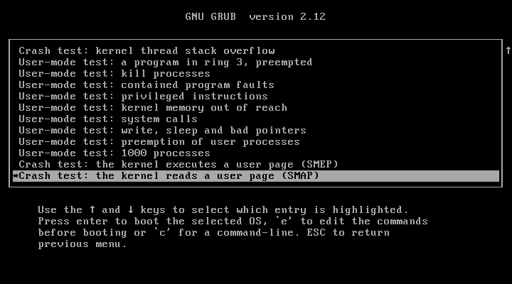

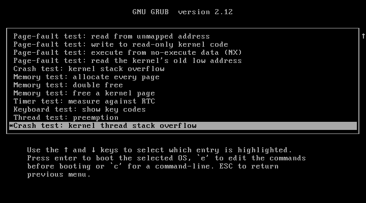

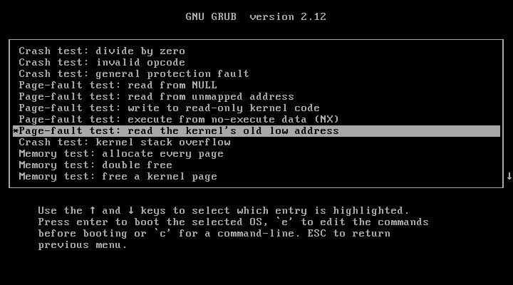

### Procedure

```powershell
.\scripts\build.ps1     # build + automated tests, produces build\madire-os.iso
.\scripts\run.ps1       # powers off / discards a saved state, attaches the ISO,
                        # sets boot order DVD -> disk, starts the VM
```

To do it by hand instead: VM **Settings > Storage**, select the optical drive, choose `build\madire-os.iso`, then **Start**.

**Close the VM (Power off) before running `build.ps1`.** A running VM keeps the ISO open, and copying the new ISO back then fails with `scp: open local "build/madire-os.iso": Broken pipe`. The build and tests still ran in the Codespace.

Keys can be typed into the VM from the host, through VirtualBox's PS/2 keyboard emulation (this is how the tests below were run):

- `VBoxManage controlvm MadireOS-Test keyboardputscancode 1e 9e` sends the `a` key;
- `VBoxManage controlvm MadireOS-Test keyboardputstring "help"` types text; Enter is `keyboardputscancode 1c 9c`.

**Keys during the BIOS (0.13; repeated by the `keywindow` group since 1.1).** In 0.13 (stage 4), keys sent from power-on made this VM's BIOS stop with `FATAL: Keyboard error:995`, before the boot menu loaded, so until 1.1 the scripts waited for the menu before the first key. The 1.1 probe on a scratch VM sent keys from 0–6 s after `startvm` in 12 boots and saw no error; since 1.1 the scripts press keys from power-on, and the `keywindow` group repeats the test on `MadireOS-Test` in every acceptance run. **The error was seen again in v1.3** (stage 9's full run, 2026-10-30): the `keywindow` row with keys from **0 ms** stopped at `FATAL: Keyboard error:995`, so keys sent that early can still reach the BIOS's keyboard self-test on this VM; the 1.1 probe's "no error" held only for its 12 boots. In the five reruns that followed, the 0 ms row revealed the menu every time; the rows from 500 to 5000 ms revealed it in every stage 9 run (one more edge, at 6000 ms, is described under *In 1.3 (stage 9)* below). **Since 1.4 (stage 1, D20)** the two edge positions report only: the counted rows press keys from 500 to 5500 ms, and the 0 ms and 6000 ms boots record what happened without deciding the result (*In 1.4 (stage 1)* below).

**The boot menu in the scripted test (0.13, Limine; hidden since 1.1).** Limine draws its menu on a **1024×768 graphics screen**; the BIOS splash and Madire's text screen are 720×400 (or 640×480). Since 1.1 the menu is hidden (`quiet: yes`): Limine draws nothing and boots the first entry after 2 s unless a key arrives; the first key shows the menu and is discarded (`common/menu.c`), and the shown menu waits with no countdown. Once the screen exists, the script therefore presses **Home every 300 ms** until a screenshot's width (read from the PNG header) is 1024 (at most `-MenuHoldMs` + 30 s); Home only selects the first entry, so a press still queued changes nothing. A BIOS stopped by keys shows no menu and starts no kernel, so an empty serial log alone proves nothing: the screen width is the proof. After 4 s, longer than the 2 s timeout, the menu must still be on the screen and the serial log still empty. (0.13 to 1.0: no key until the screen was 1024 wide, then Home ended the 3 s countdown.) A Diagnostics entry is then reached with Down (to `Diagnostics`), Enter (the directory expands in place and stays selected) and Down N + 1 times to position N, then Enter boots it. Limine's menu takes longer to appear in VirtualBox than GRUB's did (about 7 s after `startvm` returns), so the `reboot` group waits 25 s (was 15 s) before the screenshot of the second boot.

### Scripted acceptance test: `scripts/vbox-acceptance.ps1` (since 0.9)

Since 0.9 the tests below are run by a script, on Windows, with the VM powered off:

```powershell
.\scripts\vbox-acceptance.ps1                          # every test
.\scripts\vbox-acceptance.ps1 -Only boot,preempt       # some tests
.\scripts\vbox-acceptance.ps1 -Only repeat -Repeat 20  # 20 extra normal boots
```

**It checks the VM and refuses to change it.** Before anything else it reads the VM's settings (`VBoxManage showvminfo`) and compares them with the configuration above: OS type `Other_64`, BIOS firmware, 4096 MB, PAE off, DVD first in the boot order, COM1 at `0x3F8` IRQ 4 writing to `build\vbox-serial.log`, and the VM powered off; **since 1.0 (stage 11) also the storage, every controller and every port:** exactly one controller, `SATA` of type `IntelAhci`, with `MadireOS-Test.vdi` on port 0, the optical drive on port 1 and nothing on any other port (in 1.0 a v0.13 ISO attached by hand to port 0 was booted instead of the ISO under test, which the old check did not see); **since 1.2 (stage 10b) also the display and the pointing device:** graphics controller `vboxsvga`, 128 MB of video memory and `hidpointing` `usbtablet` (read only, like every check here). On any difference it lists what differs and **stops without changing anything**. It never changes a VM setting; the only change it makes is attaching the ISO under test to the optical drive (as `scripts\run.ps1` does), and it reads the attachment back to verify it. Report a difference rather than "fixing" it; a settings change needs approval.

**What it does:** it prints the SHA-256 of the ISOs it tests (`build\madire-os.iso`, and `build\madire-os-module.iso` for the module test, built as described in Test I), then boots the VM headless once per test, sends keys through VirtualBox's emulated PS/2 keyboard no sooner than 3.5 s after power-on (`-KeyDelayMs`), waits for the line that ends each test in the serial log, takes a screenshot, powers off, keeps a copy of the serial log and checks it for each expected line. Everything goes to `build\vbox-acceptance\` (`-OutDir`), with a summary file; the script exits with 1 if any expected line is missing.

| `-Only` group | What it checks |
|---|---|
| `menu` | (0.13) the boot menu held (no kernel output before the selection) and not booting while navigated; screenshots of the menu (`boot-menu`), the expanded `Diagnostics` directory, positions 0, 15 and 26 selected (since 1.1 the position-26 state also as `boot-menu-diagnostics-scrolled`: the list scrolled to its end, with the up markers); then position 26 is booted and must run the SMAP test (`SMAP test:`), which proves the navigation. Before 0.13: screenshots of the GRUB menu and submenu |
| `boot` | the normal boot: since 1.1 first `normal boot without the boot menu (screen never 1024 wide before System ready)` (no key is sent before `System ready.`; the screen's width is read every 250 ms from `startvm` on); `Scheduler self-test: PASS`, `System ready.`, then in the console `ps` (thread 0 `kernel` `running`), `version` (`Madire OS v<version> (64-bit x86-64, Multiboot 1)`, the version read from `kernel/kernel.h` since 0.10) and `mem` (the `Kernel stack:` row); since 0.9.2 also `Key events: not logged …` and **no `key:` line** although keys were typed; since 0.10 the user-mode boot self-test (`boot-selftest`: processes 1–3 and `User-mode self-test: PASS`) and a report of the CPU features as the VM presents them (`SMEP:`, `SMAP:`, `NX:`, `CR0.EM:` lines; report only); since 1.1 (stage 9) also `Keyboard lights: Num Lock on, Caps Lock off, Scroll Lock off (acknowledged)`, and after `System ready.` the read-only `VBoxManage debugvm MadireOS-Test info ps2k` (VirtualBox's own view of its PS/2 keyboard), printed as a report-only `ps2k` line, with two `lights` rows read from its `LED state XX` line: `VirtualBox keyboard lights after boot: Num Lock on, Caps Lock and Scroll Lock off` (02), then, once the console is open, Caps Lock and `VirtualBox keyboard lights after Caps Lock: Num Lock on, Caps Lock on, Scroll Lock off` (06; read every 200 ms for at most 2 s, because the kernel sends the lights from its idle loop after the key; a second report-only `ps2k after Caps Lock` line), then Caps Lock again (off) before anything is typed. **Since 1.2 (stage 10b)** the first row reads `normal boot without the boot menu (before the first serial byte only 720x400, 640x480 or blank; no screenshot matches the menu header)`: the normal boot is 1024×768 too since the switch to graphics, so a screenshot every 250 ms from `startvm` is placed by the serial log's size read just before it (before the first byte only 720×400, 640×480, or a blank screen in the kernel's mode; after it only the kernel's mode from its `Display:` line), and no screenshot may show the menu's header box (`scripts/make-wallpaper.py`'s wallpaper, compared pixel for pixel); a report-only line gives the tally |
| `graphics` (1.2) | one normal boot of the real ISO (the default entry, in graphics): while it boots, every 1024×768 screenshot after the first serial byte is classed as blank, one of the splash's four dot phases (pixel-exact against `make-wallpaper.py`'s rendering) or other (report only), and at least one must equal a dot phase; at `System ready.` the splash's ready state, 0 pixels different from its reference; then a key (not typed) opens the console, `display`, `clear`, and the console after `clear`, 0 pixels different from `tests/screen_ref.py`'s rendering; the serial lines `Display: framebuffer 1024x768x32 …`, the console's `Display:` line, `System ready. Press any key to open the console.`, `console: started`, `display`'s two lines and `console: cleared`; no `PANIC`, `FAILED`, `events dropped` or `Unexpected IRQ`. No clock and no pointer (1.2 draws neither on these screens). **The mouse is not checked by this script** (no event is injected); it is checked by hand in `MadireOS-View` (below). 12 rows. **Since 1.3 (stage 8b)** the ready state is the desktop and the console the Console window after `clear`, each against the desktop's references with the clock's cells masked, and two serial rows more (`Desktop: shown`, `Desktop: a key opened the Console window`): 14 rows (below, *In 1.3*) |
| `desktop` (1.3) | one boot of the real ISO driven through relative `IMouse.PutMouseEvent` moves and clicks and the keyboard, following `tests/screen_ref.py desktop-plan`: the M button and its menu, About, a drag of the About window and its close button, the Windows key (`e0 5b` / `e0 db`), Esc, a key that opens the Console window (not typed), `clear`, `version`, the right-click menu, the Windows key with the Console window focused, `echo ok`, Restart with Cancel, then Restart with Restart; 14 screenshots against their references (the clock masked), the serial rows, the restart, the typed lines, slot 506 against `tests/pagetables.py`, no `PANIC` or `FAILED` (case-sensitive); 26 rows |
| `scrollback` (0.9.2) | `dmesg 60`, then Shift+PgUp (indicator visible), a second Shift+PgUp, then `a` (back at the bottom); four screenshots; the log's pages checked: the first = the 24 lines above the screen (X = Y − 48), the second 24 further back but not past line 1 |
| `commands` (0.9.1) | the console commands: `help mem`, `uname -a`, `hostname`, `date` (format checked; its difference from the host's local time and from UTC is printed, report only), `dmesg 5`, `echo one` then Up (re-run: 2 runs), `history`, `help` (the full list), `reboot` then `no` (`Restart cancelled.`); three screenshots |
| `reboot` (0.9.1) | `reboot` then `yes`: `Restarting...`, `console: restart confirmed`, the keyboard-controller reset line, no triple-fault fallback; screenshots right after the reset and of the second boot. Reported only: the VM's state and whether the COM1 log kept both boots (`boot32: start` lines) |
| `preempt` | Diagnostics entry 14: `Preempt test: fair shares: …: OK` and `Preempt test: PASS` |
| `threadoverflow` | entry 15: `Double fault: kernel thread stack overflow (thread N 'overflow')`, halted |
| `pf` | the five page-fault entries and the kernel stack overflow: each one's address, NX or double-fault line, halted |
| `diag` | divide by zero (`#DE`), the timer diagnostic (`Timer diagnostic: PASS`) and the keyboard diagnostic (`a`, `Shift+A` with `flags=0x03`, Up; since 1.1 also the ISO key 0x56 as `\`, then Num Lock off and keypad 8 as `UP` without the extended flag, `flags=0x01`) |
| `diagmore` (0.13) | the four entries no other group boots: `ud` (`CPU exception 6: Invalid Opcode`, error code 0), `gpf` (`CPU exception 13: General Protection Fault`, `0x00000028`), `doublefree` and `freereserved` (their panic lines), each halted. With it every one of the 27 positions is booted through the boot menu; a report line lists the positions booted |
| `user` (0.10) | Diagnostics entries 16–24, one boot each: the entry's PASS line, then `System ready.`, and no `PANIC` (case-sensitive); a screenshot each |
| `procs` (0.11) | the console with the default entry's program modules: `run hello` (its text on the screen, then `[process 4 'hello' exited, status 0]`), `run exitcode` (status 42), `run -b spin`, `ps` (its PID running), `kill <pid>` then `no` (`Kill cancelled.`), then `yes` (killed, end line), `run spin` and `run lines 65636` each ended by Ctrl+C, a final `ps` with `0 processes`; no `key:` line, no panic; a screenshot of each step |
| `smx` (0.10) | entries 25 (`smep`) and 26 (`smap`). The expected result follows the CPU as the VM presents it (the boot's `SMEP:`/`SMAP:` line, reported): enabled → the crash screen with `CPU exception 14`, the error code (`0x00000011` / `0x00000001`), the `Cause:` line, the address and `System halted.`, and no `System ready`, `without a fault` or `NX violation`; not supported → `… test: NOT APPLICABLE (not supported by this CPU)`, `System ready.` and no `PANIC` |
| `memexhaust` | `Memory exhaustion test: PASS`, then `mem` in the console |
| `module` | the module ISO: `Boot module 1: test pattern intact (14016 bytes)` |
| `shell` (0.12; help rows changed in 1.0) | every 0.12 command and its error paths typed in one console session (see *VirtualBox `shell` group* in section 1b); since 1.0 `help` on one screen (its four section lines and the closing lines), `help programs` with `run [-b] <name> [args]`, the suggestions `ru` → `du, rm, run` and `help nosuchcommand`; since 1.1 (stage 9) the console keys before the session's end: Ctrl+C on `echo secretvbox` (`console: Ctrl+C: line cleared`), Esc on `echo escvbox`, then `echo after-clear` runs exactly; `his` and Tab runs `history `; Caps Lock around `q` in `echo Qr`; `reboot`, `ye` and Ctrl+C (`console: Ctrl+C: answered no`, `Restart cancelled.`); and neither cleared text in the serial log (`no secretvbox|escvbox`); 353 rows |
| `files` (1.0) | the Live mode and the file commands in one console session: the `Filesystem:` and self-test lines, the two Live lines, `version`'s second line, `help files` (13 commands), `pwd`/`cd`, `mkdir`/`rmdir`, `touch`/`stat`, `ls`/`ls -l`, `echo … >` and `>>` with `cat`, `echo hi>b.txt` staying one word (D11), `cp` (asking before replacing: `no`, then `yes`; `-y`), `mv` (asking; `-y`), `rm` (`no`, then `yes`; `-y`), `df` and `du /` (their pages equal), the errors (a missing name, `rm` on a folder, `rmdir` on a non-empty folder, `>` without a file name, an unknown command with a redirection creating no file); the files are made by redirection and `cp`, since the ISO's modules hold no file-making program; no `key:` line and no panic; five screenshots; 137 rows |
| `repeat` (with `-Repeat N`) | N extra normal boots; for each, the self-test result, the preemptions during its ping-pong and the ping-pong verdict |
| `risk13` (1.3, with `-Risk13 N`) | N normal boots with no key, each to `System ready.` and the desktop's first frame; one row each, a hang before the kernel started counted (below, "Stage 9's owner-run steps") |
| `keywindow` (1.1; redesigned in 1.4, D20) | the keyboard-error repeat on `MadireOS-Test`: 13 boots, Home every 300 ms starting 0, 0.5, 1, 1.5, 2, 2.5, 3, 3.5, 4, 4.5, 5, 5.5 and 6 s after `startvm`; **11 counted rows** (0.5 to 5.5 s), one each, `menu shown with keys from <n> ms; no BIOS keyboard error` (MISSING, with a screenshot `keywindow-<n>`, if the screen stays below 1024 wide and the serial log empty for 30 s, or the kernel starts first); **two report-only rows** (0 and 6 s), `keys from <n> ms: <what> after <t> ms`, where `<what>` is `menu shown`, `kernel started without the menu` or `BIOS keyboard error (no menu and no kernel output for 30 s)` (with the screenshot `keywindow-<n>`), never MISSING; a shown menu is held 4 s, then Enter boots the first entry to `System ready.`; one report-only row for the counted boots: the menus shown, the earliest and latest reveal after `startvm`, the 4 s holds and the boots to `System ready.`. About 4 minutes |

In 0.9 the full run gave 33 of 33 expected lines, and 20 extra normal boots each gave `self-test PASS; ping-pong preemptions 0; 100 yields, strictly alternating: OK`. In 0.9.1 it gave 49 of 49 (the 33, plus 12 for `commands` and 5 for `reboot`); its reports: the RTC 2 hours ahead of UTC and 2 s from the host's local time; after the guest's reboot the VM was still running and the COM1 log held 2 `boot32: start` and 2 `System ready.` lines. In 0.9.2 every group passed: `boot` with no key line, `scrollback` (`line 19 of 67`, then `line 1 of 67`: with only 42 lines kept, the second page stops at line 1), the `keyboard` diagnostic still logging its key lines. The `scrollback` page check, created in 0.9.2, first expected exactly 24 more lines on the second page; it was corrected to the approved rule and re-run (4 of 4). The serial logs are then compared with QEMU's, as described above.

**In 0.10** (ISO `b6ff78f9…`, kernel `734df709…`) every existing group passed, the boot self-test passed, and positions 16–26 passed: 16–24 each reached its PASS line and System ready, 25 and 26 reported NOT APPLICABLE (the VM has no SMEP or SMAP) and booted normally. Reports: SMEP and SMAP not supported, NX on, CR0.EM set; the RTC 2 hours ahead of UTC and 2 s from the host's local time; after `reboot`, `yes` the COM1 log held both boots. Two **script fixes** were needed in the new groups, both found by the first run and both script-only (11 rows reported MISSING although the kernel results were correct):

1. the "no `PANIC`" check (`Absent`) matched case-insensitively (`Select-String`'s default), so it hit two normal boot lines (`Paging check: panic_exception …` and `… a new one now panics`): it is now case-sensitive;
2. in the `smx` loop a variable `$T` (the feature name) overwrote the loop variable `$t` (the test name), because PowerShell variable names ignore case, so those logs were saved as `SMEP`/`SMAP`: the variable is now `$Feat`.

With the fixes, the `user` and `smx` groups were re-run: every row passed except one: `userkill` measured a **longest turn of 10 ticks** (bound: 6), with every functional result correct. That is the plan's stop rule, so stage 7 stopped; the owner chose to re-run `userkill` alone 10 times (headless, VM settings checked and unchanged): all 10 measured 5 ticks and passed, with no other VM running and the host 0–23 % busy before each run. The single 10-tick turn is recorded as a watch item (probably a VirtualBox tick burst; unconfirmed, because the turn record doesn't say which thread took it). If it recurs, the record will name the thread (its TID, and whether it is a user process or the kernel test thread) before anything else changes.

**In 0.11** (ISO `c79ac24e…`, kernel `0851bd59…`, built from the stage 6 tree) the full run with `-Repeat 10` gave **119 of 119**: every existing group, the boot self-tests, positions 16–26 and the new `procs` group; each of the 10 extra boots gave `self-test PASS; ping-pong preemptions 0`. `userkill` was then run 10 more times (the same keys and timings, VM settings checked and unchanged): all PASS with a longest turn of 5 ticks, taken by `spin` (user process 4), which resolves the 0.10 watch item. Every longest turn in the VirtualBox logs was at most 5 ticks, with the same owners as QEMU (`userpreempt`: the user processes 5/5/5/0/0, the kernel thread `frames` 1; the scheduler self-test `spin` 5; `preempt` `spin0` 5). The only difference from QEMU: the VM's CPU offers neither SMEP nor SMAP (both NOT APPLICABLE, as on QEMU's default CPU). The per-boot QEMU serial logs weren't downloaded by `remote-regress.ps1`, so the comparison used the result lines and figures (a follow-up adds the download). `run hello` on the VM:

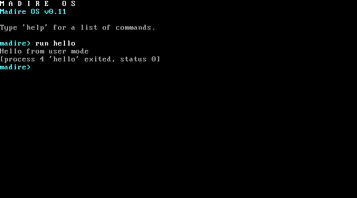

The other `procs` screenshots: [the boot screen](images/v0.11-boot.png), [`run exitcode`, `run -b spin` and `ps`](images/v0.11-ps.png), [`kill` then `no`](images/v0.11-kill-no.png), [`kill` then `yes`](images/v0.11-kill-yes.png), [Ctrl+C on `spin`](images/v0.11-ctrlc-spin.png), [Ctrl+C on `lines`](images/v0.11-ctrlc-lines.png). (`run nullptr` isn't part of the VirtualBox group; it is checked in QEMU.)

**Host memory before a run (1.0, the owner's routine).** The 4 GB VM runs on a 16 GB laptop through the Windows Hypervisor Platform, so the host needs headroom. Before `MadireOS-Test` is started, the available host memory is measured three times; the run starts only if it is steadily **3,500 MB or more**. Chrome, Edge, Grammarly, OneDrive and VoyceMobile (and Teams and Outlook) must be closed, and after a restart of the laptop Defender's scan after boot must have finished. **Closing applications (since 1.1, [AGENTS.md](../AGENTS.md) section 6):** if memory is short, the builder may close only Google Chrome, Microsoft Edge, Grammarly, OneDrive and VoyceMobile without asking (Edge's WebView2 processes, `msedgewebview2.exe`, only when started by `msedge.exe`, never those owned by another app such as Teams, Outlook or Widgets; gracefully first; force-closed only if still running after 30 s), then re-measures (three samples) and reports exactly what it closed and the memory before and after; any other application (Word, Excel, PowerPoint, Outlook, Teams, VS Code and the rest) it reports and asks the owner to close. **Since 1.2 (the owner's standing rule, AGENTS.md section 6):** the builder closes no application at all without asking the owner first; if the memory is below the threshold and no answer has come, that step stops. The local Kali VM must be powered off (the script refuses otherwise), and **only one VM runs at a time** (`MadireOS-Test`, `MadireOS-View` or Kali). **Since 1.3 (stage 8)** `scripts/vbox-acceptance.ps1` measures the three samples itself and refuses below **5,500 MB** (the owner's threshold for the stage 9 run; below).

**The screen wait (1.0, stage 11).** After `startvm`, each boot through the menu first waits for the guest screen to exist: a screenshot is retried for at most 10 s (a failed screenshot is no longer fatal, it just reads as width 0). If there is still no screen, that boot's menu row is MISSING and the run carries on; otherwise the menu wait (a 1024-pixel-wide screen; since 1.1 with Home pressed every 300 ms) follows as before. The summary reports, report only, the number of menu boots and the longest and average time to the first screenshot (dry run: 28 menu boots, longest 398 ms).

**In 1.0** the script gained the `files` group (137 rows) and the changed `help` rows of the `shell` and `commands` groups (`help` on one screen); the full run has **604 rows** (`files` 137, `shell` 343, the other groups 124). A dry run on a Kali-built ISO (stage 11, not evidence) gave 604 of 604. **The evidence (stage 12, 2026-10-17):** on the ISO of the final full Actions run 38966032674 (`fd46d922…`, kernel `d5bbf088…`) and a module ISO packaged on Kali around that kernel, **604 of 604, 0 MISSING**, all 27 Diagnostics positions booted, every log `Madire OS v1.0`, 21 minutes. Compared with QEMU's logs (numbers masked) every pair is identical apart from expected differences: the ISO's 7 program modules add 3 `Paging check: reservation boot module …` lines to `commands`, `reboot` and `scrollback`; `scrollback`'s QEMU log is another session; QEMU's `files` session makes its files with the `fsmake` module; the `procs` sessions differ (Ctrl+C in VirtualBox, `run hello x` in QEMU). Details in [PROGRESS.md](PROGRESS.md).

**In 1.1 (stage 3)** the script gained the `boot` row `normal boot without the boot menu (screen never 1024 wide before System ready)` and the `keywindow` group (12 rows), and the `menu` group the screenshot `boot-menu-diagnostics-scrolled`: the full run has **617 rows** (604 + 1 + 12; the report-only lines are not counted).

**In 1.1 (stage 9)** the script gained the rows for the keyboard polish: the `boot-console` row for the boot's `Keyboard lights:` line (+1), the `keyboard` diagnostic's rows for the ISO key and for keypad 8 with Num Lock off (+2), and the `shell` group's console-key rows (+9 in order, +1 `Absent`), and the `boot` group's two `lights` rows from `VBoxManage debugvm MadireOS-Test info ps2k` (read only; +2): the full run has **632 rows** (617 + 1 + 2 + 10 + 2). The light rows depend on VirtualBox's `info ps2k` output format: they read its line `LED state XX, Num Lock on` (VirtualBox 7.2.20 r175154: `LED state 02, Num Lock on` after boot); if a VirtualBox update changes that line, they show MISSING and the format is checked again. The `ps2k` output itself is printed as report-only lines.

**In 1.2 (stage 10b)** the script gained the `graphics` group (12 rows), the `shell` group's `help system` row for `display` (+1), the reworded `boot` row and `commands`' `help` row (the same count), and the display and pointing-device lines of the VM check: the full run has **645 rows** (632 + 12 + 1). **The evidence (stage 11, 2026-10-23):** on the ISO of the full Actions run 40015866525 (`9415b008…`, kernel `e8eee6e5…`) and a module ISO packaged on Kali around that kernel (`680c523f…`; its kernel byte-identical, its module entry `textmode: yes` as in part 1; Kali powered off before any VirtualBox step), **645 of 645, 0 MISSING**, all 27 Diagnostics positions booted, all 49 logs `Madire OS v1.2`, about 25 minutes. `graphics`: 13 screenshots while booting (11 blank, 2 equal to the splash with one dot lit), the ready state and the console after `clear` 0 pixels different. `boot`: before the first serial byte 720×400 ×8, 640×480 ×8, blank 720×400 ×6; after it 1024×768 only (9 blank, the hand-off); no menu header box.

**In 1.3 (stage 8; run by the owner in stage 9)** the script became an owner-run step ([AGENTS.md](../AGENTS.md) section 6): run from plain PowerShell with VS Code closed, it measures the available host memory three times itself (5 s apart) and refuses unless all three are at or above **5,500 MB** (`-MinFreeMB`); it refuses while Kali or `MadireOS-View` runs; it writes everything into one **new** result folder (`-OutDir`, by default `build\vbox-acceptance-<date>-<time>`; an existing, non-empty folder is refused), with the memory samples and `showvminfo` before and after (a `vm` row: only the medium and `VMStateChangeTime` may differ); at the end, also after an error, it restores the resting medium (`-RestoreIso`, checked against `-RestoreSha256`; a `vm` row with its SHA-256 and the medium as `showvminfo` reads it); the summary's last line is its exit status. The real ISO shows the desktop at System ready (the switch), so the `graphics` group's ready-state row compares the screenshot with the desktop's reference and its console row the Console window after `clear` (`tests/screen_ref.py desktop` and `desktop-console`, which part 3's `[1.2]` check proves equal to the kernel's rendering), **the clock's cells masked** (decision 12), and its serial rows gain the default path's `Desktop: shown` and `Desktop: a key opened the Console window` lines (+2). The new **`desktop` group** (one boot, 26 rows) follows `tests/screen_ref.py desktop-plan`: relative `IMouse.PutMouseEvent` moves over COM (parked at 0, 0 by moves the clamp stops, then 1:1, at most 127 each), clicks on the M button, its About row, a drag of the About window, its close button, the Windows key as `e0 5b` / `e0 db`, Esc, Space (opens the Console window, not typed), `clear`, `version`, a right click on the desktop, the Windows key with the Console window focused, `echo ok`, then Restart with Cancel and Restart with Restart; 14 screenshots (`vbox-desktop-*.png`), each against its reference rendered after the run (`desktop-render`, the About window's memory from the run's serial log; the clock's cells masked), 8 serial rows, the restart row (1 chosen, 2 boots), the typed-lines row, slot 506 against `tests/pagetables.py`, and `Absent` PANIC/FAILED (case-sensitive). The full run then has **675 rows** (645 + 2 + 26 + 2 `vm`).

**Risk 13 sampling (1.2, stage 11; docs/plans/1.2.md, section F).** The intermittent pre-kernel hang at 1024×768×32 was sampled with 30 normal boots of the same evidence ISO in `MadireOS-Test` (no key, each to `System ready.`, 60 s limit; settings checked and unchanged; a scratch script, not in the repository, that on a boot with 0 serial bytes would have kept a screenshot and the CPU registers, `VBoxManage debugvm … getregisters`, read only, before the power-off): **30 of 30 reached `System ready.`, none wrote 0 serial bytes** (each 32,886 bytes, mode 1024×768×32, no `FAILED` line), 8.3–10.8 s from `startvm` to `System ready.`, the first screenshot 720×400 in 29 boots and 640×480 in one. The hang was not reproduced; the item stays open (Kali tally and the stage 3 probe in the plan).

**Stage 9's owner-run steps (1.3).** Three steps, each from plain PowerShell with VS Code closed, each into its own new result folder, judged afterwards by a fresh session from that folder only:

1. **The module ISO** (`scripts/kali-module-iso.ps1`, which runs `scripts/kali-module-iso.sh` on Kali; Test I): packaged around the kernel of the ISO under test, as part 1 makes its own (the test module, the module entry's `limine.conf` with `textmode: yes`, `limine_tree` and `limine_iso`, all taken unchanged from `tests/qemu-part-1.sh` and `tests/qemu-lib.sh`). Nothing is built: the kernel, `limine-bios.sys` and the wallpaper are the ISO's own files, the kernel checked against `-KernelSha256`; Kali's Limine package must be the ISO's (`limine-bios.sys` identical, `limine-bios-cd.bin` identical outside its boot info table); the module ISO is read back, every file compared and its kernel checked again. It refuses unless the available host memory is at or above 4,500 MB in three samples, Kali, `MadireOS-Test` and `MadireOS-View` are powered off, Kali has 3,072 MB and the ISO has its expected SHA-256; it starts Kali headless and powers it off at the end, also after an error (`showvminfo` of Kali before and after: only `VMStateChangeTime` may differ). Folder `build\kali-module-iso-<date>-<time>\` (`madire-os-module.iso`, `limine.conf`, `kali-module-iso.log`, `module-iso-summary.txt` with its exit status last).
2. **The acceptance** (`scripts/vbox-acceptance.ps1` with `-IsoSha256` and `-ModuleIsoSha256`, checked before anything starts; every group, 675 rows).
3. **The risk 13 sample** (`scripts/vbox-acceptance.ps1 -Only risk13 -Risk13 30`, the `risk13` group, committed in stage 9 instead of 1.2's scratch script): 30 normal boots with no key, each to `System ready.` and the desktop's first frame (a screenshot equal to `tests/screen_ref.py desktop`'s reference, the clock's cells masked, within 15 s of the `Desktop: shown on` line); one row per boot (serial bytes, mode, the seconds to `System ready.`, to the `Desktop:` line and to the first frame, the first screenshot's size and time, `PANIC`/`FAILED` lines, case-sensitive), every boot's serial log and last screenshot kept; a boot whose serial log stays empty for 60 s is counted as a hang before the kernel started, with its log, its screenshot and the CPU's registers (`debugvm getregisters`, read only); a report-only summary line. With the two `vm` rows: 32 rows. The module ISO is not needed for it.

**In 1.3 (stage 9, 2026-10-30): the evidence.** Each step ran from plain PowerShell with VS Code closed and was judged by a fresh session from its result folder (`build\`, git-ignored); in every one the owner-run rule held (three memory samples at or above the threshold, the VM check, `showvminfo` before and after differing only in the medium and `VMStateChangeTime`, the resting medium `2a2acbe5…` restored and read back), and Kali was powered off before every VirtualBox step.

1. **The module ISO** (`kali-module-iso-20261030-204055`): `RESULT=PASS`; memory 5,585 / 5,594 / 5,602 MB (threshold 4,500); the kernel `130461b0…` extracted from the full run 41096493517's ISO, byte-identical to the module ISO's; module ISO `395c8c33…`; Kali powered off, its `showvminfo` differing only in `VMStateChangeTime`. (A repeated command made a second, unused module ISO, `17cc469d…`, with the same kernel: ISO builds are not byte-reproducible.)
2. **The acceptance** (`vbox-acceptance-20261030-204515`): on the ISO `45d1976b…` of the full run 41096493517 (stage 8b) and the module ISO, both SHA-256s checked; memory 5,748 / 5,758 / 5,761 MB (threshold 5,500): **674 of 675**. The `desktop` group passed all 26 rows (14 screenshots against their references, the clock masked; the Restart dialog's Cancel and Restart; slot 506 against `tests/pagetables.py`), the `graphics` group its changed rows. The one MISSING row: `keywindow` 0 ms, the VirtualBox BIOS stopped with `FATAL: Keyboard error:995` (*Keys during the BIOS* above). **The `keywindow` group rerun five times** (`-215217`, `-215912`, `-220908`, `-221433`: 12 of 12 each; `-221840`: 11 of 12): **59 of 60**. The miss, `menu shown with keys from 6000 ms`: the kernel started without the menu after 6,359 ms; its serial log (3,870 bytes, cut by the script's power-off at the first serial byte, by design) is byte-identical to the first 3,870 bytes of every other 6000 ms log of that day and of the same run's 5000 ms log, a normal boot to System ready; no `PANIC` or `FAILED`; its screenshot the kernel's blank 1024×768 screen. The 6000 ms row has always revealed the menu at 6,353–6,372 ms (v1.1 6,354 and 6,353, the v1.1 dry run 6,372, v1.2 6,370, stage 9 6,369, 6,362, 6,371, 6,354, 6,358): the first key arrives as Limine's 2 s key wait ends. **Both misses are test-timing edges outside Madire's code; the owner accepted stage 9 with both documented**, with no script or row changed in 1.3. The `keywindow` script powers the VM off at the first serial byte when the kernel starts without the menu, and gives each boot's reveal time on the console only (the summary's "latest reveal" is the 6000 ms row's).
3. **Risk 13** (`vbox-acceptance-20261030-211338`): memory 6,459 / 6,500 / 6,504 MB: **30 of 30**, no hang; every boot 33,838 serial bytes, System ready after 8.6–10.1 s, the desktop's first frame after 8.6–10.5 s. Risk 13 was not seen in 1.3; it stays open for real hardware.

**In 1.4 (stage 1, D20; [docs/plans/1.4.md](plans/1.4.md) section G3): the `keywindow` redesign, an owner-approved exception** to "existing checks are never weakened" ([AGENTS.md](../AGENTS.md) section 5). The group's 12 counted rows (keys from 0, 0.5, …, 5 and 6 s) became **11 counted rows, keys from 0.5, 1, …, 5 and 5.5 s**, each still pressing Home every 300 ms until the menu shows or 30 s pass, and **two report-only rows at 0 and 6 s**, which record `menu shown`, `kernel started without the menu` or `BIOS keyboard error (no menu and no kernel output for 30 s)` and never count as MISSING. Why it is fair: every counted row starts after the VirtualBox BIOS's keyboard self-test (500 ms has passed in every run since 1.1; the BIOS stopped with `FATAL: Keyboard error:995` only at 0 ms) and ends at least about 850 ms before the earliest observed end of Limine's 2 s key wait (the kernel started without the menu after 6,359 ms in 1.3's fifth rerun), so each counted row tests Madire's hidden menu, not the BIOS's or Limine's timing; the two edges are still observed and reported. The "BIOS keyboard error" label is inferred from the screen and the serial log (no menu, no kernel output), not read from the screen: the screenshot `keywindow-<n>` shows the BIOS's own message. The full run then has **674 rows** (675 − 12 + 11; the report-only lines are not counted).

### The view VM: `MadireOS-View` (1.2, stage 11)

A second VM, created with the owner's approval (1.2's decision 12) **only for looking at Madire OS by hand** (the owner's manual mouse check): it has a PS/2 mouse, so the pointer follows the host's mouse, which `MadireOS-Test`'s USB tablet does not give a PS/2-only guest.

| Setting | Value |
|---|---|
| Type, firmware | Other / Unknown (64-bit), **BIOS** |
| RAM, CPUs | 2048 MB, 2 |
| Display | VBoxSVGA, 32 MB video memory, 3D off |
| Mouse, keyboard | **PS/2** mouse, PS/2 keyboard |
| Network, audio, USB | none |
| Storage | one SATA (AHCI) controller with only the optical drive (no disk); boot order: DVD only |
| Serial port | COM1 (`0x3F8`, IRQ 4) to the file `build\view-serial.log` (git-ignored) |
| PAE | `off`, as `MadireOS-Test` (set in stage 12 with the owner's approval; it was VirtualBox's default `on` for a new VM until then) |

Commands that were run (with the ISO of run 40015866525 attached; one boot to `System ready.` confirmed it works: 1024×768×32, the mouse driver started, no `FAILED` or `PANIC`):

```
VBoxManage createvm --name MadireOS-View --ostype Other_64 --register
VBoxManage modifyvm MadireOS-View --memory 2048 --cpus 2 --firmware bios --graphicscontroller vboxsvga --vram 32 --accelerate-3d off --mouse ps2 --keyboard ps2 --nic1 none --audio-enabled off --usb-ohci off --usb-ehci off --usb-xhci off --boot1 dvd --boot2 none --boot3 none --boot4 none --uart1 0x3F8 4 --uartmode1 file <repo-root>\build\view-serial.log
VBoxManage storagectl MadireOS-View --name SATA --add sata --controller IntelAhci --portcount 1
VBoxManage storageattach MadireOS-View --storagectl SATA --port 0 --device 0 --type dvddrive --medium <the ISO>
VBoxManage modifyvm MadireOS-View --pae off                              # 1.2 stage 12
```

**`MadireOS-View` is never evidence**: no test, script or report counts its results, and `scripts/vbox-acceptance.ps1` never uses it. **It never runs alongside `MadireOS-Test` or the Kali VM** (power the others off first; host memory as above). Note for the manual check: the real ISO draws **no pointer on the console** (1.2 stage 10a: only the test option `pointer` or `test=mouse` draws one, and the boot menu's editor is off), so on the evidence ISO the mouse shows only as the serial lines `Mouse: …` (the aux port enabled, IRQ12 unmasked). Since 1.3 (stage 8) the real ISO shows the desktop at System ready, which draws the pointer from the first mouse movement.

**`MadireOS-View` gets the latest tested ISO (since 1.3; the owner's rule, [AGENTS.md](../AGENTS.md) section 6).** After every stage whose full run passes, the builder copies that run's ISO to `%USERPROFILE%\Desktop\madire-view\`, named with the version and the stage (for example `madire-os-v1.3-stage9.iso`), checks its SHA-256, and, with no VM running, attaches it to `MadireOS-View` only (`VBoxManage storageattach MadireOS-View --storagectl SATA --port 0 --device 0 --type dvddrive --medium <the copy>`); `showvminfo --machinereadable` before and after may differ only in the medium lines (`SATA-0-0`, `SATA-ImageUUID-0-0`). No VM is started; `MadireOS-Test` is never changed by it (its resting medium stays the latest release ISO). First done on 2026-10-30 with the stage 8b full run's ISO (`45d1976b…`, as `madire-os-v1.3-preview.iso`), replacing 1.2's view ISO; since the switch the real ISO itself draws the pointer, so no separate view ISO is made. `MadireOS-View` stays never evidence.

**The view ISO (1.2, stage 12; local only, never evidence, never committed).** For the owner's mouse check, a copy of the evidence ISO with **one extra menu entry**, `LOCAL VIEW ONLY - not a release entry: pointer mouselog`, placed after the default entry (which stays first, so a boot without a key is unchanged): the default entry's protocol, kernel and 7 modules plus `cmdline: pointer mouselog`. It was made on Kali by a scratch script (not in the repository): the evidence ISO's whole tree extracted with `xorriso -osirrox`, the entry added to `limine.conf`, the package's `limine-bios-cd.bin` put back, the image made with the Makefile's `xorriso` flags and `limine bios-install` (Limine 12.9.3); then the result's tree extracted again and compared: the same file list, every file byte-identical to the evidence ISO's except `limine.conf` (the entry) and `limine-bios-cd.bin`'s boot information table (bytes 8–64, written by `-boot-info-table`). From run 40015866525's ISO (`9415b008…`) it gave `853f8cfa8981cd7e3a3c3660a96b25bda4b8f46a6dbf1ea39bcc02386a2354f2`, kept in `build\s12-view\` (git-ignored). To use it, press a key in the 2 s window and choose the second entry.

**The owner's mouse check (1.2, stage 12, 2026-10-24; not evidence).** In `MadireOS-View` with the view ISO: the boot's serial log has `Mouse: PS/2 aux port enabled and tested, defaults set, reporting on; configuration 0x45 -> 0x47 (port 2 clock on, IRQ12 on)`, `Mouse: IRQ12 and the cascade IRQ2 unmasked: IRQ mask 0xeff8 (expected 0xeff8)`, `Mouse: packets logged on serial …`, `Mouse: pointer 12x18 pixels (scale 100 %), hidden until the first packet, then at (512, 384) moved by it`, then 1159 packets (numbered without a gap, none with `overflow`), each with its `pointer: drawn` line; the pointer clamped at x = 0, x = 1023 and y = 767; 4 left and 1 right press. The owner saw the pointer follow the hand and stop at the edges, and clicked inside the console with the pointer moving; the clicks and the keyboard worked. The driver takes bytes only in its IRQ12 handler, so IRQ12 delivery in VirtualBox is confirmed by hand. `MadireOS-View` is left powered off.

**`MadireOS-Test`'s resting medium (the v1.3 release ISO since 2026-10-31; the v1.2 release ISO from the v1.2 tag, 2026-10-24).** Between runs the VM is left powered off with the **v1.3 release ISO** on SATA port 1: `build\v1.3-release\madire-os.iso` (git-ignored), SHA-256 `e13054513342d65a133fbab36de1e92d82b6846d2f4b0120f85829adde430e74`, since its sanity boot on 2026-10-31 (below). Before it, from the v1.2 tag, the medium was the **v1.2 release ISO**: `build\v1.2-release\madire-os.iso` (git-ignored; the ISO of the full run 40036808466 from `main` on `d9bf065`), SHA-256 `2a2acbe599c003d4e3015a6ab7bfd1632d15c8741dbcffede07381cb8b7292c6`. Before it, the medium was `build\s10-evidence\madire-os.iso`. **One sanity boot** (not evidence; host memory 4,023–4,065 MB, after the owner had closed Chrome; `MadireOS-View` and Kali off): the release ISO booted once, with no key, to System ready: one `boot32: start`, `Display: framebuffer 1024x768x32 at 0xe0000000, pitch 4096, RGB at bits 16/8/0`, `Madire OS v1.2` on the boot line, `System ready. Press any key to open the console.`, no `PANIC` or `FAILED` (32,898 serial bytes), and the splash's ready state on the screen; the console was not opened (the scratch script failed to read the serial log while VirtualBox held it open, not a Madire fault), and the VM was powered off. **The VirtualBox acceptance of 1.2 (645 of 645, stage 11) was run on the evidence ISO `9415b008…`** of the full run 40015866525, which holds the same kernel `e8eee6e5…`; the two ISOs differ because the ISO build is not byte-reproducible (a watch item in [PROGRESS.md](PROGRESS.md)).

**The v1.3 release ISO and the next resting medium (1.3, stage 10b, 2026-10-30).** The release ISO is the ISO of the full run 41131135304 from `main` on the milestone commit `1df03b3` (tag `v1.3`), kept as `build\v1.3-release\madire-os.iso` (git-ignored), SHA-256 `e13054513342d65a133fbab36de1e92d82b6846d2f4b0120f85829adde430e74`; it holds the kernel `130461b0…`, as stage 9's evidence ISO `45d1976b…` does (the VirtualBox acceptance of 1.3, 674 of 675, was on that evidence ISO). **It becomes `MadireOS-Test`'s resting medium through one owner-run sanity boot** (AGENTS.md section 6; not evidence), run from plain PowerShell with VS Code closed, from the repository's root, with the committed script and no change to it: `scripts\vbox-acceptance.ps1 -Only risk13 -Risk13 1`, the release ISO given both as the ISO under test and as the resting medium (`-Iso` and `-RestoreIso`, each checked against that SHA-256), into its own new folder. Its one `risk13` row requires `System ready.`, the default path's `Desktop: shown on` line and the desktop's first frame (against `tests/screen_ref.py desktop`, the clock masked), with no `PANIC` or `FAILED`; its `vm` rows record `showvminfo` before and after (only the medium and `VMStateChangeTime` may differ) and the resting medium read back. `MadireOS-View` gets the same release ISO as `%USERPROFILE%\Desktop\madire-view\madire-os-v1.3.iso` (its rule above). **The sanity boot (2026-10-31 02:23 +02:00; judged by a fresh session from `build\vbox-resting-v1.3\`):** host memory 5,807 / 5,809 / 5,812 MB (threshold 5,500 MB); the VM check passed; `System ready.` and the desktop's first frame at 8.3 s (33,838 serial bytes, `Madire OS v1.3` on the boot line, `Desktop: shown on 1024x768x32`), the `risk13` row OK, no `PANIC` or `FAILED`; the resting medium read back by hash (`e1305451…`, `SATA-1-0` = `build\v1.3-release\madire-os.iso`); `showvminfo` before and after differing only in `VMStateChangeTime`, `SATA-1-0` and `SATA-ImageUUID-1-0` (now `726141be-ff04-4a0a-9238-a90ba7f370c7`); exit status 0. Two later attempts were refused because the folder already existed (nothing ran).

### Test A: normal boot

The boot menu shows **Madire OS v<version>** (since 1.1 **Boot Madire OS**, with the version on the Madire wallpaper) and **Diagnostics** (since 0.13 Limine's menu, on a 1024×768 screen, with `Diagnostics` as a collapsed directory; since 1.1 hidden unless a key is pressed during the 2 s after the BIOS; the screenshot below is the GRUB menu of 0.10):

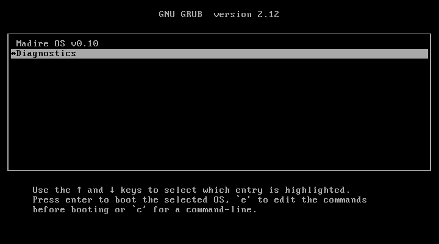

With no key it boots the first entry after 2 seconds (3 seconds before 1.1); a key during those 2 seconds shows the menu:

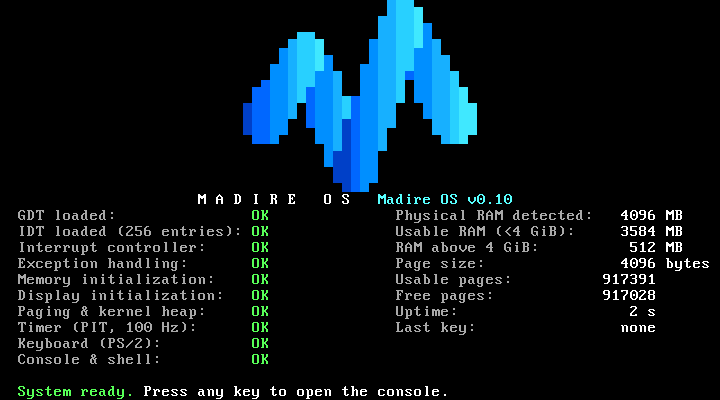

- The M logo is drawn in the blue-to-cyan gradient; `M A D I R E   O S` and `Madire OS v0.10` share one row. The screen's layout is unchanged since 0.8: the scheduler self-test (0.9) and the user-mode self-test (0.10) report on the serial log only.
- Left column: **10 status lines, all `OK`**, including `Paging & kernel heap` (0.6), `Timer (PIT, 100 Hz)`, `Keyboard (PS/2)` and `Console & shell` (a self-test of the console code, not of hardware).
- Right column: memory figures, then **Uptime**, which counts up every second, and **Last key**, which shows the last key pressed (`none` until then). For `MadireOS-Test` (4096 MB):

  | Line | Value |
  |---|---|
  | Physical RAM detected | **4096 MB** |
  | Usable RAM (<4 GiB) | **3584 MB** |
  | RAM above 4 GiB | **512 MB** |
  | Page size | **4096 bytes** |
  | Usable pages | **917391** |
  | Free pages | **917028** in 0.10 (917048 in 0.9.2, 917087 in 0.9.1, 917105 in 0.9, 917121 in 0.8, 917124 in 0.7; usable minus the low 1 MiB, the kernel and the boot loader's data; changes when the kernel's size changes, e.g. 0.9.1's 32 KiB kernel log, 0.9.2's 156 KiB scrollback, or 0.10's user-mode code and the built-in programs). This is taken before the kernel's page tables and the heap are set up; the console's `mem` then shows 60 fewer (**916968**: 15 page tables, the PML4 and 44 heap pages; 0.9 added the 3 tables of the thread stack area). |

- Bottom row: `System ready. Press any key to open the console.`
- Serial log: `boot32: start`, `boot32: CPUID ok, long mode and PAE present`, `boot64: entered 64-bit long mode`, `boot64: running at the higher half, RIP=0xffffffff80101000` (0.8), the stack paint line, `CPU mode: … 64-bit long mode active; 64-bit arithmetic PASS`, `NX: supported by the CPU …; EFER.NXE enabled`, `Paging check: lower half empty: PML4[0] not present …: OK` (twice), `Paging check: kernel thread stack area (PML4[507]), empty at boot …: OK` (0.9), `Paging walk-check: PASS (76 items, 0 mismatches)`, both guard pages `unmapped`, `Paging self-test: PASS (26 checks, 0 mismatches)`, `Kernel heap self-test: PASS`, then the scheduler self-test (0.9): `cooperative ping-pong: 100 yields, strictly alternating: OK`, `preemptions during the ping-pong: 0: OK`, the exit lines `Thread 1 'pingA' exited: code 11, stack peak 192 of 16384` and `Thread 2 'pingB' …`, `Scheduler self-test: PASS (9 checks, 0 mismatches)`; since 0.10 the user segments, `SMEP: NOT APPLICABLE (not supported by this CPU)` and `SMAP: …` (the VM offers neither), `CR0.EM: set …`, the `SYSCALL:` registers read back, `Kernel half frozen: PML4 slots 256, 507, 508, 509, 510, 511 (6 entries) …`, then the user-mode self-test: `[pid 1] Hello from user mode`, processes 1–3 with their results, `User-mode self-test: PASS`; and after "System ready." `Kernel stack: 1512 bytes at peak, of 16384` (0.10; 1496 in 0.9.2, 1512 in 0.9.1). Since 0.9.2 the log also says `Key events: not logged (boot option 'keylog' logs them; for tests only)`, and no `key:` line appears when keys are typed.

### Test F: console and shell

Press any key on the boot screen. That key opens the console and **isn't typed**: the prompt is empty.

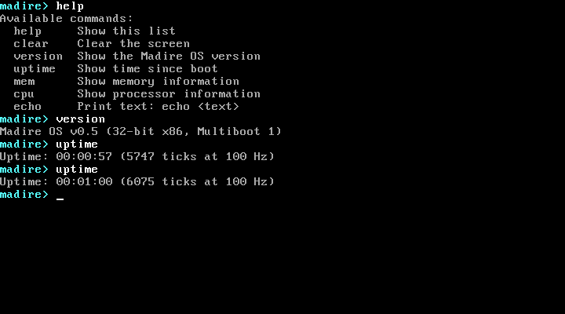

| Check | Expected |
|---|---|
| Console opens | Banner `M A D I R E   O S` / `Madire OS v0.10` / `Type 'help' …`, then `madire>` with a **blinking underline cursor** |
| `help`, `version`, `uptime` | the 7-command list, then `ps` (0.9) and the six 0.9.1 commands; `Madire OS v0.10 (64-bit x86-64, Multiboot 1)`; `Uptime: HH:MM:SS (N ticks at 100 Hz)`, advancing |
| `ps` (0.9) | `TID  STATE      TICKS    STACK PEAK    NAME`, then `  0  running   …   1512/16384   kernel` and `1 thread` (only thread 0 exists after boot: the self-tests' threads and processes 1–3 have ended; no line wraps) |
| `mem`, `cpu` | 4096 / 3584 / 512 MB, 917391 usable pages, 916968 free, 5 reserved ranges, then `Paging: enabled (4-level, 4 KiB, higher-half, NX on)`, `Mapped pages: 457`, `Page tables: 15`, `NX: supported, enabled`, `Kernel heap: 176 KiB mapped, max 16384 KiB`, `Heap in use: 0 KiB in 0 blocks`, `Heap free: 176 KiB, largest block 175 KiB`, and last `Kernel stack: … bytes at peak, of 16384` (0.10: 1512 after `ps` and `version`; 0.9.2: 1496; no line wraps); CPUID vendor, brand (VirtualBox shows the host CPU, e.g. `13th Gen Intel(R) Core(TM) i5-1335U`), family/model, features, mode `64-bit long mode, paging on, 1 CPU in use`. On this CPU the "Features:" line is longer than 80 columns and wraps (known since 0.5). |
| Editing | `echo hellx`, Backspace, `o` → `hello`; `echo abXc`, Left, Left, Delete → `abc`; `cho world`, Home, `e`, End, `!` → `world!`; Right and insert → `hello` |
| Shift, Caps Lock, Tab | `echo   Hello   World!` → `Hello World!`; Caps Lock, `echo abc` → `ECHO ABC` (unknown: names are lowercase); `echo`, Tab, `a`, Tab, Tab, `b` → `a b` |
| Errors (red) | `foo` → `Unknown command: foo. …`; `version x` → `Usage: version`; `echo 1 2 3 4 5 6 7 8` → `Too many arguments (max 8).` |
| Limits | `echo` + 100 × `a`: the line stops at 71 characters (66 `a`s echoed) |
| Empty lines | Enter alone, or spaces then Enter: just a new prompt |
| Scrolling, clear | several `help`s scroll the screen, with the prompt on the bottom row; `clear` leaves only the prompt on row 0 |

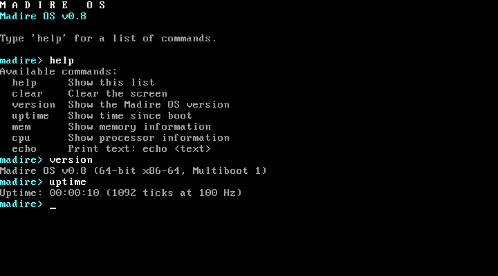

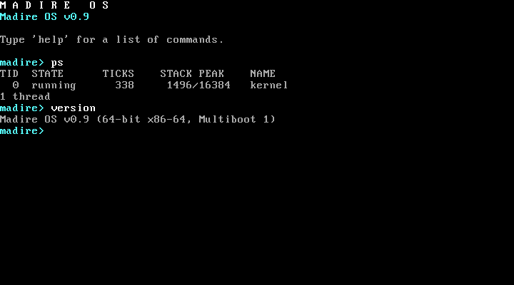

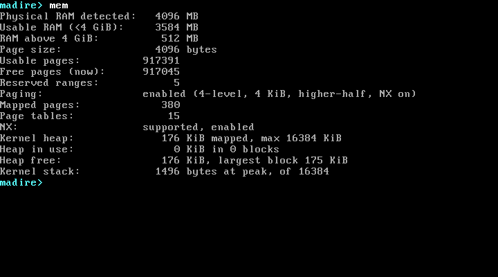

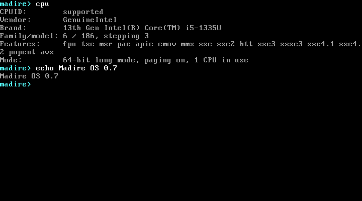

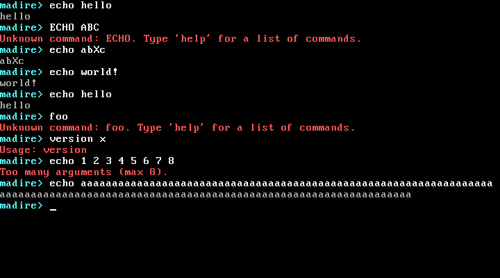

### Test B: crash screen

In the boot menu, press **↓** to highlight **Diagnostics**, press **Enter** (since 0.13 the directory expands in place), then choose **Crash test: divide by zero**:

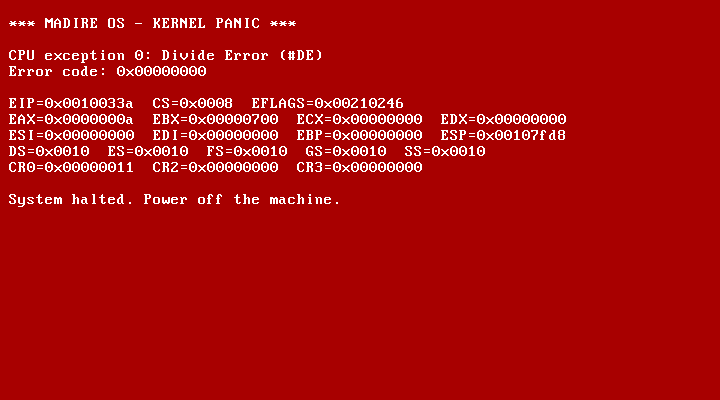

- White on red, headed `*** MADIRE OS - KERNEL PANIC ***`.
- `CPU exception 0: Divide Error (#DE)`, `RAX=0x000000000000000a`, `RCX=0x0000000000000000`, `CS=0x0008`, `DS=0x0010`, then `CR0`/`CR2`/`CR3`, `CR4` and `EFER` (the 64-bit dump since 0.7; the 0.2 screenshot shows the older 32-bit layout). Since 0.8, RIP and RSP are higher-half addresses (`0xffffffff80…`).
- Since 0.4, RFLAGS has bit 9 set (e.g. `0x0000000000010246`): the exception happened with hardware interrupts live.
- No line is longer than 79 characters (since 0.7).

The other two crash entries should show `Invalid Opcode (#UD)` and `General Protection Fault (#GP)` with error code `0x00000028`.

### Test C: memory diagnostics

| Entry | Expected |
|---|---|
| **Memory test: allocate every page** | after **about 50–90 seconds** on a 4 GB VM (each page goes through the physical-access window since 0.6; 50 s in the 0.8 run), `Memory exhaustion test: PASS (… pages)` and `System ready.` That is the boot panel's free pages minus the frames paging and the heap already hold (0.10: 916968 pages; 0.9.2: 916988; 0.9.1: 917027; 0.9: 917045; 60 = 15 page tables + the PML4 + 44 heap pages, which the serial log lists; 0.8: 57; 0.7: 54). Afterwards the console's `mem` shows free pages back at that figure and the heap figures unchanged. |
| **Memory test: double free** | crash screen: `Double free of physical page 0x…` |
| **Memory test: free a kernel page** | crash screen: `Attempt to free reserved page 0x00100000` |

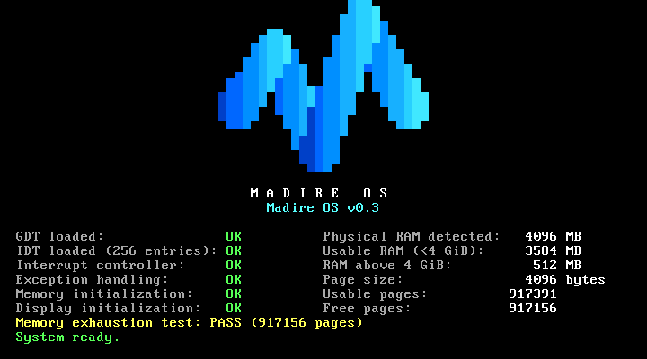

### Test D: timer diagnostic

**Diagnostics → Timer test: measure against RTC.** After about 4 seconds:
`Timer diagnostic: PASS (300 ticks in 3 RTC seconds, expected 270-330)`, then `System ready.`

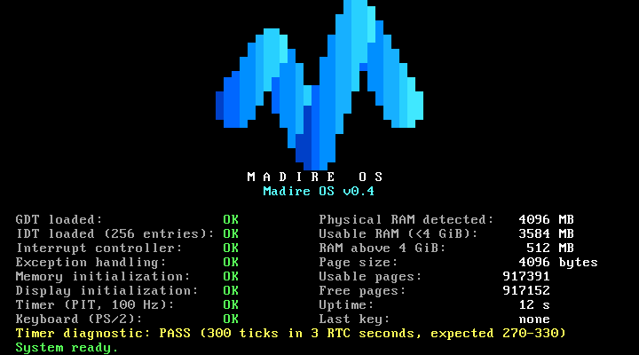

### Test E: keyboard diagnostic

**Diagnostics → Keyboard test: show key codes.** Each key event appears in the panel area, with `>` marking the newest line. After 10 lines it wraps to the top. Reboot to exit. (This diagnostic never opens the console.)

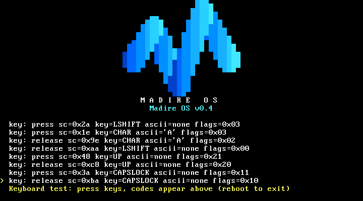

Check: Shift+A gives `LSHIFT` and then `'A'` with `flags=0x03`; Up is `UP` with `flags=0x21` (extended); Caps Lock toggles (`0x11` on, `0x01` off), and `a` gives `'A'` while it's on.

### Test G: page-fault diagnostics (0.6; NX added in 0.7, `pflow` in 0.8)

**Diagnostics → Page-fault test: …**. Each ends on the crash screen with `CPU exception 14: Page Fault (#PF)` and the decoded error code under it, on up to three lines (since 0.7: `Page fault: …`, `Details: …` only when needed, `Address: 0x…`):

| Entry | Error code | Decoded lines | CR2 |
|---|---|---|---|
| read from NULL | `0x00000000` | `Page fault: not present, read, kernel mode` / `Address: 0x0000000000000000` | `0x0000000000000000` |
| read from unmapped address | `0x00000000` | `Page fault: not present, read, kernel mode` / `Address: 0x0000000040000000` | `0x0000000040000000` |
| write to read-only kernel code | `0x00000003` | `Page fault: protection violation, write, kernel mode` / `Address: 0xffffffff80100000` (0.8; `0x0000000000100000` up to 0.7) | `0xffffffff80100000` |
| execute from no-execute data (NX) | `0x00000011` | `Page fault: protection violation, read, kernel mode` / `Details: instruction fetch (NX violation)` / `Address:` the data page (0.10: `0xffffffff801b3000`; 0.9.2: `0xffffffff801a2000`; 0.9.1: `0xffffffff8017b000`; 0.9: `0xffffffff80169000`; 0.8: `0xffffffff8015e000`) | the data page |
| read the kernel's old low address (0.8) | `0x00000000` | `Page fault: not present, read, kernel mode` / `Address: 0x0000000000100000` | `0x0000000000100000` |

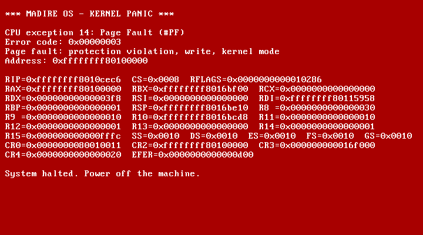

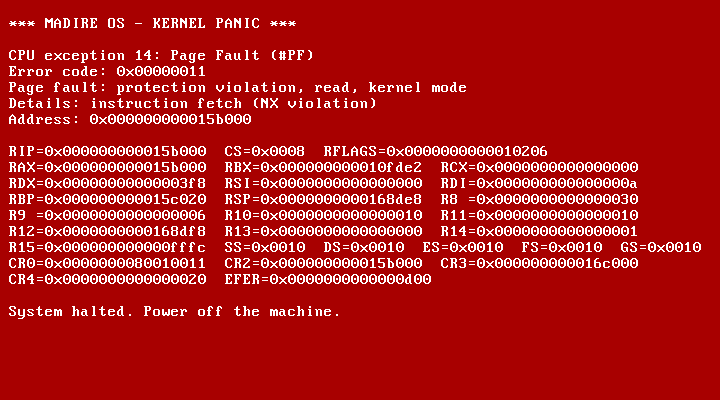

**`pflow` (0.8)** reads `0x100000`, where the kernel ran up to 0.7. With the lower half empty that address is not mapped, so it must end here, not read kernel code:

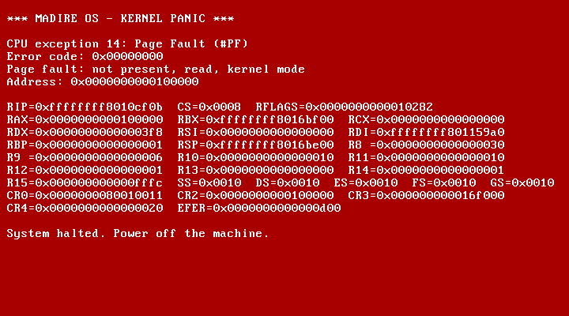

For `pfnx`, the serial log shows first that kernel code ran (`returned 0x5a5a5a5a (correct)`), then that the data page has the NX bit. On a CPU without NX the data page runs and the test says **NOT APPLICABLE** (serial and screen) instead of passing; the VM exposes NX, so it faults.

The four heap diagnostics (`heapdouble`, `heapinvalid`, `heapcorrupt`, `heapexhaust`) have no boot-menu entries; they run in QEMU only (section 1b).

### Test H: kernel stack overflow (0.7)

**Diagnostics → Crash test: kernel stack overflow.** The kernel recurses until its stack reaches the unmapped guard page:

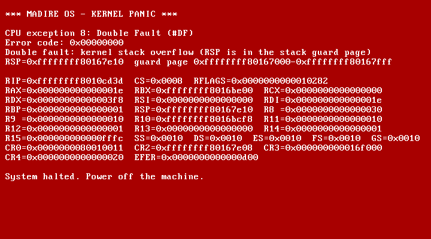

- `CPU exception 8: Double Fault (#DF)`, error code `0x00000000`;
- `Double fault: kernel stack overflow (RSP is in the stack guard page)`, then `RSP=0x…` and the guard page's range (the RSP lies inside it);
- the full register dump (the handler ran on its own IST1 stack), then `System halted.`;
- the VM **doesn't reset**: the screen stays up, and the serial log shows `boot32: start` once.

### Test I: boot module through the boot menu (0.7; on screen since 0.8; Limine since 0.13)

The normal ISO loads no module, so this uses a scratch ISO built exactly like the QEMU test's (since 0.13 a `limine.conf` with `module_path: boot():/boot/test-module.bin` and `module_string: test-module`, made with `limine_tree` and `limine_iso` from `tests/qemu-lib.sh`; before, a `grub.cfg` with a `module` line; and a test module made by `make_test_module` in `tests/qemu-part-1.sh`); it isn't part of the repository (since 1.3 stage 9 it is packaged on Kali by `scripts/kali-module-iso.ps1`, around the kernel of the ISO under test: "Stage 9's owner-run steps" above). The serial log has the full result:
`Boot module 1: 0x0016f000-0x001726c0 (14016 bytes): test pattern intact (FNV-1a …, expected …)`. Since 0.8 the boot screen's message line also shows `Boot module 1: test pattern intact (14016 bytes)`, for machines without a serial port; otherwise it looks like a normal boot, with one more reserved range:

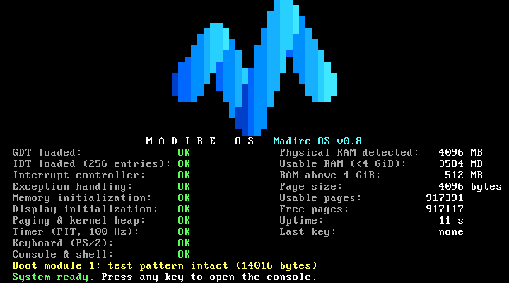

### Test J: preemption (0.9)

**Diagnostics → Thread test: preemption** (entry 14). Three kernel threads that never yield spin for 300 ticks (3 seconds), and the scheduler must share the CPU between them by preemption alone. The boot screen's message line shows `Preempt test: 3 threads that never yield, for 3 seconds...`, then `Preempt test: PASS`, and the boot finishes normally (`System ready.`):

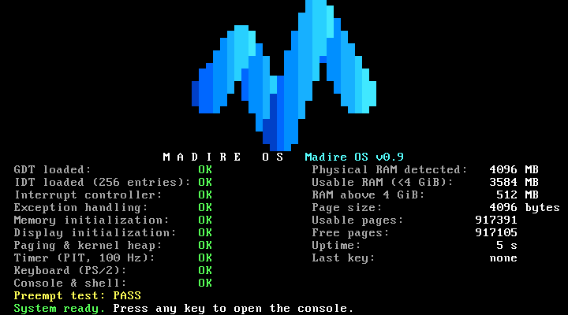

The serial log has the figures. From the 0.9 run:

- `Preempt test: fair shares: spin0 33.3% (100 ticks), spin1 33.6% (101), spin2 33.0% (99) of 300 (each 25-42%): OK`
- `Preempt test: preemptions: 59 preemptions in 300 ticks (about 60 expected: one per 5-tick slice): OK`
- every thread made progress, the timer kept ticking (311 ticks elapsed), and everything returned (free pages, stack slots, live threads);
- `Preempt test: longest turn: 5 ticks (slice 5)`, then `Preempt test: PASS (6 checks, 0 mismatches)`.

The exact shares and counts vary slightly from run to run; each share must stay within 25–42 %.

### Test K: kernel thread stack overflow (0.9)

**Diagnostics → Crash test: kernel thread stack overflow** (entry 15). A kernel thread named `overflow` recurses until its stack runs into the unmapped 16 KiB guard below it:

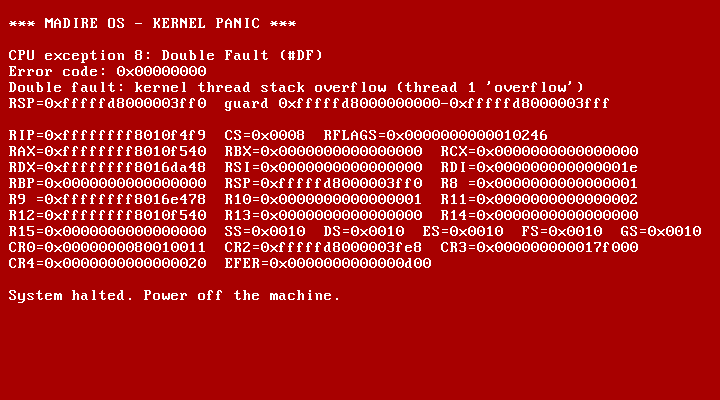

- `CPU exception 8: Double Fault (#DF)`, error code `0x00000000`;
- `Double fault: kernel thread stack overflow (thread 1 'overflow')`, then `RSP=0xfffffd8000003ff0  guard 0xfffffd8000000000-0xfffffd8000003fff`: the RSP lies inside that thread's guard, in slot 507;
- the full register dump (the handler ran on IST1), then `System halted.`;
- the VM **doesn't reset**: the serial log shows `boot32: start` once.

### Test L: the 0.9.1 commands and reboot

In the console (the scripted `commands` and `reboot` groups do the same):

| Check | Expected |
|---|---|
| `help` | the 7 commands, `ps`, then `history`, `uname`, `hostname`, `date`, `dmesg`, `reboot` |
| `help mem`, `mem --help` | `mem: Show memory information` / `Usage: mem` (any command works, with either form) |
| `uname -a`, `hostname` | `Madire OS madire 0.9.1 x86_64`; `madire` |
| `date` | e.g. `2026-10-06 09:59:27 (RTC; time zone not set)`: on `MadireOS-Test` this is the host's **local** time, because VirtualBox keeps the RTC on local time; QEMU shows UTC |
| `dmesg 5` | the last 5 kernel-log lines: usually the key events of the command just typed, then `madire> dmesg 5` itself |
| `echo one`, then Up and Enter | `echo one` runs again |
| `history` | the commands so far, numbered, `history` itself last |
| `reboot`, then `no` | `Restart Madire OS now? Type 'yes' to confirm:`, a `yes/no> ` prompt, `Restart cancelled.`, back to `madire> ` |
| `reboot`, then `yes` | `Restarting...`, then the VM resets: BIOS, the boot menu (3 s; Limine since 0.13) and a normal boot again. The COM1 log keeps both boots |


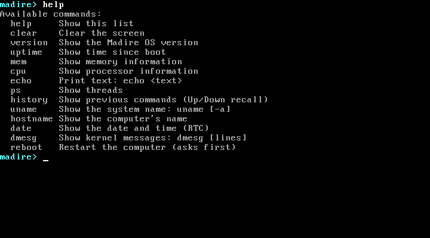

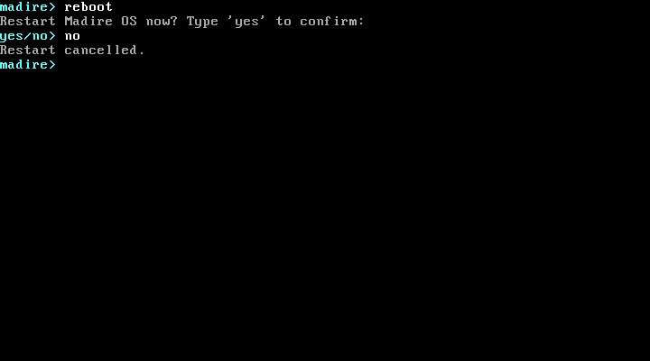

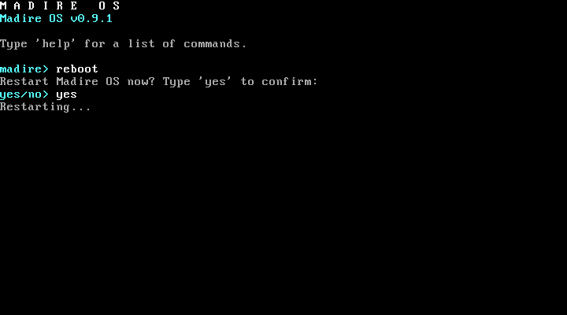

### Test M: scrollback and key logging (0.9.2)

In the console (the scripted `scrollback` and `boot` groups do the same):

| Check | Expected |
|---|---|
| `dmesg 60`, then **Shift+PgUp** | older lines fill rows 0–23 and the bottom row shows, in reverse colours, `-- scrolled back: line 19 of 67 (Shift+PgUp/PgDn; any key returns) --` (the numbers depend on how many lines are kept); the cursor disappears |
| **Shift+PgUp** again | 24 lines further back, never past line 1 (`line 1 of 67` with only 42 lines kept: the banner and `madire> dmesg 60` at the top) |
| **Shift+PgDn** | 24 lines forward; past the newest kept line, back to the live screen |
| Any other key, e.g. `a` | back to the live screen, and the key is typed (`madire> a`); Shift alone does nothing |
| Not scrolled back: plain PgUp/PgDn | nothing happens |
| `clear`, then Shift+PgUp | the lines that were on screen before `clear` are there |
| The serial log | `Key events: not logged (boot option 'keylog' logs them; for tests only)` and no `key:` line, although keys were typed |


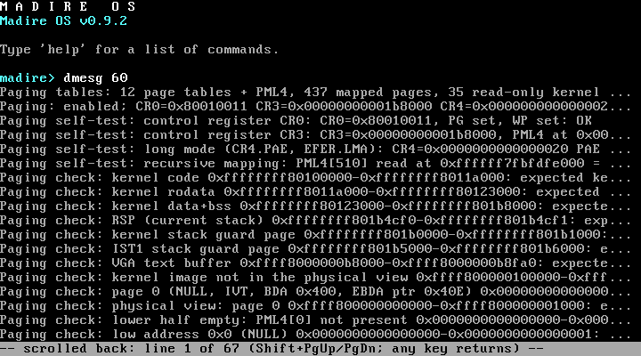

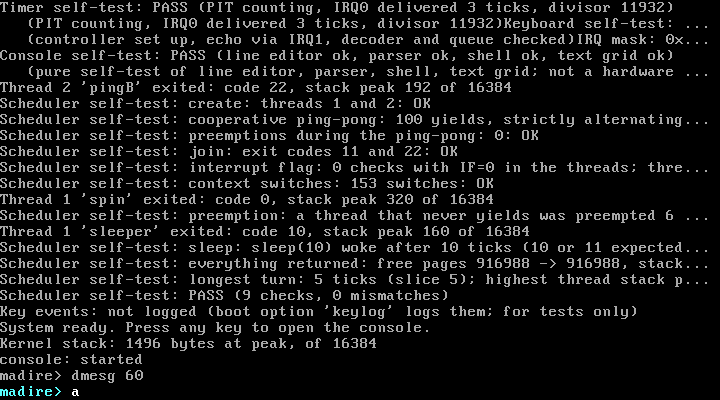

In the last screenshot, one `dmesg` line reads `…divisor 11932)Keyboard self-test: …`: two boot-screen lines joined. This is the documented `dmesg` gap (a boot-screen status line's newline goes to the serial port only), not a 0.9.2 change; a fix is proposed in [PROGRESS.md](PROGRESS.md).

### Test N: user processes and SMEP/SMAP (0.10)

**Diagnostics → User-mode test: …** (entries 16–24). Each runs built-in programs as processes and ends with its result on the message line, then `System ready.` and the console (the scripted `user` group does the same). For example, entry 18 (`userfault`):


| Entry | Message line | The serial log shows |
|---|---|---|
| 16 `userspin` | `User-mode test: PASS` | `spin preempted 19 times from ring 3 and back in ring 3 after a preemption 95 times; 40 switches, 100 ticks run by spin; longest turn 5 ticks …` |
| 17 `userkill` | `User kill test: PASS` | 60 processes (PIDs 4–63) started and killed, 40 after reaching ring 3; teardown exact; `longest turn 5 ticks (slice 5, at most 6): OK` |
| 18 `userfault` | `User fault test: PASS` | one line per program, e.g. `Process N 'nullptr' ended by CPU exception 14 (#PF Page Fault) at RIP 0x…: address 0x0000000000000000, not present, read, user mode; the kernel continues`, and the instruction bytes compared with the expected ones |
| 19 `userpriv` | `User privilege test: PASS` | #GP for each privileged instruction and gate (the gate in the error code), #NM for x87 `fld1` (`d9 e8`), #UD for MMX `pxor` and SSE `xorps` |
| 20 `userkmem` | `User kernel-memory test: PASS` | a user-mode page fault at each kernel address read or written; the kernel's checksum unchanged |
| 21 `usersys` | `User syscall test: PASS` | exit statuses 42, 43, 7, 44; `getpid`; `-ENOSYS` for 1028 numbers; registers preserved; exact call counts |
| 22 `userio` | `User I/O test: PASS` | `[pid N] Hello from user mode`; `?` for control characters; `nanosleep 100 ms: 10 ticks asked for, 10 slept: OK`; bad pointers refused, nothing logged |
| 23 `userpreempt` | `User preemption test: PASS` | each spin process's longest turn (at most 6 ticks) and the kernel frame thread's (logged only) |
| 24 `userchurn` | `User churn test: PASS` | 1000 processes; everything restored |

**Diagnostics → Crash test: the kernel executes / reads a user page (SMEP / SMAP)** (entries 25 and 26). On a CPU with SMEP and SMAP they end on the crash screen with `CPU exception 14: Page Fault (#PF)`, error code `0x00000011` / `0x00000001`, and a `Cause:` line naming SMEP or SMAP (see *Crash screen* in [architecture.md](architecture.md)). `MadireOS-Test` doesn't offer SMEP or SMAP to the guest, so there each reports NOT APPLICABLE on the message line and the boot finishes normally:

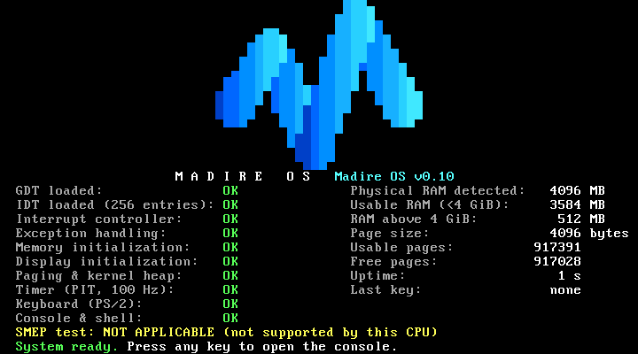

### Troubleshooting by layer

| Symptom | Layer | Check |
|---|---|---|
| "No bootable medium found" | ISO / VM config | ISO attached? Boot order has DVD first? |
| UEFI shell, or a blank screen before the boot menu | VM config | Firmware must be BIOS |
| The boot loader refuses the kernel (Limine: a `multiboot1:` panic such as `Invalid magic`; GRUB before 0.13: `error: no multiboot header found`) | Kernel / linker | Multiboot test in `make test` (`scripts/check-multiboot.py`); `.multiboot` must come first in `linker.ld` |
| The boot loader is given the ELF file (GRUB before 0.13: `invalid arch-dependent ELF magic`) | Toolchain | The ISO must hold the flat binary `build/madire.kernel` (loaded through the a.out kludge fields), not the 64-bit ELF `build/madire.elf` |
| White on red on the top row: `Madire OS needs a 64-bit (x86-64) CPU: … Halted.` | CPU / VM | The (virtual) CPU has no long mode or no PAE: in VirtualBox, choose a 64-bit OS type (e.g. `Other_64`) and a CPU with hardware virtualization |
| Screen blank after the boot menu | Kernel | Check the serial log (`build/serial-boot.log` from `make test`, or `build\vbox-serial.log` in VirtualBox): the last `boot32:`/`boot64:` marker shows how far the stub got |
| VM resets straight back to the boot menu or the BIOS | CPU tables | Triple fault. Run `make test`: whichever marker or status line is missing from `build/serial-boot.log` shows the failing step. |
| A status line says `FAILED` | That subsystem | The serial log has the reason (`Timer self-test: FAIL (…)`, `Keyboard self-test: FAIL (…)`, …) |
| `Timer … FAILED (PIT counting but IRQ0 never delivered)` | IRQ0 / PIC | Mask or EOI problem: check `IRQ mask:` in the serial log |
| `Keyboard … FAILED (no keyboard answered)` | i8042 / VM | VM has no PS/2 keyboard (e.g. USB-only input); check the VM's input settings |
| Uptime stays at 0 | Timer | Timer status will also be `FAILED`; see above |
| Keys don't change "Last key" | Keyboard / IRQ1 | Keyboard status; `key:` lines in the serial log |
| Bottom row says `console disabled` | Keyboard or console self-test | The console is offered only if both `Keyboard (PS/2)` and `Console & shell` are `OK` |
| Console open but typing does nothing | Keyboard / IRQ1 | `key:` lines in the serial log; keys with Ctrl or Alt held are ignored by design |
| `FATAL: Keyboard error:995` before the boot menu | VirtualBox BIOS | Keys were sent too soon after power-on; since 0.13 the script sends none before Limine's menu (a 1024-pixel-wide screen) is shown |
| Crash screen: `PIC mask is 0x…, expected 0x…` | IRQ layer | An IRQ line other than 0/1 was unmasked: a kernel bug |
| Logo in wrong colours | VGA palette | `drivers/vga/vga_text.c` `vga_set_palette()` |
| Crash screen: `Memory: …` or `Memory self-test failed: …` | Memory | The message names the problem; see `docs/architecture.md` |
| `Paging & kernel heap: FAILED (paging)` | Paging | The walk-check found a mismatch (or the CPU has no CPUID): the `Paging check: … MISMATCH` line in the serial log names the address; paging stays off, the heap is disabled, boot continues |
| `Paging & kernel heap: FAILED (heap)` | Kernel heap | `Kernel heap self-test:` lines in the serial log; `kmalloc` returns `NULL` from then on |
| Crash screen: `Paging self-test failed` | Paging | Paging was on but the self-test failed; `Paging self-test: … MISMATCH` in the serial log |
| Crash screen: exception 14 outside the page-fault tests | A kernel bug | The `Page fault:` lines give the access type and the address (CR2); RIP is the faulting instruction. `Details: instruction fetch (NX violation)` means code ran from a no-execute page (data, stack or heap) |
| Crash screen: exception 14 with a low address (below `0x0000800000000000`) outside `pflow` | A kernel bug (0.8) | The lower half is empty in the kernel's tables: code used a physical address as a pointer. Use `phys_view()` (low 1 MiB, boot data), the window (other frames) or `kernel_phys()` (see `docs/development.md`). Since 0.10 a process's lower half holds its user pages: a kernel access to one must go through `copy_from_user` |
| Crash screen: `Cause: SMEP violation …` or `Cause: SMAP violation …` outside `test=smep`/`smap` | A kernel bug (0.10) | The kernel executed a user page, or read or wrote one outside `copy_from_user` (RIP is the instruction). Copy user memory with `copy_from_user` |
| Crash screen: `Kernel-half PML4 entry created after the freeze: …` | A kernel bug (0.10) | Something mapped into an empty kernel-half PML4 slot after boot. New kernel areas must use a slot that exists at the freeze (see `docs/development.md`) |
| Crash screen: `User-mode CPU set-up failed` or `System-call set-up failed` | CPU set-up (0.10) | The serial log's `SMEP:`, `SMAP:`, `CR0.EM:` and `SYSCALL:` lines say which register didn't take the value |
| Crash screen: `User-mode self-test failed (details on the serial log).` | User mode (0.10) | The `User-mode self-test:` lines name the process and the result that was wrong (or the cleanup figure) |
| `Process N '…' ended by CPU exception …; the kernel continues` in the log | Expected for the fault tests (0.10) | A program made a mistake and was ended alone; the line names the exception, RIP and (for a page fault) the address |
| `[pid N] …` lines in the log | Expected (0.10) | A program's `write` output; it goes to the serial log and `dmesg` only, with `?` for control characters |
| Screen blank or reset right after `boot64: entered 64-bit long mode`, with no `running at the higher half` line | Boot stub / linker (0.8) | The jump to the higher half failed: check the stub's temporary PML4[511] mapping and that `.boot` is linked at 1 MiB and everything else at `0xFFFFFFFF80000000` + physical |
| Crash screen: exception 8, `Double fault: kernel stack overflow …` outside the stack test | A kernel bug | The kernel stack (16 KiB) ran into its guard page: too-deep recursion or a large local buffer |
| Crash screen: `Heap: …` | Kernel heap misuse | Double free, invalid free or a corrupted block: a kernel bug; the message gives the pointer |
| Crash screen: `kmalloc: called with interrupts disabled` | Kernel heap | `kmalloc`/`kcalloc`/`kfree` called from an IRQ/exception handler or with interrupts off |
| Crash screen: `Scheduler self-test failed (details on the serial log).` | Scheduler (0.9) | The `Scheduler self-test:` lines name the failing check. If it's the ping-pong order, check the line `preemptions during the ping-pong`: a reordering right after a preemption is accepted (option (A)); one without a preemption is a real fault |
| Crash screen: `… called with preemption disabled (count N, thread T '…').` outside the `preempt*` tests | A kernel bug (0.9) | A thread yielded, slept, joined or exited inside a `preempt_disable()` section (or while holding the window). The message names the call and the thread |
| Crash screen: `Screen output from thread N '…': only thread 0 writes to the screen` | A kernel bug (0.9) | A thread other than 0 used `kprintf`/`kputs`; it must use `klogf` |
| Crash screen: `Boot screen used from thread N '…'` | A kernel bug (0.9) | A boot-screen call outside thread 0; every such call must go through `BOOTSCREEN_SAFE()` on thread 0 |
| Crash screen: `Double fault: kernel thread stack overflow (thread N '…')` outside Test K | A kernel bug (0.9) | That thread used more than its 16 KiB stack: too-deep recursion or a large local buffer. Exit lines (`Thread N '…' exited: …, stack peak P of 16384`) show how close other threads came |
| `make iso` stops with `error: … calls bootscreen_*()` | Build check (0.9) | `scripts/check-bootscreen.sh`: a boot-screen call outside the boot sequence; use `BOOTSCREEN_SAFE()` in `kernel/kernel.c` |
| A thread test hangs in QEMU but passes in VirtualBox | Test code (0.9) | A loop that only polls `timer_ticks()` can starve IRQ0 under QEMU's TCG; do real work between the reads (see [development.md](development.md)) |
| `date` is hours off | VM clock basis (0.9.1) | Expected: VirtualBox keeps the RTC on the host's local time, QEMU on UTC, and `date` has no time zone. Don't change the VM's clock setting without approval |
| `date` says `Date: unavailable (RTC not responding)` | CMOS RTC | The RTC stayed busy (update in progress) or gave an invalid date; `test_rtc` lists what is refused |
| `dmesg` lacks the `GDT loaded: OK` … lines, or shows two boot lines joined (`…11932)Keyboard self-test: …`) | Kernel log (0.9.1) | Expected: the boot screen's status lines (and their newlines) and the console's output go to serial directly, not through `klogf` (documented gap, fix proposed in PROGRESS.md); the serial log has everything |
| No `key:` lines in the serial log | Expected (0.9.2) | Key events are logged only with the boot option `keylog` or during `test=keyboard`/`test=kbdflood`; the log says `Key events: not logged …`. Add `keylog` for a test, never where secrets are typed |
| Shift+PgUp does nothing | Console (0.9.2) | `console: scrollback is empty` means nothing has scrolled off yet; the keypad's PgUp types `9` (Num Lock is assumed on): use the grey PgUp key |
| `reboot` then `yes`, but the serial log shows `the keyboard controller did not reset the machine` | Reset (0.9.1) | The keyboard controller ignored `0xFE`; the triple-fault fallback follows and should still reset. If the machine halts instead, report it |
| `help x` says `No help for 'x': unknown command.` without a hint | Expected (0.9.1) | The message is kept short so every line fits 79 columns; type `help` for the list |
| `vbox-acceptance.ps1`: `The VM does not match the documented settings; refusing to run` | VM config | The lines above it name each difference. Nothing was changed. Don't change a VM setting without approval; report the difference |
| Panel shows less usable RAM than the VM has | Expected | RAM above 4 GiB isn't used yet, and firmware-reserved areas never are |
| `build\vbox-serial.log` is empty or missing | VM config | COM1 must be set to file mode (see the VM configuration above); the file is recreated at every power-on |
| `build.ps1`: `open local "build/madire-os.iso": Broken pipe` | VM running | Power off `MadireOS-Test`, then build again |
| `run.ps1`: "state is Saved" | VM state | Use the current `run.ps1`, which discards saved states automatically (since commit `f07b517`) |
