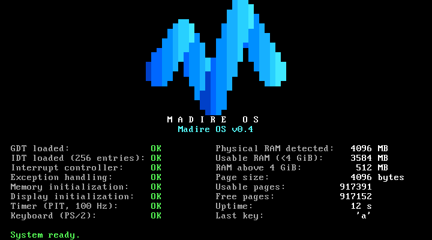

# Testing

## 1. Automated tests (`make test`)

These run in the Linux build environment, and `scripts/build.ps1` runs them on every build. `make test` runs the host unit tests first (`make unit`), then [`tests/qemu-tests.sh`](../tests/qemu-tests.sh).

### 1a. Host unit tests (`make unit`, `tests/unit/`)

The pure modules have no hardware access, printing or panics:

- memory: `mmap.c`, `pmm.c`, `reserve.c`
- keyboard decoder and queue: `scancode.c`, `keyqueue.c`
- PIT divisor maths: `pit_divisor.h`

They're compiled with the host GCC as ordinary 32-bit Linux programs (`-m32`, same warnings-as-errors options) and tested with synthetic data: cases real hardware can't produce on demand.

| Suite | Since | Cases |
|---|---|---|
| `test_mmap` (12) | 0.3 | QEMU- and VirtualBox-shaped maps; type classification (1/2/3/4/5/unknown); entry `size > 20` skipped correctly; `size < 20`, truncated entry, 64-bit overflow (including an end of exactly 2^64), empty map, null or wrapping buffer all rejected; zero-length entries skipped; unsorted and overlapping entries; 150 entries (no silent limit) |
| `test_pmm` (20) | 0.3 | first allocation = lowest free page; distinct allocations; exhaustion (then 0, repeatedly); free and reallocate; free after exhaustion; double free, reserved or kernel page, VGA page, page 0 and unaligned address all rejected; sub-page region and page-boundary crossing; reservations round outward; reserved wins over overlapping usable; phase enforcement; RAM above 4 GiB ignored or clipped (including near 2^64); no memory; a single usable page; multiple regions in order; the full 4 GiB space drained (1,048,320 pages) |
| `test_reserve` (9) | 0.3 | low 1 MiB, kernel, info block, map, command line; modules (table, range, name; empty module); invalid module range; table full; null or wrapping pointers; unterminated string; kernel and stack layout checks; end to end: every page from an exhausted allocator is checked against every reserved byte |
| `test_pit` (5) | 0.4 | 100 Hz → 11932, 1000 → 1193, 50 → 23864; extremes (1193182 Hz → 1, 19 Hz → 62799); out-of-range rejected (18 Hz, 0, above the base clock) with output untouched; rounding in both directions; every rate from 19 to 10,000 Hz within 0.5 % |
| `test_scancode` (17) | 0.4 | letter press and release; left, right and both Shifts; Caps Lock toggles once while held (auto-repeat ignored); Caps+Shift; shifted symbols; Ctrl/Alt flags; `E0` extended keys (Up, right Ctrl, keypad Enter, right Alt, Delete, Left), including the same byte without a prefix; fake shifts around Print Screen ignored; full Pause sequence → one event; unknown codes; stray release; Enter/Backspace/Tab/Space/Esc; F1–F12; prefix then release; keyboard replies are not keys; **all 256 bytes after every prefix state** decode safely; every key has a name |
| `test_keyqueue` (8) | 0.4 | empty pop; FIFO order; fill to 64; overflow drops the newest and counts it (the first 64 kept, in order); space frees after a pop; 1,000 uneven push/pop rounds with wrap-around; counters wrapping past 2^32; re-init |

### 1b. QEMU tests (`tests/qemu-tests.sh`)

These boot the kernel headless in QEMU and check the serial output. The kernel copies its screen text to COM1 and logs details there. Each run writes `build/serial-*.log`.

Checks added in 0.4 are tagged `[0.4]`, so the summary line separates them from the 0.3 regression checks:
`ALL TESTS PASSED (180 checks: 150 0.3 regression + 30 new in 0.4)`.
The only 0.3 check that changed is the version check (`v0.3` → `v0.4`).

| Group | How it boots | What it checks |
|---|---|---|
| Multiboot header | (not booted) | `grub-file --is-x86-multiboot` accepts the kernel |
| Normal boot | the real ISO, through GRUB (128 MB), and QMP types `x` after "System ready." | logo lit-pixel count = **293**; title; version `v0.4`; `GDT`, `IDT`, `Interrupt controller`, `Exception handling`, `Memory initialization`, `Display` all `OK`; `Memory self-test: PASS`; every memory panel line; no `PENDING`, `FAILED` or `PANIC`; memory model check. **[0.4]** Timer and keyboard self-tests `PASS` and status `OK`; `IRQ mask: 0xfffc`; `uptime: 5 s`; the typed key arrives (press and release); no unexpected IRQs or dropped keys. |
| RAM sizes | `-kernel` at `-m 16M`, `32M`, `1G`, `4G` | boots; self-test passes; memory `OK`; panel shows the expected MB above 4 GiB; memory model check with pinned values |
| Boot module | `-m 32M -kernel … -initrd module.bin` | module range reserved; model check |
| Exhaustion | `-append "test=memexhaust"` at 16M and 128M | every free page allocated, verified and freed; `System ready` afterwards; no panic. **[0.4]** ran with IRQ0/IRQ1 live. |
| Double free / free reserved | `test=doublefree`, `test=freereserved` | crash screen with the page address |
| Crash tests | `test=divzero`, `ud`, `gpf` | vector, name, error code (`0x28` for #GP), register dump with `CS=0x0008`, halted. **[0.4]** raised with IRQ0/IRQ1 live. |
| **[0.4] Timer rate** | `-m 32M -kernel … -append "test=timer"` | `Timer diagnostic: PASS`: 270–330 ticks across 3 RTC seconds. The measured value is printed (typically 293–300). |
| **[0.4] Keyboard, scripted** | `test=keyboard`, with `tests/qmp_keys.py` typing `a, Shift+B, Caps Lock, a, Caps Lock, Shift+1, Up, right Ctrl, Enter, keypad Enter` | every event decoded exactly, **in order**: scancode, key name, character and flags. For example `'B'` with `flags=0x03`, `'A'` with Caps (`0x11`), `'!'`, `UP` extended (`0x21`), `RCTRL` (`0x25`), `KP_ENTER` (`0x21`), and the extended release. Nothing dropped or unknown. |
| **[0.4] Queue overflow** | `test=kbdflood`, with QMP typing 50 keys (100 events) quickly | queue full (**64 kept**), overflow dropped and counted, **kept + dropped + late = 100** (no event lost unaccounted), drop count reported from normal context, kept events are the oldest in order, system ready afterwards |
| **[0.4] Unexpected IRQ** | `test=irqunexpected` | IRQ2 counted and acknowledged, reported from normal context, system ready, no panic |

Every QEMU run uses `-no-reboot`. If the CPU triple-faults (an exception that can't be handled, which resets the CPU), QEMU exits, the expected text never appears, and the test fails. A crash can't pass by accident.

**Keyboard injection (`tests/qmp_keys.py`):** connects to QEMU's QMP socket using only the Python standard library. It waits until a "ready" line appears in the serial log, then sends each combination with `send-key` (QEMU sends a make and a break for each key, like a real keyboard).

**Why the flood test checks conservation, not a fixed drop count:** how many of the 100 events arrive inside the kernel's 3-second window depends on host timing (runs have given dropped = 35 with 1 late, and dropped = 36 with 0 late). The invariants that must always hold: the queue ends full (64), every other event is either counted as dropped or delivered afterwards, and nothing disappears.

**Timer timing: deterministic mode tried, fallback used.** The plan was to run the timer test under `-icount shift=0,sleep=off -rtc clock=vm`, so the PIT and the RTC would both follow QEMU's virtual clock and the count would be exactly repeatable. This was tested explicitly, 3 runs, and **it never reached a result within 30 s**. The diagnostic busy-polls the RTC for precise second boundaries, and under `-icount` each emulated port access costs far more real time than the virtual time it advances, so 4 virtual seconds would take minutes. The documented fallback is used instead: QEMU's normal clock with the kernel's ±10 % band. Host-clock runs measured 293–300 ticks.

**Memory model check (`tests/memory_check.py`):** reads the memory map and reservations the kernel logged, and recomputes usable, free and reserved pages, physical RAM and RAM above 4 GiB with separate per-page Python code. Every figure must equal the kernel's `memory:` summary line.

**Pinned values.** These come from the memory maps **QEMU 8.2.2** reported (inspected with GRUB 2.12 `lsmmap`). They're regression expectations for that environment only. The kernel never uses them: it always calculates from the map.

| `-m` | Usable pages | Physical RAM | Above 4 GiB |
|---|---|---|---|
| 16M | 3967 | 15 MB | 0 |
| 32M | 8063 | 31 MB | 0 |
| 128M (ISO) | 32639 | 127 MB | 0 |
| 1G | 262015 | 1023 MB | 0 |
| 4G | 786303 | 4095 MB | 1024 MB |

**Logo reference:** `python scripts/logo-preview.py preview.png` runs the same stroke data and whole-number maths as `kernel/logo.c`, independently. If you change the logo, update both files and `LOGO_PIXELS` in the test script.

## 2. VirtualBox tests (manual acceptance)

### One-time VM configuration: `MadireOS-Test`

| Setting | Value |
|---|---|
| Type | Other / Unknown |
| Firmware | **BIOS** (not EFI) |
| RAM | 4096 MB |
| CPUs | 2 |
| Video memory | 128 MB |
| Network | NAT |
| Storage | SATA port 0: 30 GB disk (unused for now); SATA port 1: optical drive |

Commands that were run (`VBoxManage` is in `C:\PFiles\Oracle\VirtualBox\`):

```
VBoxManage modifyvm MadireOS-Test --firmware bios --ostype Other
```

### Procedure

```powershell
.\scripts\build.ps1     # build + automated tests, produces build\madire-os.iso
.\scripts\run.ps1       # powers off / discards a saved state, attaches the ISO,
                        # sets boot order DVD -> disk, starts the VM
```

To do it by hand instead: VM **Settings > Storage**, select the optical drive, choose `build\madire-os.iso`, then **Start**.

**Close the VM (Power off) before running `build.ps1`.** A running VM keeps the ISO open, and copying the new ISO back then fails with `scp: open local "build/madire-os.iso": Broken pipe`. The build and tests still ran in the Codespace.

Keys can be typed into the VM from the host (this is how the tests below were run):
`VBoxManage controlvm MadireOS-Test keyboardputscancode 1e 9e` (the `a` key).

### Test A: normal boot

The GRUB menu shows **Madire OS v0.4** and **Diagnostics**. After 3 seconds it boots the first entry:



- The M logo is drawn in the blue-to-cyan gradient.
- Left column: **8 status lines, all `OK`**, including `Timer (PIT, 100 Hz)` and `Keyboard (PS/2)`.
- Right column: memory figures, then **Uptime**, which counts up every second, and **Last key**, which shows the last key pressed (`none` until then). For `MadireOS-Test` (4096 MB):

  | Line | Value |
  |---|---|
  | Physical RAM detected | **4096 MB** |
  | Usable RAM (<4 GiB) | **3584 MB** |
  | RAM above 4 GiB | **512 MB** |
  | Page size | **4096 bytes** |
  | Usable pages | **917391** |
  | Free pages | **917152** (usable minus the low 1 MiB, the kernel and GRUB's boot data; changes when the kernel's size changes) |

- `System ready.` in green on the bottom row.
- Pressing a key (or `keyboardputscancode 1e 9e`) shows `Last key: 'a'`.

### Test B: crash screen

In the GRUB menu, press **↓** to highlight **Diagnostics**, press **Enter**, then choose **Crash test: divide by zero**:


- White on red, headed `*** MADIRE OS - KERNEL PANIC ***`.
- `CPU exception 0: Divide Error (#DE)`, `EAX=0x0000000a`, `ECX=0x00000000`, `CS=0x0008`, `DS=0x0010`.
- Since 0.4, EFLAGS has bit 9 set (e.g. `0x00210246`): the exception happened with hardware interrupts live.

The other two crash entries should show `Invalid Opcode (#UD)` and `General Protection Fault (#GP)` with error code `0x00000028`.

### Test C: memory diagnostics

| Entry | Expected |
|---|---|
| **Memory test: allocate every page** | after **about a minute** on a 4 GB VM, `Memory exhaustion test: PASS (917152 pages)` and `System ready.` Uptime keeps counting during the test. |
| **Memory test: double free** | crash screen: `Double free of physical page 0x…` |
| **Memory test: free a kernel page** | crash screen: `Attempt to free reserved page 0x00100000` |


### Test D: timer diagnostic

**Diagnostics → Timer test: measure against RTC.** After about 4 seconds:
`Timer diagnostic: PASS (300 ticks in 3 RTC seconds, expected 270-330)`, then `System ready.`


### Test E: keyboard diagnostic

**Diagnostics → Keyboard test: show key codes.** Each key event appears in the panel area, with `>` marking the newest line. After 8 lines it wraps to the top. Reboot to exit.


Check: Shift+A gives `LSHIFT` and then `'A'` with `flags=0x03`; Up is `UP` with `flags=0x21` (extended); Caps Lock toggles (`0x11` on, `0x01` off), and `a` gives `'A'` while it's on.

### Troubleshooting by layer

| Symptom | Layer | Check |
|---|---|---|
| "No bootable medium found" | ISO / VM config | ISO attached? Boot order has DVD first? |
| UEFI shell, or a blank screen before GRUB | VM config | Firmware must be BIOS |
| GRUB shows `error: no multiboot header found` | Kernel / linker | Multiboot test in `make test`; `.multiboot` must come first in `linker.ld` |
| GRUB `invalid arch-dependent ELF magic` | Toolchain | Kernel must be 32-bit (`file build/madire.kernel` should show ELF 32-bit) |
| Screen blank after GRUB | Kernel | Check `build/serial-boot.log` from `make test` |
| VM resets straight back to GRUB/BIOS | CPU tables | Triple fault. Run `make test`: whichever status line is missing from `build/serial-boot.log` shows the failing step. |
| A status line says `FAILED` | That subsystem | The serial log has the reason (`Timer self-test: FAIL (…)`, `Keyboard self-test: FAIL (…)`, …) |
| `Timer … FAILED (PIT counting but IRQ0 never delivered)` | IRQ0 / PIC | Mask or EOI problem: check `IRQ mask:` in the serial log |
| `Keyboard … FAILED (no keyboard answered)` | i8042 / VM | VM has no PS/2 keyboard (e.g. USB-only input); check the VM's input settings |
| Uptime stays at 0 | Timer | Timer status will also be `FAILED`; see above |
| Keys don't change "Last key" | Keyboard / IRQ1 | Keyboard status; `key:` lines in the serial log |
| Crash screen: `PIC mask is 0x…, expected 0x…` | IRQ layer | An IRQ line other than 0/1 was unmasked: a kernel bug |
| Logo in wrong colours | VGA palette | `drivers/vga/vga_text.c` `vga_set_palette()` |
| Crash screen: `Memory: …` or `Memory self-test failed: …` | Memory | The message names the problem; see `docs/architecture.md` |
| Panel shows less usable RAM than the VM has | Expected | RAM above 4 GiB and firmware-reserved areas aren't usable by a 32-bit kernel |
| `build.ps1`: `open local "build/madire-os.iso": Broken pipe` | VM running | Power off `MadireOS-Test`, then build again |
| `run.ps1`: "state is Saved" | VM state | Use the current `run.ps1`, which discards saved states automatically (since commit `f07b517`) |
