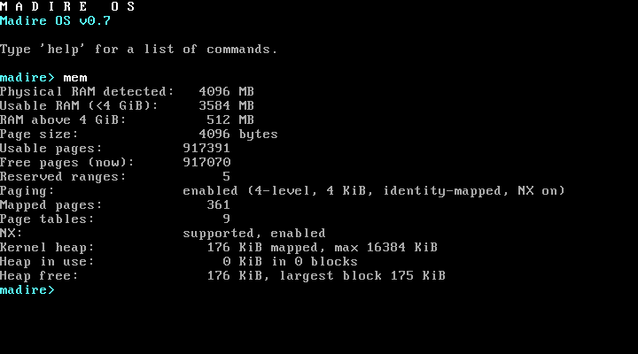
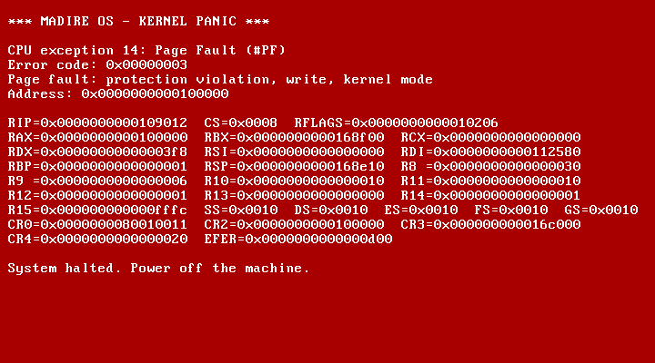
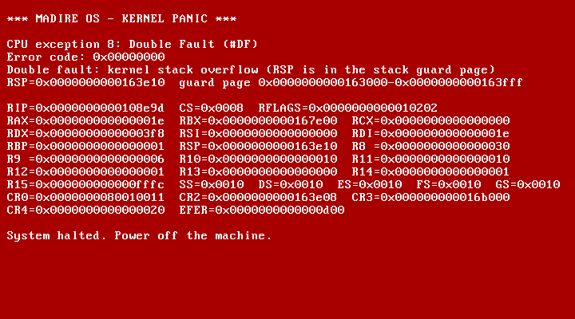

# Testing

## 1. Automated tests (`make test`)

These run in the Linux build environment, and `scripts/build.ps1` runs them on every build. `make test` runs the host unit tests first (`make unit`), then [`tests/qemu-tests.sh`](../tests/qemu-tests.sh).

### 1a. Host unit tests (`make unit`, `tests/unit/`)

The pure modules have no hardware access, printing or panics:

- memory: `mmap.c`, `pmm.c`, `reserve.c`
- paging and heap (0.6; 4-level since 0.7): `pte.h`, `vmm_core.c` (on fake physical frames), `heap.c`
- keyboard decoder and queue: `scancode.c`, `keyqueue.c`
- PIT divisor maths: `pit_divisor.h`
- console and shell: `textbuf.c`, `lineedit.c`, `parser.c`, `shell.c`, `cpuinfo.c`
- 0.7: the boot-module check `bootmod.c`; the NX decision in `cpuid.h` and the page-fault decoding in `pagefault.h`; the formatter in `kprintf.c`

They're compiled with the host GCC as ordinary 64-bit Linux programs (`-m64 -no-pie`, same warnings-as-errors options), linked at 256 MiB so their static test data lies below 4 GiB (the memory modules take 32-bit physical addresses), and tested with synthetic data: cases real hardware can't produce on demand. Known limitation: `test_reserve` also relies on that data lying above its fake 32 MiB machine, so it depends on the test binary's load address.

| Suite | Since | Cases |
|---|---|---|
| `test_mmap` (12) | 0.3 | QEMU- and VirtualBox-shaped maps; type classification (1/2/3/4/5/unknown); entry `size > 20` skipped correctly; `size < 20`, truncated entry, 64-bit overflow (including an end of exactly 2^64), empty map, null or wrapping buffer all rejected; zero-length entries skipped; unsorted and overlapping entries; 150 entries (no silent limit) |
| `test_pmm` (20) | 0.3 | first allocation = lowest free page; distinct allocations; exhaustion (then 0, repeatedly); free and reallocate; free after exhaustion; double free, reserved or kernel page, VGA page, page 0 and unaligned address all rejected; sub-page region and page-boundary crossing; reservations round outward; reserved wins over overlapping usable; phase enforcement; RAM above 4 GiB ignored or clipped (including near 2^64); no memory; a single usable page; multiple regions in order; the full 4 GiB space drained (1,048,320 pages) |
| `test_reserve` (9) | 0.3 | low 1 MiB, kernel, info block, map, command line; modules (table, range, name; empty module); invalid module range; table full; null or wrapping pointers; unterminated string; kernel and stack layout checks; end to end: every page from an exhausted allocator is checked against every reserved byte |
| `test_pit` (5) | 0.4 | 100 Hz → 11932, 1000 → 1193, 50 → 23864; extremes (1193182 Hz → 1, 19 Hz → 62799); out-of-range rejected (18 Hz, 0, above the base clock) with output untouched; rounding in both directions; every rate from 19 to 10,000 Hz within 0.5 % |
| `test_scancode` (17) | 0.4 | letter press and release; left, right and both Shifts; Caps Lock toggles once while held (auto-repeat ignored); Caps+Shift; shifted symbols; Ctrl/Alt flags; `E0` extended keys (Up, right Ctrl, keypad Enter, right Alt, Delete, Left), including the same byte without a prefix; fake shifts around Print Screen ignored; full Pause sequence → one event; unknown codes; stray release; Enter/Backspace/Tab/Space/Esc; F1–F12; prefix then release; keyboard replies are not keys; **all 256 bytes after every prefix state** decode safely; every key has a name |
| `test_keyqueue` (8) | 0.4 | empty pop; FIFO order; fill to 64; overflow drops the newest and counts it (the first 64 kept, in order); space frees after a pop; 1,000 uneven push/pop rounds with wrap-around; counters wrapping past 2^32; re-init |
| `test_textbuf` (9) | 0.5 | writing and position; newline; wrap at column 80 (an 80-character line plus newline gives no blank line); scrolling at the bottom; 1,000 scrolls; clear; Backspace (never past column 0); tab and non-printable characters; cursor clamping and direct cell writes |
| `test_lineedit` (12) | 0.5 | insert; Shift/Caps characters passed through; Backspace at start and in the middle; Delete; Left/Right/Home/End at the edges; insert at cursor; **exactly 71 characters accepted, the 72nd refused** (also mid-line); Enter and keypad Enter; releases ignored; Ctrl/Alt ignored; Up/Down/F-keys/Esc/modifiers ignored (no history); Tab inserted |
| `test_parser` (9) | 0.5 | one word; multiple spaces; leading/trailing spaces; tabs; empty and blank lines; exactly 8 words accepted, a 9th refused; a 71-character word; case preserved; nothing outside the line touched |
| `test_cpuinfo` (8) | 0.5 | CPUID unavailable; vendor strings; family/model/stepping with extended family and model (families 6, 0xF, 5); no leaf 1; brand string trimmed, absent, or exactly 48 characters; hypervisor vendor with NUL padding; feature list, "none" and safe truncation; non-printable bytes sanitised |
| `test_shell` (12) | 0.5 | **exact output** of `help`, `version`, `uptime` (0 s up to 2^32 − 1 s; ticks hidden once they no longer fit in 32 bits; timer unavailable), `mem` (MadireOS-Test figures), `cpu` (full, minimal, unavailable, paging on), `echo` (spaces, tabs, empty, 8 words); unknown commands and case-sensitivity; usage errors for all six fixed-argument commands; too many words; empty lines; `clear`; repeated commands give identical output |
| `test_pte` (6) | 0.6, 4-level in 0.7 | index split at every level (PML4, PDPT, PD, PT); canonical and non-canonical addresses, sign extension; entry encode/decode including the NX bit (offset bits never leak into the frame); alignment helpers; the 64-bit layout constants consistent (slots 508–511); page 0 (and the BIOS data area in it) is the NULL guard |
| `test_vmm` (17) | 0.6, 4-level in 0.7 | on fake frames: map, translate, unmap (frame returned); PDPT, PD and PT created on demand per level, counted and cleared; `ensure_table`; out of frames **at each level** → `NO_FRAME` with nothing half-done; unaligned addresses and frames, and only the write and NX flags accepted (never user pages); page 0, the recursive slot and non-canonical addresses refused; no mapping replaced (`EXISTS`); unmap of an unmapped page (`NOT_MAPPED`); **exactly one flush per unmap, for that address**; remap after unmap; leaf flags and intermediate entries; many mappings across table boundaries; upper-half addresses; a 2 MiB page translated, and never replaced or split; the recursive entry never touched; recursive-table addresses; error strings |
| `test_heap` (25) | 0.6 | init and bad parameters; basic alloc/free; **16-byte alignment for every size 1–4,096**; `alloc(0)`; 1,000 small blocks packed and intact; whole arena without growth; growth (page-sized, at least 16 KiB), refused growth, cap reached (never beyond); **repeated exhaustion → NULL, no corruption**; fragmentation then merging; merge with next, previous and both; split threshold (16 left → no split, 32 → split); **double free** (also after a merge); **invalid pointers** (outside, header, inside a block, misaligned); **corruption** (magic, check value, `prev_size`, size, payload overrun) caught by `heap_check`, `free` and `alloc`; `calloc` zeroes and refuses overflow; statistics consistent; **10,000 pseudo-random steps** with tagged payloads and overlap checks |
| `test_shell_mem06` (5) | 0.6 | `mem` without the 0.6 pointers is exactly the 0.5 output and a prefix of the extended one; exact paging and heap lines (0.7: `enabled (4-level, 4 KiB, identity-mapped, NX on/off)` and the `NX:` row: supported/enabled, supported/not enabled, not supported); paging-disabled and heap-disabled wording; singular `block`, a heap at the 16 MiB cap |
| `test_bootmod` (5) | 0.7 | FNV-1a against published test vectors; an intact test module; every single changed byte detected; truncated modules and modules without the header; status strings |
| `test_kprintf` (6) | 0.7 | the existing formats unchanged; `%llx`/`%llu`/`%lld` and `%lx`/`%lu` up to the full 64-bit range; `%p` at 16 digits; every power of ten; truncation to the buffer size |
| `test_nx` (3) | 0.7 | NX capability decision from CPUID (no extended leaf, bit clear, bit set); the NX page-table flag (bit 63, or 0 without NX); page-fault error-code decoding, including the NX-violation case |
| `test_shell_cpu07` (8) | 0.7 | `cpu` mode line `64-bit long mode` only when EFER.LMA is set (LME alone is not enough; no EFER keeps the 32-bit wording); `version` says `64-bit x86-64` exactly when `cpu` says long mode; `version x` still gives its usage |

### 1b. QEMU tests (`tests/qemu-tests.sh`)

These boot the kernel headless in QEMU and check the serial output. The kernel copies its screen text to COM1 and logs details there. Each run writes `build/serial-*.log`.

Checks added in 0.4, 0.5, 0.6 and 0.7 are tagged `[0.4]`, `[0.5]`, `[0.6]` and `[0.7]`, so the summary line separates them from the 0.3 regression checks:
`ALL TESTS PASSED (357 checks: 150 0.3 regression + 30 from 0.4 + 32 from 0.5 + 49 from 0.6 + 96 new in 0.7)`.

Existing checks updated in 0.7 (the count of existing checks is unchanged; each still proves the same thing):

- every boot uses `qemu-system-x86_64` instead of `qemu-system-i386`;
- the version checks (4): `v0.6` → `v0.7`, and `version` prints `Madire OS v0.7 (64-bit x86-64, Multiboot 1)` (the `[0.5] version` check and the count of 7 identical outputs);
- the crash tests' register dump: `EIP=0x…` (8 digits) → `RIP=0x…` (16 digits), still with `CS=0x0008`;
- `[0.5] cpu reports CPUID information`: the mode line must say `64-bit long mode, paging on, 1 CPU in use`;
- `[0.6] CR0.PG, CR0.WP, CR4.PAE and EFER.LMA set, CR3 holds a page-aligned PML4`: CR4 and EFER added, CR3 printed 16 digits wide;
- `[0.6]` page faults: CR2 and the address are 16 digits; the decoded line and the address are now two lines (`Page fault: …`, then `Address: 0x…`), checked in order;
- `[0.6]` heap misuse: heap addresses start with `0xfffffe80000`, other pointers are 16 digits, and the corrupted-block message says `(freeing 0x…)`;
- `[0.6] mem`: the paging line is `enabled (4-level, 4 KiB, identity-mapped, NX on|off)`;
- the boot-module test (`-initrd`) now loads a 0.7 **test module** (a header with an FNV-1a checksum, then 14,000 random bytes) instead of plain random bytes, so its contents can also be checked.

Existing checks updated in 0.6:

- the version checks: `v0.5` → `v0.6`;
- `[0.5] cpu reports CPUID information`: the mode line must now say `paging on` (only that);
- `exhaust 16M/128M: all N free pages allocated…`: N is now the `free_pages` figure from memory set-up minus the frames paging and the heap hold before the test. The kernel logs them (`frames in use before the test: T page tables + 1 directory + H heap pages = F`); the parts must add up, and the test's own count of pages left alone (taken from the allocator's bitmaps) must be exactly F, so an unaccounted page still fails.

| Group | How it boots | What it checks |
|---|---|---|
| Multiboot header | (not booted) | `grub-file --is-x86-multiboot` accepts the kernel |
| Normal boot | the real ISO, through GRUB (128 MB), and QMP types `x` after "System ready." | logo lit-pixel count = **293**; title; version `v0.7`; `GDT`, `IDT`, `Interrupt controller`, `Exception handling`, `Memory initialization`, `Display` all `OK`; `Memory self-test: PASS`; every memory panel line; no `PENDING`, `FAILED` or `PANIC`; memory model check. **[0.4]** Timer and keyboard self-tests `PASS` and status `OK`; `IRQ mask: 0xfffc`; `uptime: 5 s`; the typed key arrives (press and release); no unexpected IRQs or dropped keys. **[0.5]** Console self-test `PASS`, `Console & shell: OK`, `System ready. Press any key to open the console.`, and the typed `x` opens the console (`console: started`). |
| RAM sizes | `-kernel` at `-m 16M`, `32M`, `1G`, `4G` | boots; self-test passes; memory `OK`; panel shows the expected MB above 4 GiB; memory model check with pinned values |
| Boot module | `-m 32M -kernel … -initrd module.bin` | module range reserved; model check |
| Exhaustion | `-append "test=memexhaust"` at 16M and 128M | every free page allocated, verified and freed (through the physical-access window since 0.6; the frames held by paging and the heap are left alone and must match the kernel's count exactly); `System ready` afterwards; no panic. **[0.4]** ran with IRQ0/IRQ1 live. |
| Double free / free reserved | `test=doublefree`, `test=freereserved` | crash screen with the page address |
| Crash tests | `test=divzero`, `ud`, `gpf` | vector, name, error code (`0x28` for #GP), 64-bit register dump (`RIP=0x…` 16 digits) with `CS=0x0008`, halted. **[0.4]** raised with IRQ0/IRQ1 live. |
| **[0.4] Timer rate** | `-m 32M -kernel … -append "test=timer"` | `Timer diagnostic: PASS`: 270–330 ticks across 3 RTC seconds. The measured value is printed (typically 293–300). |
| **[0.4] Keyboard, scripted** | `test=keyboard`, with `tests/qmp_keys.py` typing `a, Shift+B, Caps Lock, a, Caps Lock, Shift+1, Up, right Ctrl, Enter, keypad Enter` | every event decoded exactly, **in order**: scancode, key name, character and flags. For example `'B'` with `flags=0x03`, `'A'` with Caps (`0x11`), `'!'`, `UP` extended (`0x21`), `RCTRL` (`0x25`), `KP_ENTER` (`0x21`), and the extended release. Nothing dropped or unknown. |
| **[0.4] Queue overflow** | `test=kbdflood`, with QMP typing 50 keys (100 events) quickly | queue full (**64 kept**), overflow dropped and counted, **kept + dropped + late = 100** (no event lost unaccounted), drop count reported from normal context, kept events are the oldest in order, system ready afterwards |
| **[0.4] Unexpected IRQ** | `test=irqunexpected` | IRQ2 counted and acknowledged, reported from normal context, system ready, no panic |
| **[0.5] Console session** | `-kernel`, then `tests/qmp_keys.py --text` types a 32-line session: `x` (opens the console), then commands, edits and errors | first key opens the console and isn't typed; all 32 lines submitted; empty and blank lines give no output; `help` (7 lines, in order); exact `version` (`64-bit x86-64`); `uptime` twice, advancing; `mem` figures; `cpu` lines (mode `64-bit long mode, paging on`); Shift and multiple spaces; tabs; Caps Lock (and case-sensitive names); Backspace; Left+Delete; Home/End/insert; Right/insert; Ctrl/Alt ignored; unknown command; usage error; more than 8 words refused; exactly 8 accepted; **71-character limit** (refusal logged, 66 `a`s echoed); 7 identical `version` outputs; scrolling; `clear`; no dropped keys, panic or unexpected IRQs |
| **[0.6] Paging and heap at boot** | the normal-boot log | `Paging walk-check: PASS`; page 0 left unmapped; paging self-test: TLB flush on remap, window map/access/unmap, **no page leak** (free pages equal before and after), `PASS`; CR0.PG, CR0.WP, CR4.PAE and EFER.LMA set and CR3 page-aligned (bits checked by the script); `Paging enabled: OK`; heap self-test no page leak and `PASS`; `Kernel heap: OK`; no `MISMATCH` anywhere |
| **[0.6] RAM sizes** | the 16M, 32M, 1G, 4G and module logs | `Paging enabled: OK` and `Kernel heap: OK` at every size |
| **[0.6] Page faults** | `test=pfnull`, `pfunmapped`, `pfreadonly` (32M) | `CPU exception 14: Page Fault (#PF)`; CR2 `0x0000000000000000` / `0x0000000040000000` / `0x0000000000100000`; decoded `Page fault: not present, read, kernel mode` / the same / `Page fault: protection violation, write, kernel mode`, then `Address: 0x…` = CR2; halted |
| **[0.6] Heap misuse** | `test=heapdouble`, `heapinvalid`, `heapcorrupt` (32M) | crash screen with `Heap: double free of 0xfffffe80000…`, `Heap: invalid free of 0x… (pointer not from the heap).`, `Heap: corrupted block at 0xfffffe80000… (freeing 0xfffffe80000…)`; halted |
| **[0.6] Heap exhaustion** | `test=heapexhaust` (32M, so the 16 MiB cap is reachable) | `NULL` at the 16 MiB cap and still `NULL` afterwards; everything freed and `heap_check` OK; **free pages before − after = heap pages grown + page tables** (recomputed by the script); System ready; no panic |
| **[0.6] Console `mem`** | the console session | after the 0.5 lines, in order: `Paging: enabled (4-level, 4 KiB, identity-mapped, NX on)` (or `NX off`), `Mapped pages`, `Page tables`, `Kernel heap: … KiB mapped, max 16384 KiB`, `Heap in use`, `Heap free` |
| **[0.7] Boot module integrity** | `-initrd` with a test module; the same module corrupted in one byte; a GRUB ISO with a `module` line | `test pattern intact` through QEMU's loader and through GRUB; one changed byte reported as `CORRUPTED`; System ready |
| **[0.7] Long mode** | the normal-boot log | the stub's markers in order (`boot32: start`, `CPUID ok, long mode and PAE present`, `boot64: entered 64-bit long mode`); EFER.LME and LMA, CR0.PE and PG, CR4.PAE (bits checked by the script); CS `0x0008` is a 64-bit code segment (descriptor bits L = 1, D = 0 checked by the script); task register `0x18`; `64-bit long mode active; 64-bit arithmetic PASS`; the 4-level walk's independent recount matches |
| **[0.7] Layout** | the normal-boot log | the kernel runs at its identity address (RIP inside kernel code, which starts at 1 MiB); PML4[508] in use (self-test page mapped and read back, window table present), PML4[509] (heap at `0xfffffe8000000000`, heap self-test PASS), PML4[510] (recursive entry points to the PML4); each slot index is computed by the script from the logged address |
| **[0.7] NX** | the normal-boot log and the console session | NX supported and EFER.NXE enabled with LMA kept (EFER bits checked); kernel code, interrupt stubs, the page-fault handler and IRQ handlers executable; rodata, data/bss, the IST1 stack, the current stack and the heap no-execute; `mem` shows `NX: supported, enabled` |
| **[0.7] `pfnx`** | `test=pfnx` (32M) | kernel code ran first (`0x5a5a5a5a`, no NX bit); the data page has the NX bit; exception 14, error code `0x11`; `Page fault: protection violation, read, kernel mode`, `Details: instruction fetch (NX violation)`, `Address:` = the page = CR2; halted |
| **[0.7] CPU without NX** | `-cpu qemu64,-nx` (32M), normal boot and `test=pfnx` | reported as not supported, EFER.NXE left clear; walk-check and self-test PASS with no NX bits; paging and heap OK; System ready; `pfnx` reports **NOT APPLICABLE** on serial and on screen (never a pass), then System ready, no panic |
| **[0.7] Stack guard pages** | the normal-boot log | kernel stack 16 KiB and IST1 stack 8 KiB, both read/write no-execute; both guard pages **unmapped** in the walk-check and the self-test, each directly below its stack; the data/bss range has exactly those 2 holes; the boot, keyboard-flood, console, heap-exhaustion and memory-exhaustion runs never hit a guard page (no exception) |
| **[0.7] `stackoverflow`** | `test=stackoverflow` (32M) | the guard page is not mapped; exception 8 (#DF), error code 0; `Double fault: kernel stack overflow (RSP is in the stack guard page)`; RSP inside the walk-checked guard page (checked numerically); full register dump (the handler ran on IST1); halted; **booted once (no reset)** |
| **[0.7] Screen width** | the crash logs and the console session | every crash-screen line (divzero, ud, gpf, doublefree, freereserved, pfnull, pfunmapped, pfreadonly, pfnx, stackoverflow, heapdouble, heapinvalid, heapcorrupt) and every `mem` line is at most **79** characters (an 80-character line would leave a blank line on the crash screen) |
| **[0.7] No 64-bit CPU** | `-cpu qemu32`, `qemu-system-i386`, `-cpu 486`, `-cpu qemu64,-lm`, `-cpu qemu64,-pae` | `boot32: start`, then `Madire OS needs a 64-bit (x86-64) CPU: long mode not supported. Halted.` (`PAE not supported` for `-pae`); no mode switch attempted; **QEMU still running at the timeout** (a triple fault would have ended the run under `-no-reboot`) |

**How the console session is checked:** the console copies each submitted line to serial as `madire> <line>`, followed by the command's output lines, so the test reads exactly what was typed and printed. Only the final, edited line is logged, not the individual keystrokes (those still appear as 0.4 `key:` lines). Every key goes QMP → i8042 → IRQ1 → the unchanged 0.4 driver, decoder and queue → idle loop → console: the keyboard driver is never bypassed.

Every QEMU run uses `-no-reboot`. If the CPU triple-faults (an exception that can't be handled, which resets the CPU), QEMU exits, the expected text never appears, and the test fails. A crash can't pass by accident.

**Keyboard injection (`tests/qmp_keys.py`):** connects to QEMU's QMP socket using only the Python standard library. It waits until a "ready" line appears in the serial log, then sends each combination with `send-key` (QEMU sends a make and a break for each key, like a real keyboard).

- **Text mode (0.5):** `--text` types a string, using Shift for capitals and symbols; `{ret}`, `{bs}`, `{del}`, `{left}`, `{home}`, `{caps}`, `{ctrl+c}` and similar stand for special keys, and `{wait:N}` pauses.
- **Finishing (0.5):** QEMU queues `send-key` requests and delivers them at its own pace (each key is held for 30 ms), so the last keys can reach the guest many seconds after the script has sent them. `--done TEXT` makes the script wait until TEXT (the output of a final `echo end-of-console-test`) is in the log before QEMU is stopped.

**Why the flood test checks conservation, not a fixed drop count:** how many of the 100 events arrive inside the kernel's 3-second window depends on host timing (runs have given dropped = 35 with 1 late, and dropped = 36 with 0 late). The invariants that must always hold: the queue ends full (64), every other event is either counted as dropped or delivered afterwards, and nothing disappears.

**Timer timing: deterministic mode tried, fallback used.** The plan was to run the timer test under `-icount shift=0,sleep=off -rtc clock=vm`, so the PIT and the RTC would both follow QEMU's virtual clock and the count would be exactly repeatable. This was tested explicitly, 3 runs, and **it never reached a result within 30 s**. The diagnostic busy-polls the RTC for precise second boundaries, and under `-icount` each emulated port access costs far more real time than the virtual time it advances, so 4 virtual seconds would take minutes. The documented fallback is used instead: QEMU's normal clock with the kernel's ±10 % band. Host-clock runs measured 293–300 ticks.

**Memory model check (`tests/memory_check.py`):** reads the memory map and reservations the kernel logged, and recomputes usable, free and reserved pages, physical RAM and RAM above 4 GiB with separate per-page Python code. Every figure must equal the kernel's `memory:` summary line.

**Pinned values.** These come from the memory maps **QEMU 8.2.2** reported (inspected with GRUB 2.12 `lsmmap`). They're regression expectations for that environment only. The kernel never uses them: it always calculates from the map.

| `-m` | Usable pages | Physical RAM | Above 4 GiB |
|---|---|---|---|
| 16M | 3967 | 15 MB | 0 |
| 32M | 8063 | 31 MB | 0 |
| 128M (ISO) | 32639 | 127 MB | 0 |
| 1G | 262015 | 1023 MB | 0 |
| 4G | 786303 | 4095 MB | 1024 MB |

**Logo reference:** `python scripts/logo-preview.py preview.png` runs the same stroke data and whole-number maths as `kernel/logo.c`, independently. If you change the logo, update both files and `LOGO_PIXELS` in the test script.

## 2. VirtualBox tests (manual acceptance)

### One-time VM configuration: `MadireOS-Test`

| Setting | Value |
|---|---|
| Type | Other / Unknown (64-bit) (since 0.7) |
| Firmware | **BIOS** (not EFI) |
| RAM | 4096 MB |
| CPUs | 2 |
| Video memory | 128 MB |
| Network | NAT |
| Storage | SATA port 0: 30 GB disk (unused for now); SATA port 1: optical drive |
| Serial port (since 0.7) | COM1 (`0x3F8`, IRQ 4), output to the file `build\vbox-serial.log` (git-ignored) |
| PAE/NX setting | left at its default (`--pae off`): VirtualBox still shows the guest long mode and NX |

Commands that were run (`VBoxManage` is in `C:\PFiles\Oracle\VirtualBox\`):

```
VBoxManage modifyvm MadireOS-Test --firmware bios --ostype Other
VBoxManage modifyvm MadireOS-Test --ostype Other_64                      # 0.7
VBoxManage modifyvm MadireOS-Test --uart1 0x3F8 4 --uartmode1 file C:\Users\Mamishi.Madire\Desktop\madire-os\build\vbox-serial.log   # 0.7
```

**The serial log is the VirtualBox evidence** (since 0.7): the kernel writes the same lines QEMU's tests read (boot markers, CPU mode, walk-check, self-tests, crash details, the boot-module result). VirtualBox recreates the file at every power-on, so copy it after each test. Compare it with the QEMU run of the same kernel; differences found in 0.7 and why they are expected:

- the code-segment descriptor shows `0x00af9b…` in VirtualBox and `0x00af9a…` in QEMU: VirtualBox sets the descriptor's "accessed" bit when CS is loaded (L = 1 and D = 0 are identical);
- boots through GRUB give 19 paging self-test checks and 360 mapped pages, boots with QEMU's `-kernel` give 20 and 361: the two loaders place boot data differently (one more reservation above 1 MiB). VirtualBox and QEMU booting the same ISO through GRUB give identical figures;
- counts that depend on RAM size (free pages, memory-exhaustion pages) differ between the 4 GB VM and QEMU's smaller test machines.

### Procedure

```powershell
.\scripts\build.ps1     # build + automated tests, produces build\madire-os.iso
.\scripts\run.ps1       # powers off / discards a saved state, attaches the ISO,
                        # sets boot order DVD -> disk, starts the VM
```

To do it by hand instead: VM **Settings > Storage**, select the optical drive, choose `build\madire-os.iso`, then **Start**.

**Close the VM (Power off) before running `build.ps1`.** A running VM keeps the ISO open, and copying the new ISO back then fails with `scp: open local "build/madire-os.iso": Broken pipe`. The build and tests still ran in the Codespace.

Keys can be typed into the VM from the host, through VirtualBox's PS/2 keyboard emulation (this is how the tests below were run):

- `VBoxManage controlvm MadireOS-Test keyboardputscancode 1e 9e` sends the `a` key;
- `VBoxManage controlvm MadireOS-Test keyboardputstring "help"` types text; Enter is `keyboardputscancode 1c 9c`.

**Wait about 3 seconds after power-on before sending keys.** Keys that arrive while the BIOS is still starting make it stop with `FATAL: Keyboard error:995`, before GRUB even loads.

### Test A: normal boot

The GRUB menu shows **Madire OS v0.7** and **Diagnostics**:


After 3 seconds it boots the first entry:


- The M logo is drawn in the blue-to-cyan gradient; `M A D I R E   O S` and `Madire OS v0.7` share one row.
- Left column: **10 status lines, all `OK`**, including `Paging & kernel heap` (0.6), `Timer (PIT, 100 Hz)`, `Keyboard (PS/2)` and `Console & shell` (a self-test of the console code, not of hardware).
- Right column: memory figures, then **Uptime**, which counts up every second, and **Last key**, which shows the last key pressed (`none` until then). For `MadireOS-Test` (4096 MB):

  | Line | Value |
  |---|---|
  | Physical RAM detected | **4096 MB** |
  | Usable RAM (<4 GiB) | **3584 MB** |
  | RAM above 4 GiB | **512 MB** |
  | Page size | **4096 bytes** |
  | Usable pages | **917391** |
  | Free pages | **917124** in 0.7 (usable minus the low 1 MiB, the kernel and GRUB's boot data; changes when the kernel's size changes). This is taken before the kernel's page tables and the heap are set up; the console's `mem` then shows 54 fewer (**917070**: 9 page tables, the PML4 and 44 heap pages). |

- Bottom row: `System ready. Press any key to open the console.`
- Serial log: `boot32: start`, `boot32: CPUID ok, long mode and PAE present`, `boot64: entered 64-bit long mode`, `CPU mode: … 64-bit long mode active; 64-bit arithmetic PASS`, `NX: supported by the CPU …; EFER.NXE enabled`, `Paging walk-check: PASS (46 items, 0 mismatches)`, both guard pages `unmapped`, `Paging self-test: PASS`, `Kernel heap self-test: PASS`.

### Test F: console and shell

Press any key on the boot screen. That key opens the console and **isn't typed**: the prompt is empty.


| Check | Expected |
|---|---|
| Console opens | Banner `M A D I R E   O S` / `Madire OS v0.7` / `Type 'help' …`, then `madire>` with a **blinking underline cursor** |
| `help`, `version`, `uptime` | the 7-command list; `Madire OS v0.7 (64-bit x86-64, Multiboot 1)`; `Uptime: HH:MM:SS (N ticks at 100 Hz)`, advancing |
| `mem`, `cpu` | 4096 / 3584 / 512 MB, 917391 usable pages, then `Paging: enabled (4-level, 4 KiB, identity-mapped, NX on)`, `Mapped pages: 361`, `Page tables: 9`, `NX: supported, enabled`, `Kernel heap: 176 KiB mapped, max 16384 KiB`, `Heap in use: 0 KiB in 0 blocks`, `Heap free: 176 KiB, largest block 175 KiB` (no line wraps); CPUID vendor, brand (VirtualBox shows the host CPU, e.g. `13th Gen Intel(R) Core(TM) i5-1335U`), family/model, features, mode `64-bit long mode, paging on, 1 CPU in use`. On this CPU the "Features:" line is longer than 80 columns and wraps (known since 0.5). |
| Editing | `echo hellx`, Backspace, `o` → `hello`; `echo abXc`, Left, Left, Delete → `abc`; `cho world`, Home, `e`, End, `!` → `world!`; Right and insert → `hello` |
| Shift, Caps Lock, Tab | `echo   Hello   World!` → `Hello World!`; Caps Lock, `echo abc` → `ECHO ABC` (unknown: names are lowercase); `echo`, Tab, `a`, Tab, Tab, `b` → `a b` |
| Errors (red) | `foo` → `Unknown command: foo. …`; `version x` → `Usage: version`; `echo 1 2 3 4 5 6 7 8` → `Too many arguments (max 8).` |
| Limits | `echo` + 100 × `a`: the line stops at 71 characters (66 `a`s echoed) |
| Empty lines | Enter alone, or spaces then Enter: just a new prompt |
| Scrolling, clear | several `help`s scroll the screen, with the prompt on the bottom row; `clear` leaves only the prompt on row 0 |





### Test B: crash screen

In the GRUB menu, press **↓** to highlight **Diagnostics**, press **Enter**, then choose **Crash test: divide by zero**:


- White on red, headed `*** MADIRE OS - KERNEL PANIC ***`.
- `CPU exception 0: Divide Error (#DE)`, `RAX=0x000000000000000a`, `RCX=0x0000000000000000`, `CS=0x0008`, `DS=0x0010`, then `CR0`/`CR2`/`CR3`, `CR4` and `EFER` (the 64-bit dump since 0.7; the 0.2 screenshot shows the older 32-bit layout).
- Since 0.4, RFLAGS has bit 9 set (e.g. `0x0000000000010246`): the exception happened with hardware interrupts live.
- No line is longer than 79 characters (since 0.7).

The other two crash entries should show `Invalid Opcode (#UD)` and `General Protection Fault (#GP)` with error code `0x00000028`.

### Test C: memory diagnostics

| Entry | Expected |
|---|---|
| **Memory test: allocate every page** | after **about 60–90 seconds** on a 4 GB VM (each page goes through the physical-access window since 0.6), `Memory exhaustion test: PASS (… pages)` and `System ready.` That is the boot panel's free pages minus the frames paging and the heap already hold (0.7: 54 = 9 page tables + the PML4 + 44 heap pages; the serial log lists them). Afterwards the console's `mem` shows free pages back at that figure and the heap figures unchanged. |
| **Memory test: double free** | crash screen: `Double free of physical page 0x…` |
| **Memory test: free a kernel page** | crash screen: `Attempt to free reserved page 0x00100000` |


### Test D: timer diagnostic

**Diagnostics → Timer test: measure against RTC.** After about 4 seconds:
`Timer diagnostic: PASS (300 ticks in 3 RTC seconds, expected 270-330)`, then `System ready.`


### Test E: keyboard diagnostic

**Diagnostics → Keyboard test: show key codes.** Each key event appears in the panel area, with `>` marking the newest line. After 10 lines it wraps to the top. Reboot to exit. (This diagnostic never opens the console.)


Check: Shift+A gives `LSHIFT` and then `'A'` with `flags=0x03`; Up is `UP` with `flags=0x21` (extended); Caps Lock toggles (`0x11` on, `0x01` off), and `a` gives `'A'` while it's on.

### Test G: page-fault diagnostics (0.6; NX added in 0.7)

**Diagnostics → Page-fault test: …**. Each ends on the crash screen with `CPU exception 14: Page Fault (#PF)` and the decoded error code under it, on up to three lines (since 0.7: `Page fault: …`, `Details: …` only when needed, `Address: 0x…`):

| Entry | Error code | Decoded lines | CR2 |
|---|---|---|---|
| read from NULL | `0x00000000` | `Page fault: not present, read, kernel mode` / `Address: 0x0000000000000000` | `0x0000000000000000` |
| read from unmapped address | `0x00000000` | `Page fault: not present, read, kernel mode` / `Address: 0x0000000040000000` | `0x0000000040000000` |
| write to read-only kernel code | `0x00000003` | `Page fault: protection violation, write, kernel mode` / `Address: 0x0000000000100000` | `0x0000000000100000` |
| execute from no-execute data (NX) | `0x00000011` | `Page fault: protection violation, read, kernel mode` / `Details: instruction fetch (NX violation)` / `Address:` the data page | the data page |




For `pfnx`, the serial log shows first that kernel code ran (`returned 0x5a5a5a5a (correct)`), then that the data page has the NX bit. On a CPU without NX the data page runs and the test says **NOT APPLICABLE** (serial and screen) instead of passing; the VM exposes NX, so it faults.

The four heap diagnostics (`heapdouble`, `heapinvalid`, `heapcorrupt`, `heapexhaust`) have no GRUB entries; they run in QEMU only (section 1b).

### Test H: kernel stack overflow (0.7)

**Diagnostics → Crash test: kernel stack overflow.** The kernel recurses until its stack reaches the unmapped guard page:



- `CPU exception 8: Double Fault (#DF)`, error code `0x00000000`;
- `Double fault: kernel stack overflow (RSP is in the stack guard page)`, then `RSP=0x…` and the guard page's range (the RSP lies inside it);
- the full register dump (the handler ran on its own IST1 stack), then `System halted.`;
- the VM **doesn't reset**: the screen stays up, and the serial log shows `boot32: start` once.

### Test I: boot module through GRUB (0.7)

The normal ISO loads no module, so this uses a scratch ISO built exactly like the QEMU test's (a `grub.cfg` with a `module /boot/test-module.bin` line, and a test module made by `make_test_module` in `tests/qemu-tests.sh`); it isn't part of the repository. The result is on the serial log only:
`Boot module 1: 0x0016b000-0x0016e6c0 (14016 bytes): test pattern intact (FNV-1a …, expected …)`. The boot screen looks like a normal boot, with one more reserved range.

### Troubleshooting by layer

| Symptom | Layer | Check |
|---|---|---|
| "No bootable medium found" | ISO / VM config | ISO attached? Boot order has DVD first? |
| UEFI shell, or a blank screen before GRUB | VM config | Firmware must be BIOS |
| GRUB shows `error: no multiboot header found` | Kernel / linker | Multiboot test in `make test`; `.multiboot` must come first in `linker.ld` |
| GRUB `invalid arch-dependent ELF magic` | Toolchain | GRUB must be given the flat binary `build/madire.kernel` (loaded through the a.out kludge fields), not the 64-bit ELF `build/madire.elf` |
| White on red on the top row: `Madire OS needs a 64-bit (x86-64) CPU: … Halted.` | CPU / VM | The (virtual) CPU has no long mode or no PAE: in VirtualBox, choose a 64-bit OS type (e.g. `Other_64`) and a CPU with hardware virtualization |
| Screen blank after GRUB | Kernel | Check the serial log (`build/serial-boot.log` from `make test`, or `build\vbox-serial.log` in VirtualBox): the last `boot32:`/`boot64:` marker shows how far the stub got |
| VM resets straight back to GRUB/BIOS | CPU tables | Triple fault. Run `make test`: whichever marker or status line is missing from `build/serial-boot.log` shows the failing step. |
| A status line says `FAILED` | That subsystem | The serial log has the reason (`Timer self-test: FAIL (…)`, `Keyboard self-test: FAIL (…)`, …) |
| `Timer … FAILED (PIT counting but IRQ0 never delivered)` | IRQ0 / PIC | Mask or EOI problem: check `IRQ mask:` in the serial log |
| `Keyboard … FAILED (no keyboard answered)` | i8042 / VM | VM has no PS/2 keyboard (e.g. USB-only input); check the VM's input settings |
| Uptime stays at 0 | Timer | Timer status will also be `FAILED`; see above |
| Keys don't change "Last key" | Keyboard / IRQ1 | Keyboard status; `key:` lines in the serial log |
| Bottom row says `console disabled` | Keyboard or console self-test | The console is offered only if both `Keyboard (PS/2)` and `Console & shell` are `OK` |
| Console open but typing does nothing | Keyboard / IRQ1 | `key:` lines in the serial log; keys with Ctrl or Alt held are ignored by design |
| `FATAL: Keyboard error:995` before GRUB | VirtualBox BIOS | Keys were sent too soon after power-on; wait about 3 s |
| Crash screen: `PIC mask is 0x…, expected 0x…` | IRQ layer | An IRQ line other than 0/1 was unmasked: a kernel bug |
| Logo in wrong colours | VGA palette | `drivers/vga/vga_text.c` `vga_set_palette()` |
| Crash screen: `Memory: …` or `Memory self-test failed: …` | Memory | The message names the problem; see `docs/architecture.md` |
| `Paging & kernel heap: FAILED (paging)` | Paging | The walk-check found a mismatch (or the CPU has no CPUID): the `Paging check: … MISMATCH` line in the serial log names the address; paging stays off, the heap is disabled, boot continues |
| `Paging & kernel heap: FAILED (heap)` | Kernel heap | `Kernel heap self-test:` lines in the serial log; `kmalloc` returns `NULL` from then on |
| Crash screen: `Paging self-test failed` | Paging | Paging was on but the self-test failed; `Paging self-test: … MISMATCH` in the serial log |
| Crash screen: exception 14 outside the page-fault tests | A kernel bug | The `Page fault:` lines give the access type and the address (CR2); RIP is the faulting instruction. `Details: instruction fetch (NX violation)` means code ran from a no-execute page (data, stack or heap) |
| Crash screen: exception 8, `Double fault: kernel stack overflow …` outside the stack test | A kernel bug | The kernel stack (16 KiB) ran into its guard page: too-deep recursion or a large local buffer |
| Crash screen: `Heap: …` | Kernel heap misuse | Double free, invalid free or a corrupted block: a kernel bug; the message gives the pointer |
| Crash screen: `kmalloc: called with interrupts disabled` | Kernel heap | `kmalloc`/`kcalloc`/`kfree` called from an IRQ/exception handler or with interrupts off |
| Panel shows less usable RAM than the VM has | Expected | RAM above 4 GiB isn't used yet, and firmware-reserved areas never are |
| `build\vbox-serial.log` is empty or missing | VM config | COM1 must be set to file mode (see the VM configuration above); the file is recreated at every power-on |
| `build.ps1`: `open local "build/madire-os.iso": Broken pipe` | VM running | Power off `MadireOS-Test`, then build again |
| `run.ps1`: "state is Saved" | VM state | Use the current `run.ps1`, which discards saved states automatically (since commit `f07b517`) |
