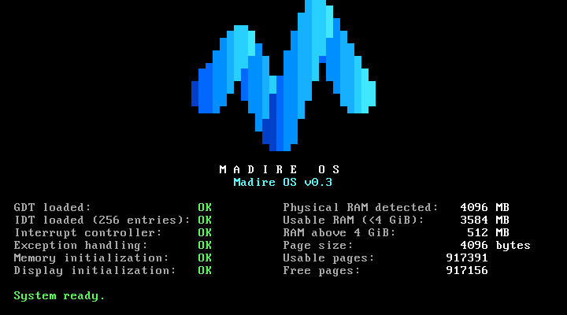
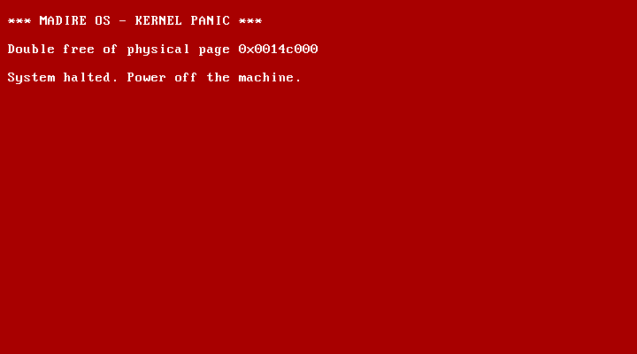

# Testing

## 1. Automated tests (`make test`)

These run in the Linux build environment, and `scripts/build.ps1` runs them on every build. `make test` runs the host unit tests first (`make unit`), then [`tests/qemu-tests.sh`](../tests/qemu-tests.sh).

### 1a. Host unit tests (`make unit`, `tests/unit/`)

The pure memory modules (`mmap.c`, `pmm.c`, `reserve.c`) are compiled with the host GCC as ordinary 32-bit Linux programs (`-m32`, same warnings-as-errors options). They're then tested with synthetic memory maps and fake Multiboot data: cases real firmware can't produce on demand.

| Suite | Cases |
|---|---|
| `test_mmap` (12) | QEMU- and VirtualBox-shaped maps; type classification (1/2/3/4/5/unknown); entry `size > 20` skipped correctly; `size < 20`, truncated entry, 64-bit overflow (including an end of exactly 2^64), empty map, null or wrapping buffer all rejected; zero-length entries skipped; unsorted and overlapping entries; 150 entries (no silent limit) |
| `test_pmm` (20) | first allocation = lowest free page; distinct allocations; exhaustion (then 0, repeatedly); free and reallocate; free after exhaustion; double free, reserved or kernel page, VGA page, page 0 and unaligned address all rejected; sub-page region and page-boundary crossing; reservations round outward; reserved wins over overlapping usable; phase enforcement; RAM above 4 GiB ignored or clipped (including near 2^64); no memory; a single usable page; multiple regions in order; the full 4 GiB space drained (1,048,320 pages) |
| `test_reserve` (9) | low 1 MiB, kernel, info block, map, command line; modules (table, range, name; empty module); invalid module range; table full; null or wrapping pointers; unterminated string; kernel and stack layout checks; end to end: every page from an exhausted allocator is checked against every reserved byte |

### 1b. QEMU tests (`tests/qemu-tests.sh`)

These boot the kernel headless in QEMU and check the serial output. The kernel copies all its screen text to COM1 and logs memory details there. Each run writes `build/serial-*.log`.

| Group | How it boots | What it checks |
|---|---|---|
| Multiboot header | (not booted) | `grub-file --is-x86-multiboot` accepts the kernel |
| Normal boot | the real ISO, through GRUB (128 MB) | logo lit-pixel count = **293** (from `scripts/logo-preview.py`); title; version `v0.3`; `GDT`, `IDT`, `Interrupt controller`, `Exception handling`, `Memory initialization`, `Display` all `OK`; `Memory self-test: PASS`; every memory panel line; no `PENDING`, `FAILED` or `PANIC`; `System ready.`; plus the memory model check (below) |
| RAM sizes | `-kernel` at `-m 16M`, `32M`, `1G`, `4G` | boots; self-test passes; memory `OK`; panel shows the expected MB above 4 GiB; memory model check with pinned values |
| Boot module | `-m 32M -kernel … -initrd module.bin` | module range reserved; model check |
| Exhaustion | `-append "test=memexhaust"` at 16M and 128M | every free page (count taken from the log) allocated, verified and freed; `System ready` afterwards; no panic |
| Double free | `-append "test=doublefree"` | crash screen: `Double free of physical page 0x…` |
| Free reserved | `-append "test=freereserved"` | crash screen: `Attempt to free reserved page 0x00100000` |
| Crash test `divzero` | `-kernel … -append "test=divzero"` | crash screen; `CPU exception 0: Divide Error`; error code `0x00000000`; register dump with `CS=0x0008`; no `System ready` |
| Crash test `ud` | `-append "test=ud"` | `CPU exception 6: Invalid Opcode`; error code `0x00000000` |
| Crash test `gpf` | `-append "test=gpf"` | `CPU exception 13: General Protection Fault`; error code **`0x00000028`** (the bad selector, which proves the error-code path works) |

Every QEMU run uses `-no-reboot`. If the CPU triple-faults (an exception that can't be handled, which resets the CPU), QEMU exits, the expected text never appears, and the test fails. A crash can't pass by accident.

**Memory model check (`tests/memory_check.py`):** reads the memory map and reservations the kernel logged, and recomputes usable, free and reserved pages, physical RAM and RAM above 4 GiB with separate per-page Python code. Every figure must equal the kernel's `memory:` summary line. It also checks that the low 1 MiB, kernel, info block and map are all reserved.

**Pinned values.** These come from the memory maps **QEMU 8.2.2** reported (inspected with GRUB 2.12 `lsmmap`). They're regression expectations for that environment only. The kernel never uses them: it always calculates from the map. A different QEMU version may legitimately change them, in which case update the test after checking the new map.

| `-m` | Usable pages | Physical RAM | Above 4 GiB |
|---|---|---|---|
| 16M | 3967 | 15 MB | 0 |
| 32M | 8063 | 31 MB | 0 |
| 128M (ISO) | 32639 | 127 MB | 0 |
| 1G | 262015 | 1023 MB | 0 |
| 4G | 786303 | 4095 MB | 1024 MB |

Physical RAM shows slightly under the `-m` size because the firmware keeps about 0.5 MB, which the map reports as reserved.

**Logo reference:** `python scripts/logo-preview.py preview.png` runs the same stroke data and whole-number maths as `kernel/logo.c`, independently. It prints the expected pixel grid and count, and can write a PNG preview. If you change the logo, update both files and `LOGO_PIXELS` in the test script.

## 2. VirtualBox tests (manual acceptance)

### One-time VM configuration: `MadireOS-Test`

| Setting | Value |
|---|---|
| Type | Other / Unknown |
| Firmware | **BIOS** (not EFI) |
| RAM | 4096 MB |
| CPUs | 2 |
| Video memory | 128 MB |
| Network | NAT |
| Storage | SATA port 0: 30 GB disk (unused for now); SATA port 1: optical drive |

Commands that were run (`VBoxManage` is in `C:\PFiles\Oracle\VirtualBox\`):

```
VBoxManage modifyvm MadireOS-Test --firmware bios --ostype Other
```

### Procedure

```powershell
.\scripts\build.ps1     # build + automated tests, produces build\madire-os.iso
.\scripts\run.ps1       # powers off / discards a saved state, attaches the ISO,
                        # sets boot order DVD -> disk, starts the VM
```

To do it by hand instead: VM **Settings > Storage**, select the optical drive, choose `build\madire-os.iso`, then **Start**.

### Test A: normal boot

The GRUB menu shows **Madire OS v0.3** and **Diagnostics**. After 3 seconds it boots the first entry, and the screen should look like this:



- The M logo is drawn in the blue-to-cyan gradient. If it shows purple, brown or magenta, the palette programming didn't take effect.
- Left column: six status lines, all `OK`.
- Right column: the real memory figures. For `MadireOS-Test` (4096 MB), expect:

  | Line | Value |
  |---|---|
  | Physical RAM detected | **4096 MB** |
  | Usable RAM (<4 GiB) | **3584 MB** |
  | RAM above 4 GiB | **512 MB** |
  | Page size | **4096 bytes** |
  | Usable pages | **917391** |
  | Free pages | **917156** |

  VirtualBox places 512 MB of the VM's RAM above 4 GiB, and a 32-bit kernel without PAE can't use it. Free pages is usable pages minus the low 1 MiB (159 pages), the kernel (74 pages) and GRUB's boot data (2 pages). It changes if the kernel's size changes.
- `System ready.` in green.

### Test C: memory diagnostics

In the GRUB menu: **Diagnostics** → one of the entries below.

| Entry | Expected |
|---|---|
| **Memory test: allocate every page** | `Memory test: allocating every free page...`, then, after **about a minute** on a 4 GB VM (every page is written), `Memory exhaustion test: PASS (917156 pages)` and `System ready.` |
| **Memory test: double free** | crash screen: `Double free of physical page 0x0014c000` |
| **Memory test: free a kernel page** | crash screen: `Attempt to free reserved page 0x00100000` |





### Test B: crash screen

In the GRUB menu, press **↓** to highlight **Diagnostics**, press **Enter**, then choose **Crash test: divide by zero**. The screen should look like this:


- White on red, headed `*** MADIRE OS - KERNEL PANIC ***`.
- `CPU exception 0: Divide Error (#DE)`, `EAX=0x0000000a`, `ECX=0x00000000` (the values the test loads), `CS=0x0008`, `DS=0x0010`.
- The machine halts.

The other two Diagnostics entries should show `Invalid Opcode (#UD)` and `General Protection Fault (#GP)` with error code `0x00000028`.

Close the VM with **Machine > Close > Power off**. If you choose "Save the machine state" instead, `run.ps1` discards that saved state automatically next time.

### Troubleshooting by layer

| Symptom | Layer | Check |
|---|---|---|
| "No bootable medium found" | ISO / VM config | ISO attached? Boot order has DVD first? |
| UEFI shell, or a blank screen before GRUB | VM config | Firmware must be BIOS |
| GRUB shows `error: no multiboot header found` | Kernel / linker | Multiboot test in `make test`; `.multiboot` must come first in `linker.ld` |
| GRUB `invalid arch-dependent ELF magic` | Toolchain | Kernel must be 32-bit (`file build/madire.kernel` should show ELF 32-bit) |
| Screen blank after GRUB | Kernel | Check `build/serial-boot.log` from `make test` |
| VM resets straight back to GRUB/BIOS | CPU tables | Triple fault. Run `make test`: whichever status line is missing from `build/serial-boot.log` shows the failing step. |
| A status line says `FAILED` | That subsystem | The check reads back what the CPU or hardware reports; see `docs/architecture.md` |
| Logo in wrong colours | VGA palette | `drivers/vga/vga_text.c` `vga_set_palette()` |
| Crash screen: `Memory: invalid memory map: …` | Bootloader data | The message names the problem and its byte offset; see the memory map rules in `docs/architecture.md` |
| Crash screen: `Memory self-test failed: …` | Allocator or RAM | The message names the failing check; rerun `make unit` and the QEMU memory tests |
| Crash screen: `Memory: kernel … is not inside usable RAM` | Loader / VM memory | The kernel was loaded where the map doesn't say usable RAM; check the VM's RAM setting |
| Panel shows less usable RAM than the VM has | Expected | RAM above 4 GiB and firmware-reserved areas aren't usable by a 32-bit kernel; see the `RAM above 4 GiB` line |
| `run.ps1`: "state is Saved" | VM state | Use the current `run.ps1`, which discards saved states automatically (since commit `f07b517`) |
